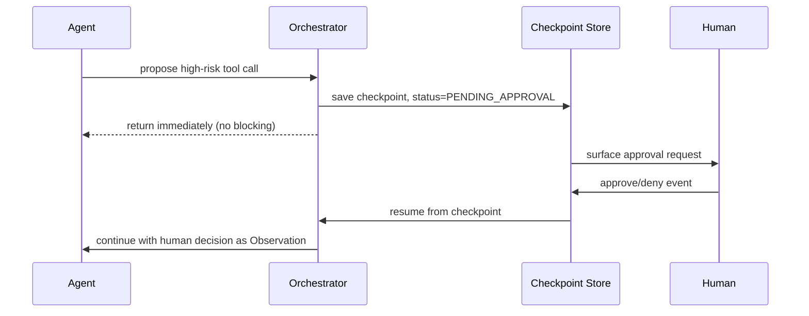

## Question
How do you design an asynchronous Human-in-the-Loop (HITL) interrupt pattern for high-risk tool executions without stalling the underlying application server or losing process context?

## Quick Answer
A high-risk tool call is never blocked on synchronously — the agent's state is checkpointed and the run is marked "paused, awaiting approval" while the request handler returns immediately; a separate approval event (webhook, queue message, or polling callback) later triggers resumption from that exact checkpoint, so no server thread or connection is held open while a human deliberates.

## Detailed Answer
The naive approach — holding an HTTP request or a worker thread open while waiting for a human to click "approve" — doesn't scale, and it's fragile: a server restart, timeout, or deploy during the wait loses the entire run. The async pattern instead treats a human approval as just another **asynchronous event the graph is waiting on**, structurally identical to waiting on a slow tool call.

Concretely: when the agent proposes a high-risk action (a destructive database write, an external email send, a large financial transaction), the orchestrator checkpoints the full execution state — including everything needed to resume, like the proposed tool call and its arguments — and transitions the run into a `PENDING_APPROVAL` status in persistent storage. The request handler that triggered this returns right away, freeing up the server entirely; there's no thread, socket, or process sitting idle. The pending approval is then surfaced to a human through whatever channel makes sense (a dashboard, a Slack message, an email with approve/deny links), and when they respond, that response arrives as an independent event — a webhook call, a message on a queue, or a row update a poller picks up — which loads the checkpoint by its ID and resumes execution exactly where it left off, injecting the human's decision as the next Observation.

## Production Implications
- Give every pending approval a timeout and a defined fallback (auto-deny, escalate) — a human who never responds shouldn't leave a run stuck forever
- Make the checkpoint self-contained enough that resumption doesn't depend on any in-memory state from the original request
- Idempotency-guard the resume path — an approval webhook that fires twice shouldn't execute the tool call twice
- Log every pause/resume transition with who approved what, since HITL checkpoints are usually the audit trail regulators or reviewers actually care about

<Callout variant="tip" title="Key Takeaways">
Treat a pending human approval as an async event the graph is checkpointed and waiting on — never as a synchronous block that ties up server resources for however long a person takes to respond.
</Callout>

