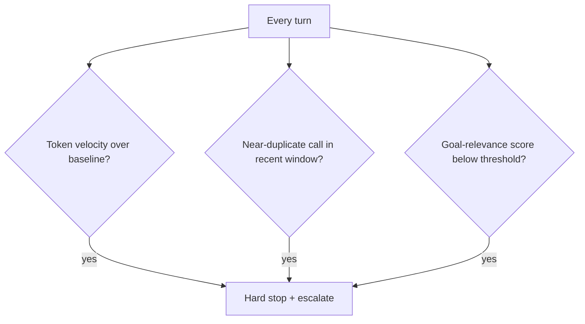

## Question
How do you implement robust architectural circuit breakers (token usage velocity, repetition detection, goal-drift metrics) to prevent autonomous agents from getting stuck in non-convergent, infinite tool-calling loops?

## Quick Answer
Robust loop control layers three independent circuit breakers — a token-velocity limit that fires when a run's burn rate exceeds its expected budget, a repetition detector that catches near-identical tool calls recurring within a short window, and a goal-drift metric that measures how far the agent's current activity has diverged from its original task — and any single breaker tripping forces a hard stop, not just a logged warning.

## Detailed Answer
A single circuit breaker isn't enough, because non-convergent loops fail in genuinely different shapes. **Token usage velocity** catches the case where an agent is technically doing *different* things each turn but never converging — burning tokens at a rate that, extrapolated, blows through the run's cost budget long before the task could plausibly finish. This is measured as a rate (tokens per turn, or tokens per unit wall-clock time) against an expected baseline for the task type, not just a hard cap on total tokens — a rate-based check catches runaway behavior earlier than waiting for an absolute ceiling to hit.

**Repetition detection** catches the more literal infinite loop: the agent calling the same tool with the same (or near-identical) arguments repeatedly, often because it's stuck reacting to the same error without making progress. This needs a similarity check, not exact string matching — near-duplicate detection (via a hash of normalized arguments, or embedding similarity for less structured calls) within a sliding window of recent turns, since an agent stuck in a loop rarely issues the exact same call byte-for-byte every time; it's more common to see the same *kind* of call with cosmetically different arguments.

**Goal-drift metrics** catch the subtler failure where the agent isn't repeating itself, isn't burning tokens unusually fast, but has quietly stopped working toward the original task — exploring a tangent that keeps generating plausible-looking activity without making progress on the actual goal. This is the hardest of the three to measure cheaply; common approaches include periodically re-scoring the current trajectory's relevance against the original task description (via embedding similarity or a lightweight classifier call) and tripping the breaker if that score drops below a threshold for several consecutive turns.

All three should be **hard stops**, not advisory logs a human might notice later — the entire point of a circuit breaker is that it acts before a human has to intervene, since by the time a human is watching a dashboard, the cost or damage from a runaway loop may already be substantial.

## Production Implications
- Calibrate baselines per task type — a code-refactor task and a research task have very different expected token-per-turn rates, so one global threshold will be wrong for most tasks
- Escalate a tripped breaker to a human or a logging system with the full trajectory attached, not just a terminated run with no context
- Test breaker sensitivity against known-good long-running tasks before deploying — an overly aggressive breaker that kills legitimate slow-but-progressing runs is its own reliability problem
- Combine all three signals rather than relying on one — a loop that evades token-velocity limits (because each turn is cheap) is often exactly the kind repetition detection or goal-drift scoring catches

<Callout variant="tip" title="Key Takeaways">
No single metric reliably catches every shape of non-convergent loop — layer token-velocity, repetition, and goal-drift breakers together, and make each one a hard stop rather than a warning a human might miss.
</Callout>

