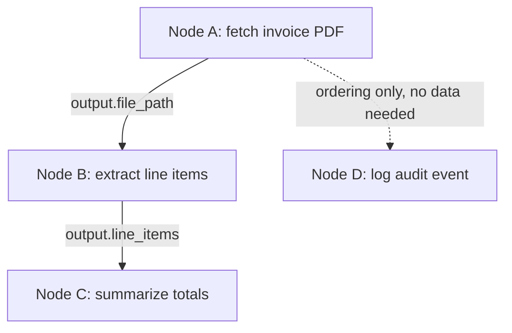

## Question
When an agent decomposes a complex goal into a Directed Acyclic Graph (DAG) of sub-tasks, how do you handle data dependencies between nodes when Node B requires the runtime output of Node A?

## Quick Answer
When Node B needs Node A's runtime output, the DAG models this as a **data dependency edge**, not just an ordering constraint — the orchestrator holds Node B's execution until Node A's actual result exists, then substitutes that result into Node B's parameters before Node B runs, rather than scheduling both nodes based on plan order alone.

## Detailed Answer
A DAG-based decomposition breaks a goal into nodes with edges representing dependencies. Some edges are purely about *ordering* — Node B just needs to happen after Node A for logical reasons — but a **data dependency** is stronger: Node B's parameters literally cannot be filled in until Node A has produced its output, because Node B needs a value it doesn't have yet (a file path Node A creates, an ID returned by an API Node A calls, a summary Node A generates). Treating these the same as ordering-only edges is a common bug: the orchestrator marks Node A "done" and immediately dispatches Node B with a placeholder or stale value instead of A's real result.

The fix is to make data dependencies explicit in the graph representation — each node declares which of its input parameters are bound to another node's output (e.g. `node_b.params.file_path = node_a.output.created_path`), rather than free text the orchestrator has to infer. At runtime, the scheduler won't mark Node B as "ready" until every node it data-depends on has both completed *and* produced the specific output field it needs — this is different from simply completing, since a node can finish with an error or an empty result that still leaves the dependency unsatisfied. Once satisfied, the orchestrator resolves the binding (substitutes A's actual output value into B's parameter) before dispatching B, so B never runs against a guess.

<Callout variant="tip" title="Key Takeaways">
Model data dependencies as explicit, typed bindings between a producing node's output and a consuming node's input — never as implicit ordering the scheduler has to guess at.
</Callout>

