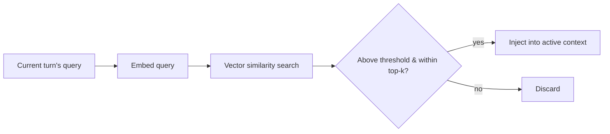

## Question
How do you architect a dual-layer memory system that separates short-term execution state from long-term episodic memory, and what dynamic retrieval strategy prevents irrelevant semantic memories from polluting the active context window?

## Quick Answer
Short-term memory is the current run's live transcript, held entirely in the active context window and discarded (or summarized) at the end of the run; long-term episodic memory lives outside the context window in a vector store queried by semantic similarity, and only the top-scoring, thresholded results are ever pulled back into context — never the whole store.

## Detailed Answer
The **short-term layer** is exactly what a basic ReAct loop already has: the Thought/Action/Observation history for the current task, held directly in the prompt. It's fast, precise, and fully in scope, but it disappears when the run ends (or gets compacted/summarized once it grows too large — see the ReAct token-growth discussion). The **long-term episodic layer** exists to survive across runs: past interactions, resolved tasks, or extracted facts get embedded and written to a vector database, indexed for semantic (not exact-match) retrieval, so a future run can ask "have I seen something like this before?" rather than starting from zero every time.

The part that actually determines whether this helps or hurts is retrieval, not storage. A naive implementation just pulls the top-*k* nearest neighbors for every query and stuffs them into context — which pollutes the active window with tangentially related memories that outrank the current task's own signal. A better retrieval strategy applies a **similarity threshold** (discard anything below a minimum relevance score, even if it's technically in the top-*k*), a **hard cap** on how many memories are injected per turn regardless of how many clear the threshold, and often **recency or usage-frequency weighting** on top of raw similarity, so an older-but-highly-relevant memory doesn't always lose to a recent-but-mediocre one. Some architectures add a lightweight second pass — a smaller/cheaper model or a rule-based filter that re-ranks the semantic candidates for actual task relevance — before anything is allowed into the active context.

<Callout variant="tip" title="Key Takeaways">
Long-term memory only helps if retrieval is gated by relevance thresholds and hard caps — an ungated retrieval pipeline just trades context drift for memory-pollution drift.
</Callout>

