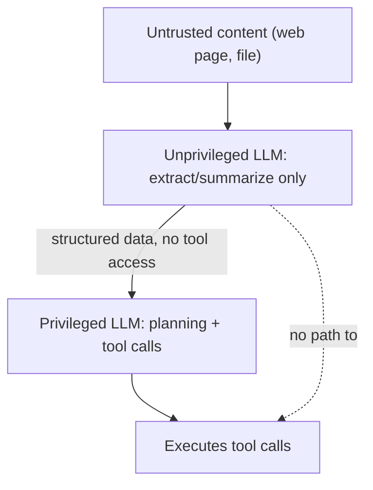

## Question
How does the "Dual-LLM Architecture" (separating a privileged control-flow model from an unprivileged data-processing model) prevent data exfiltration and unauthorized tool invocations when processing untrusted inputs?

## Quick Answer
The privileged (control-flow) model plans, decides which tools to call, and has execution rights — but it never directly reads untrusted content like a web page or file body. Instead, an unprivileged (quarantined) model reads that content and is given no tool access at all, returning only a constrained, structured summary back to the privileged model — so an injection embedded in the content has no privileged execution context to reach even if it fully succeeds against the quarantined model.

## Detailed Answer
The Dual-LLM pattern is a direct application of the classic security principle of **privilege separation**: don't let the component that processes untrusted input also be the component with the authority to act on the world. In a single-LLM agent, the same model both reads a fetched web page *and* decides which tools to call next — which means an injected instruction hidden in that web page is one successful manipulation away from triggering a privileged tool call, because there's no boundary between "understood the content" and "can act on it."

The Dual-LLM split breaks that link. The **privileged (control-flow) LLM** owns planning and tool invocation — it decides what to fetch, what to do with results, and issues the actual tool calls — but the raw content of anything untrusted (a web page body, a file's contents) is never placed directly in its context. Instead, that content goes to an **unprivileged (quarantined) LLM** whose entire job is narrow: extract or summarize specific, requested information from the untrusted content and return it in a constrained, structured format. Critically, the quarantined model has **no tool access whatsoever** — even if an injected instruction inside the content fully succeeds in manipulating it, there's nothing for that manipulation to do, because the quarantined model can't call any tools, and its only output channel back to the privileged model is a narrow, structured data format, not free-form text that could itself carry a secondary injection.

The privileged model receives only that sanitized, structured output — never the raw content — and makes its next decision based on it. This doesn't rely on either model being perfectly injection-resistant; it relies on the *architecture* ensuring that even a fully successful injection against the quarantined model has no privileged capability to exploit, which is a fundamentally stronger guarantee than hoping a single model's judgment resists every injection attempt.

## Production Implications
- Constrain the quarantined model's output schema tightly — free-text output back to the privileged model reopens a channel for a secondary injection to ride along
- Audit that the quarantined model genuinely has zero tool bindings at the infrastructure level, not just "isn't instructed to use tools" in its prompt
- Log both the quarantined model's raw output and what the privileged model did with it, so a successful injection attempt against the quarantined side is still traceable
- Treat this as complementary to, not a replacement for, egress allow-listing on the privileged model's own tool calls — privilege separation limits blast radius, it doesn't eliminate every risk on its own

<Callout variant="tip" title="Key Takeaways">
Privilege separation works because it doesn't depend on either model perfectly resisting manipulation — it depends on the manipulated model never having the tool access to act on it, which is an architectural guarantee rather than a hope.
</Callout>

