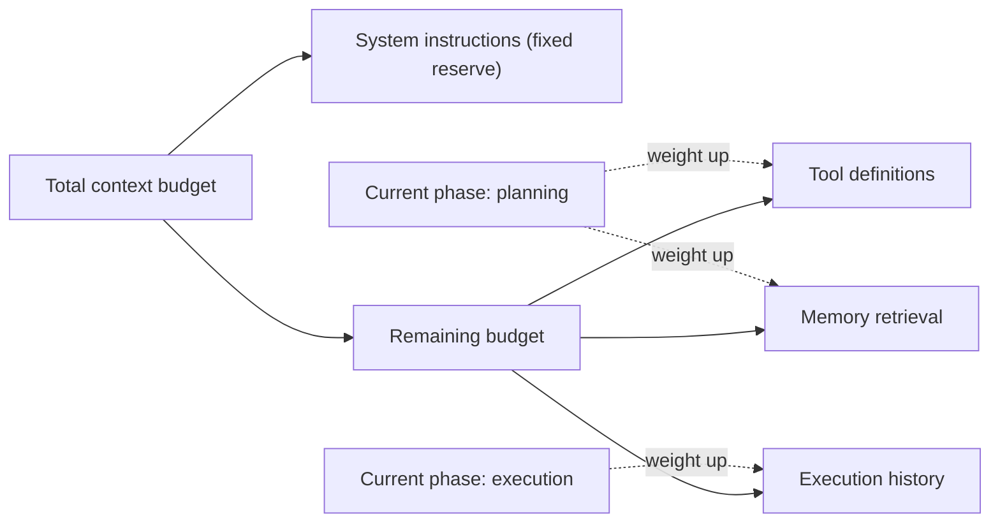

## Question
How do you construct a dynamic token budget controller that allocates token allowances across system instructions, active tool definitions, dynamic memory retrieval, and short-term execution history based on the current phase of task execution?

## Quick Answer
A token budget controller treats the context window as a fixed pool divided across competing categories — system instructions, active tool definitions, retrieved memory, and short-term execution history — with system instructions getting a reserved fixed allocation and the rest split by a ratio that shifts depending on which phase of the task the agent is currently in.

## Detailed Answer
Left unmanaged, these four categories compete for space unpredictably: a verbose tool catalog can crowd out execution history, or a memory retrieval step can inject enough content to push out the tool definitions the agent actually needs on the next step. A budget controller makes the allocation explicit instead of accidental. **System instructions** (the core prompt defining the agent's role and constraints) typically get a small, fixed reservation near the top of the budget — this content doesn't change turn to turn and shouldn't be squeezed by anything else. The remaining budget is then split across the other three categories using ratios that aren't static — they shift with the **phase of task execution**.

During a **planning phase** — early in a run, before much has happened — the agent benefits more from broad access to relevant memory (what's worked on similar tasks before) and the full tool catalog (what's even possible), while execution history is thin because there isn't much of it yet; the budget controller weights memory and tool space higher here. During an **active execution phase** — deep into a multi-step task — recent execution history becomes the highest-value content (what just happened, what the immediate next step depends on), while the tool catalog can often be narrowed to just the tools relevant to the current sub-task rather than the full set, and memory retrieval can be scoped tighter or skipped for turns where nothing new needs surfacing. A controller that recognizes this phase shift and re-derives the allocation each turn — rather than using one fixed split for the whole run — keeps the highest-value content in context at the point it's actually needed, instead of applying a one-size-fits-all ratio that's wrong for at least part of every run.

<Callout variant="tip" title="Key Takeaways">
Treat context allocation as a phase-aware budget, not a static split — what deserves the most tokens changes as a run moves from planning into deep execution.
</Callout>

