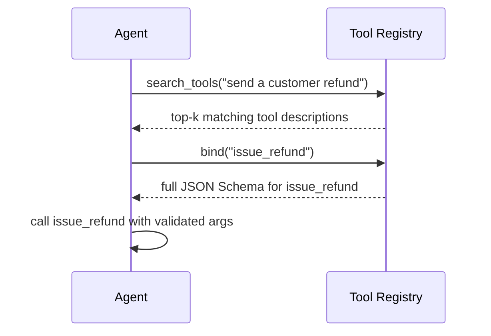

## Question
How do you implement a dynamic Tool Registry that allows an agent to search, inspect, and bind OpenAPI schemas or function definitions on the fly, avoiding context window bloat caused by loading hundreds of static tools upfront?

## Quick Answer
Instead of loading hundreds of tool definitions into every prompt, a dynamic tool registry stores them externally — indexed and searchable by name, description, or embedding similarity — and exposes the agent a single lightweight `search_tools` capability; the agent searches for what it needs, gets back a handful of matching schemas, and only those get bound into context for that turn.

## Detailed Answer
Loading every available tool's full JSON Schema into the system prompt scales badly: with a few dozen tools it's manageable, but with hundreds (a real concern once an agent wraps a large OpenAPI surface, where every endpoint is a candidate tool), the static tool catalog alone can dwarf the rest of the context budget, most of it irrelevant to any given turn. A dynamic registry treats the tool catalog the way a search index treats a document corpus: the full set of schemas lives outside the prompt, in a store the agent can query, and only the small subset relevant to the current step is pulled in.

Concretely, this usually means: parsing an **OpenAPI spec** (or a collection of function definitions) once at setup time into individual, indexed tool entries — each with a name, description, and parameter schema, embedded for semantic search. The agent is given exactly one meta-tool up front: something like `search_tools(query)`, which returns the top-*k* candidate tools matching the query by relevance. The agent inspects those candidates (their descriptions are enough to decide relevance without needing the full parameter schema yet), and only when it commits to using a specific one does the runtime **bind** that tool's full schema into context for the actual call — at which point the interaction looks just like ordinary native tool calling, scoped to a handful of tools instead of hundreds.

This trades a small amount of latency (an extra search round-trip before the real tool call) for a large reduction in steady-state context cost, and it scales to arbitrarily large tool catalogs in a way that static loading fundamentally can't — the context cost per turn stays roughly constant regardless of whether the registry holds 50 tools or 5,000.

<Callout variant="tip" title="Key Takeaways">
Treat the tool catalog as an external, searchable index rather than something loaded wholesale into every prompt — it's the only approach that scales gracefully as the number of available tools grows into the hundreds.
</Callout>

