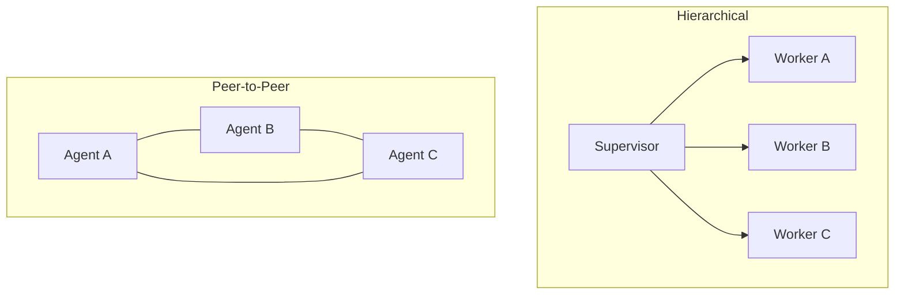

## Question
What are the operational trade-offs between a Supervisor/Worker (Hierarchical) agent topology and a Peer-to-Peer agent network in terms of latency, context isolation, and single-point-of-failure risks?

## Quick Answer
A Supervisor/Worker (hierarchical) topology centralizes routing and keeps each worker's context isolated, but the supervisor becomes both a single point of failure and an extra latency hop on every decision; a peer-to-peer network removes that bottleneck by letting agents talk directly, at the cost of losing a clear place where coordination logic and context isolation actually live.

## Detailed Answer
In a **Supervisor/Worker** topology, one agent (or a deterministic router) decides which specialized worker handles each sub-task, dispatches it, and integrates the result. This gives strong **context isolation** — each worker only sees the slice of context it needs for its task, not the entire system's history, which keeps individual worker prompts small and focused and makes it easy to reason about what any one worker can and can't see. The costs are structural: every task routes through the supervisor, so it's an extra hop of **latency** on every decision, and if the supervisor fails or gets stuck, the *entire system* stalls — a textbook **single point of failure**. It also concentrates coordination logic in one place, which is easier to audit but harder to scale horizontally, since the supervisor itself can become a throughput bottleneck as worker count grows.

In a **Peer-to-Peer** network, agents communicate directly without a central router — an agent that identifies it needs another's capability hands off (or negotiates) directly. This removes the single-point-of-failure risk and can lower latency for interactions that would otherwise require a round trip through a supervisor, but it comes at the cost of **context isolation**: without a central point enforcing what each agent can see, context sprawl across peer-to-peer conversations is much easier to end up with, and there's no single place to look to understand the system's current coordination state — debugging "why did agent C do that" means reconstructing a distributed conversation instead of reading one supervisor's log.

| Dimension | Hierarchical (Supervisor/Worker) | Peer-to-Peer |
|-----------|-----------------------------------|---------------|
| Latency | Extra hop through supervisor on every decision | Direct agent-to-agent, fewer hops |
| Context isolation | Strong — supervisor scopes what each worker sees | Weak — context sprawl across peer conversations |
| Single point of failure | Yes — supervisor down means system down | No single node, but coordination is harder to audit |
| Debuggability | High — one place to read overall state | Low — state is distributed across peer exchanges |

## Production Implications
- Default to hierarchical for most production systems — the debuggability and isolation benefits usually outweigh the extra latency hop
- If choosing peer-to-peer for throughput reasons, invest in a shared, queryable trace/log so you can reconstruct coordination after the fact
- For hierarchical topologies, make the supervisor's own failure mode explicit (timeout + fallback), since it's the one node whose downtime takes out everything

<Callout variant="tip" title="Key Takeaways">
Hierarchical topologies trade latency and a single point of failure for isolation and debuggability; peer-to-peer trades those away for resilience and throughput — pick based on which failure mode you can least afford.
</Callout>

