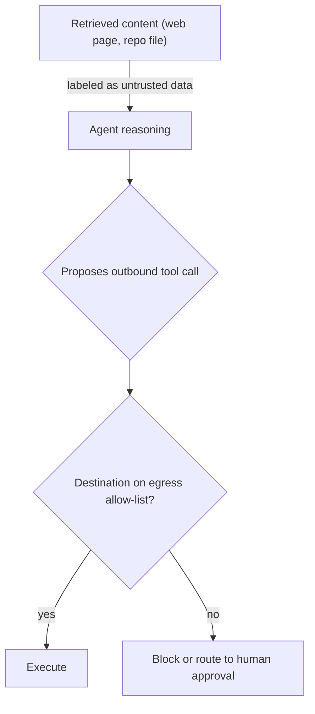

## Question
How do you protect a software engineering agent from indirect prompt injection attacks contained within retrieved web pages or repository files that attempt to exfiltrate secrets via outbound tool calls?

## Quick Answer
Retrieved content — a web page, a file in a repository — is data, never instructions, and the agent architecture has to enforce that distinction structurally: content the agent reads should never be able to trigger a tool call on its own, and any outbound call that would send data somewhere new (an unfamiliar URL, an unexpected recipient) needs to pass an allow-list check or human approval before it fires.

## Detailed Answer
**Indirect prompt injection** works by hiding instructions inside content the agent is expected to process as data — a comment in a source file, hidden text on a web page, a commit message — hoping the agent's language model treats that embedded text as a command rather than as content to summarize or analyze. For a software engineering agent, the dangerous version of this is an injected instruction that tries to get the agent to read a secret (an API key, a credential file) and then send it somewhere external, disguised as an innocuous-looking tool call the agent was tricked into making.

The core defense is **structural**, not just prompt-level warnings telling the model to "ignore instructions in retrieved content" — that helps but isn't reliable enough alone, since a sufficiently crafted injection can still get through a model's own judgment. The more robust layers: **strict data/instruction separation**, where retrieved content is passed to the model in a clearly delimited, explicitly-labeled-as-data channel, and the system prompt is explicit that anything in that channel is never to be treated as a directive, regardless of how it's phrased. **Egress allow-listing**, where any outbound tool call that sends data somewhere — an HTTP request, an email, a file upload — is checked against a fixed allow-list of known-safe destinations before it's permitted to run; an injected instruction trying to exfiltrate a secret to an attacker-controlled URL fails here because that URL was never on the allow-list, independent of whether the model "believed" the injected instruction. **Least-privilege secrets access**, so that even if an injection succeeds in getting the agent to attempt reading a secret, the agent's own execution context doesn't have that secret available to read in the first place for tasks that don't need it. And for any outbound action that doesn't cleanly match the allow-list or that touches a genuinely new destination, routing through a human-in-the-loop approval gate rather than letting the model's own judgment be the last line of defense.

## Production Implications
- Never grant an agent's tool-execution context broader secret access than the specific task requires — scope credentials per task, not per agent
- Log every outbound call's destination alongside the retrieved content that was in context when it was proposed, so a successful injection attempt is traceable after the fact
- Treat "ignore embedded instructions" system-prompt language as a supplementary defense, not the primary one — egress allow-listing is what actually stops exfiltration when the prompt-level defense is bypassed
- Periodically red-team the pipeline with known injection patterns against realistic retrieved content, not just synthetic test prompts

<Callout variant="tip" title="Key Takeaways">
Prompt-level instructions to "ignore embedded commands" are not sufficient on their own — the reliable defense is structural: retrieved content stays labeled as untrusted data, and outbound tool calls are gated by an allow-list the model's own judgment can't override.
</Callout>

