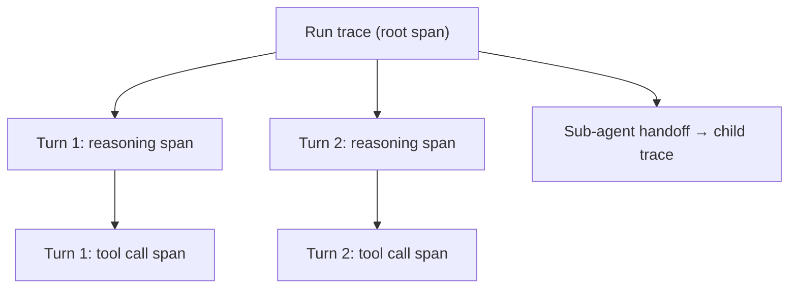

## Question
How do you extend OpenTelemetry or native APM tools to instrument an agentic workflow, and what key metrics beyond latency and cost (e.g., tool error rate, loop depth, context utilization ratio) are essential for diagnosing agent performance in production? --- *Total: 31 questions across 4 tiers (8 Beginner / 8 Intermediate / 8 Advanced / 7 Expert)*

## Quick Answer
Extending OpenTelemetry for an agent means modeling the whole run as one root trace, with each Thought-Action-Observation turn as a nested span carrying attributes like tool name, arguments, and outcome; beyond the standard latency and cost metrics, the signals worth dedicated dashboards and alerts are **tool error rate**, **loop depth** (turns per run), and **context utilization ratio** (tokens used versus the model's limit).

## Detailed Answer
OpenTelemetry's span/trace model maps naturally onto an agent run if you treat the whole run as a single **trace** and each turn as a **span** within it — a span for the model's reasoning call, a child span for the resulting tool execution, tagged with attributes like `tool.name`, `tool.arguments` (redacted where sensitive), `tool.outcome` (success/error/timeout), and `tokens.input` / `tokens.output` for that turn specifically. Nesting matters here more than in typical request tracing: a sub-agent handoff should produce a child trace linked to the parent's span, not a disconnected trace, so a multi-agent run's full call graph is reconstructable from the trace data alone rather than requiring manual correlation across separate logs.

Standard APM metrics — latency and cost — are necessary but not sufficient for diagnosing agent-specific failure modes, since an agent run can be fast and cheap while still being subtly broken. Three additional metrics earn dedicated tracking:

**Tool error rate** — the fraction of tool calls that return an error, tracked per tool and per run, not just as one global average. A spike in error rate for one specific tool usually points to something concrete (an API contract change, a permissions issue) well before it shows up as a latency or cost anomaly, since a failing tool often gets retried, which can even make latency and cost look *normal* while masking a real problem.

**Loop depth** — the number of Thought-Action-Observation turns a run takes before completing. This is the earliest-available signal for non-convergent behavior — a run whose turn count is climbing well past what similar tasks typically need is a leading indicator of the kind of infinite-loop failure circuit breakers exist to stop, and tracking it as a metric (not just enforcing a hard cap) lets you see the trend before it hits the cap.

**Context utilization ratio** — tokens currently in context divided by the model's context limit, tracked per turn across a run. A ratio climbing steadily toward 1.0 predicts context-compaction pressure and eventual truncation before it actually happens, which is far more actionable than discovering it only after a run starts producing degraded output because critical context silently fell out of the window.

## Production Implications
- Alert on tool error rate per-tool, not on a global average — a single flaky tool can be masked by dozens of healthy ones in an aggregate metric
- Track loop depth against a per-task-type baseline, since "normal" turn count varies enormously between task categories
- Set a context utilization warning threshold well below 1.0 (e.g. 80%) so compaction can trigger proactively rather than reactively after truncation already happened
- Propagate trace context across sub-agent handoffs explicitly — without it, multi-agent runs fragment into disconnected traces that are far harder to debug as a whole

<Callout variant="tip" title="Key Takeaways">
Latency and cost tell you a run was slow or expensive after the fact — tool error rate, loop depth, and context utilization are the metrics that let you catch an agent-specific failure mode developing before it fully manifests.
</Callout>

