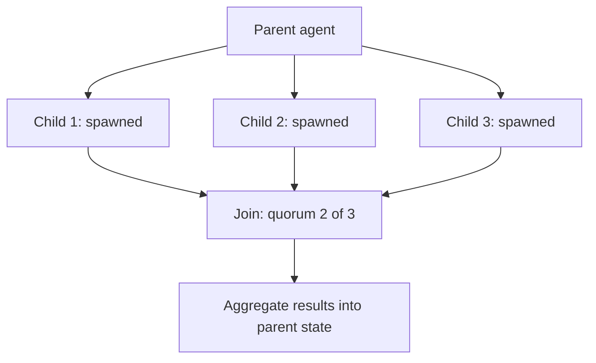

## Question
How do you architect a parent agent pattern capable of spawning transient child sub-agents in parallel, monitoring their lifecycles, and aggregating their asynchronous execution results into a unified parent state?

## Quick Answer
The parent spawns each child as a transient, independently scoped agent instance with its own bounded context (not a fork of the parent's full history), tracks each one's lifecycle through explicit states until it reaches a terminal outcome (success, failure, or timeout), and only proceeds past the fan-out once a defined join condition — all children resolved, or a quorum of them — is satisfied.

## Detailed Answer
Spawning children is the easy part; the hard parts are **lifecycle tracking** and **aggregation**. Each child sub-agent should be created with a scoped task package (the same handoff-contract discipline that applies to any delegation) rather than inheriting the parent's entire context — this keeps children isolated from each other's in-flight state and keeps the parent from having to reason about N children's full transcripts simultaneously. The parent tracks each child through an explicit state machine — `spawned → running → succeeded / failed / timed_out` — rather than just waiting on a bag of futures and hoping they all resolve cleanly; this matters because a child that hangs indefinitely needs a defined timeout and failure path, not an unbounded wait that stalls the whole parent run.

The **join pattern** is what actually determines the parent's forward progress. A strict join waits for *every* child to reach a terminal state before proceeding, which is simplest but means one stuck child blocks the whole aggregation. A quorum join proceeds once a threshold (e.g. 3 of 5) of children have succeeded, treating stragglers as best-effort — useful when children are doing redundant or exploratory work and the parent doesn't need all of them to succeed. A race join takes the first child to succeed and cancels the rest, useful when multiple children are attempting the same goal via different strategies and only one result is needed. Whichever pattern is used, the aggregation step itself should be deterministic code, not a fresh LLM call trying to freehand-merge N children's outputs — the reducer-style discipline used for concurrent state updates in a graph applies here too: define explicitly how child results combine (concatenate, vote, pick-highest-confidence) rather than leaving it to an ad hoc summarization pass.

## Production Implications
- Cap total concurrent children per parent — unbounded fan-out is a resource and cost risk, not just a design nicety
- Always define a per-child timeout and what the parent does when it fires (treat as failure, retry, or proceed without it)
- Make the aggregation/reducer step explicit and testable — don't leave "merge these child results" to an LLM call with no defined merge semantics
- Propagate child failures distinctly from child timeouts in the parent's state, since the retry strategy for each usually differs

<Callout variant="tip" title="Key Takeaways">
Reliable parallel sub-agent spawning depends on explicit lifecycle states and a defined join/aggregation strategy — treating child completion as a simple "wait for everything" future is what causes stuck or silently-lossy parent runs.
</Callout>

