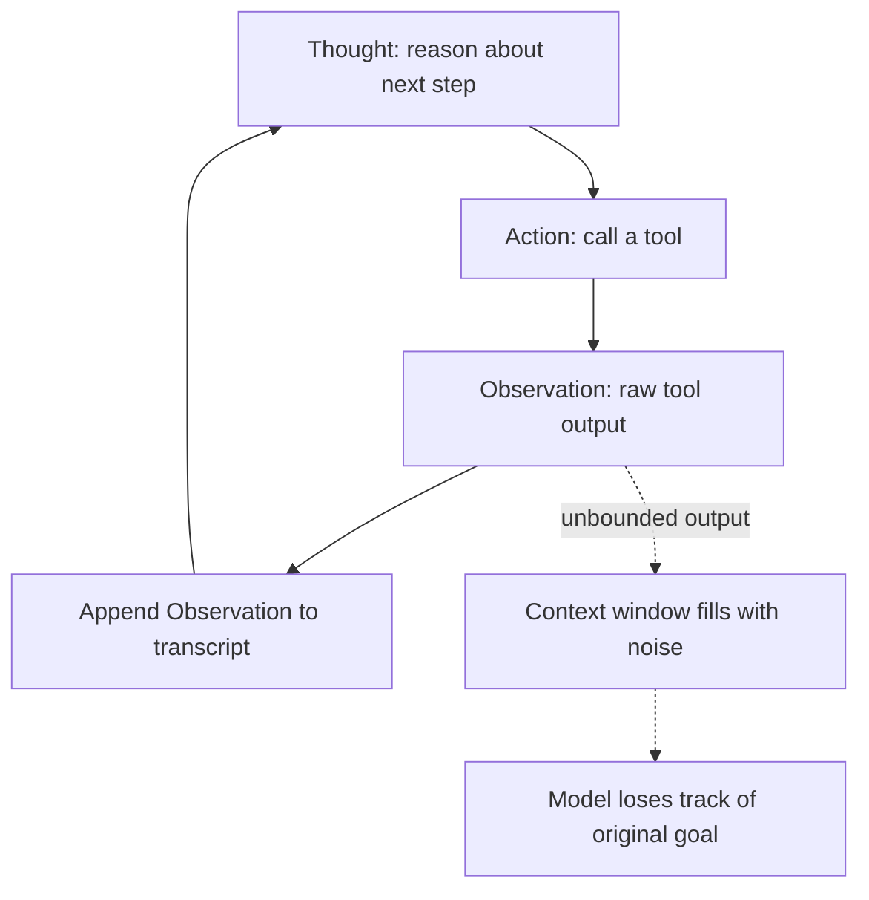

## Question
How does the Thought-Action-Observation (ReAct) loop function state-wise during runtime, and why does an unconstrained observation window lead to immediate context drift or failure in simple autonomous loops?

## Quick Answer
The ReAct loop keeps state by re-injecting the running transcript of every **Thought**, **Action**, and **Observation** back into the prompt on each turn; if the observation window is unconstrained, raw tool output accumulates faster than the model can stay grounded, and the agent's reasoning drifts away from the original task.

## Detailed Answer
A ReAct agent has no persistent memory of its own — every "turn" is really just a fresh completion call where the entire prior transcript is pasted back in as context. The loop works like this: the model emits a **Thought** (its reasoning about what to do next), then an **Action** (a tool call), the runtime executes that action and returns an **Observation** (the raw result), and that observation gets appended to the transcript before the next completion call. State, in other words, isn't stored anywhere external — it's rebuilt from scratch every single turn by re-reading the growing string.

This is fine for a handful of turns. It breaks down when the **observation window is unconstrained** — for example, a tool call returns a 50,000-token API response or an entire file's contents, and that whole blob gets appended verbatim. Two things go wrong at once: the context window fills up with low-signal noise (most of a raw JSON payload is irrelevant to the next decision), and the model's attention gets diluted across a transcript where the original goal statement is now buried dozens of turns back. The practical symptom is "context drift" — the agent starts responding to details in a recent, noisy observation instead of the task it was actually given, or it starts hallucinating a plan that doesn't match its own earlier Thoughts because it's effectively lost track of them.

<Callout variant="tip" title="Key Takeaways">
A ReAct loop is only as reliable as the discipline applied to what gets written back into the transcript — truncate, summarize, or filter every observation before it re-enters context, or drift is inevitable.
</Callout>

