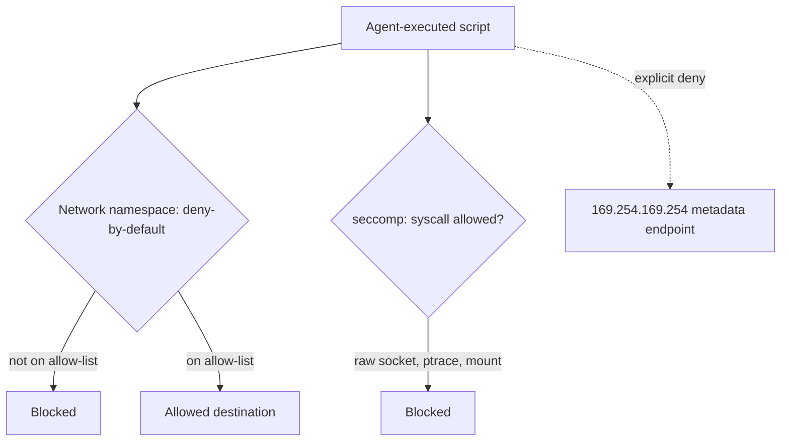

## Question
What network, file-system, and system-call restriction profiles (e.g., `seccomp`, eBPF, network namespaces) must be applied to a code execution sandbox to prevent an agent-executed script from accessing internal infrastructure or cloud provider metadata endpoints?

## Quick Answer
A safe sandbox needs three restriction layers working together: a network namespace or eBPF policy enforcing deny-by-default egress (only explicitly allow-listed destinations reachable), a seccomp profile blocking dangerous syscalls (raw sockets, `ptrace`, unrestricted `mount`), and an explicit block on the cloud provider metadata endpoint — without all three, a script that can't touch the local filesystem can still reach internal services or steal cloud credentials over the network alone.

## Detailed Answer
**Network restriction** is the layer most often under-scoped. A sandbox with network access "for the API call it needs to make" but no further restriction can reach far more than that one API — internal services on the host's network, other containers, or the broader internal infrastructure the host sits inside. The fix is a **network namespace** with a deny-by-default policy, opening only the specific destinations the task actually requires, enforced either at the namespace/iptables level or with **eBPF** for more granular, per-connection policy that can inspect and block based on destination without the overhead of a full proxy. Deny-by-default matters specifically because an allow-list of "known good" destinations is enumerable and auditable, while a block-list of "known bad" destinations is chasing an open-ended set that's easy to have gaps in.

**Cloud metadata endpoint** access deserves its own explicit callout because it's a distinct, high-value target: cloud providers expose instance metadata (including, in misconfigured setups, IAM credentials) at a well-known link-local address (`169.254.169.254` on AWS/GCP/Azure). A sandbox with otherwise-reasonable network restrictions that forgets to block this specific address can let a malicious or injected script retrieve credentials scoped to the *host's* cloud identity — a privilege escalation path that has nothing to do with the local filesystem or the task's declared network needs at all. This address should be explicitly denied regardless of what else is on the egress allow-list.

**System-call restriction** via **seccomp** filters which syscalls a sandboxed process is even permitted to invoke, independent of what its network or filesystem permissions say — blocking primitives like raw socket creation (which can bypass higher-level network policy), `ptrace` (which can be used to inspect or manipulate other processes), and unrestricted `mount` (which can be used to escape a container's intended filesystem view). This is a defense-in-depth layer: even if a network or filesystem policy has a gap, a tight seccomp profile can prevent the syscalls that would be needed to exploit it.

## Production Implications
- Treat the metadata endpoint block as mandatory, not optional — verify it explicitly in sandbox tests rather than assuming a general network policy covers it
- Default seccomp profiles to deny, then allow-list only the specific syscalls the sandbox's legitimate workload needs — starting from an allow-everything profile and trying to block known-bad calls is the weaker approach
- Test egress policy with an actual attempted connection to a disallowed destination as part of sandbox CI, not just a code review of the policy configuration
- Re-verify these restrictions after any sandbox runtime upgrade — container runtime and eBPF tooling changes have historically reintroduced gaps in previously-hardened configurations

<Callout variant="tip" title="Key Takeaways">
Filesystem restrictions alone are not enough — a sandbox with unrestricted network egress can pivot into internal infrastructure or steal cloud credentials from the metadata endpoint without ever touching a local file, so network and syscall restrictions need to be treated as equally mandatory.
</Callout>

