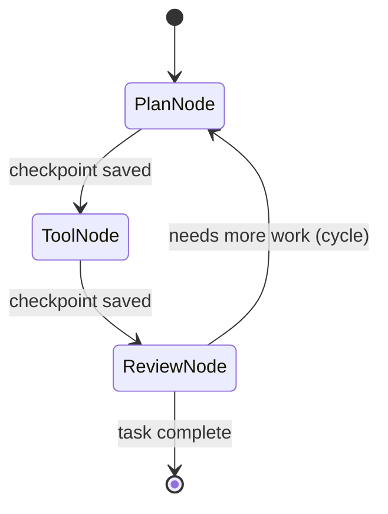

## Question
How do state-graph architectures (e.g., LangGraph) model agent loops as directed graphs with persistence, and how do explicit checkpointers enable time-travel, replay, and mutation of state during execution failures?


## Quick Answer
State-graph architectures model an agent as nodes (units of work) connected by edges (allowed transitions, including cycles back to earlier nodes), and a checkpointer persists the full state to storage after every node executes — which means any past checkpoint can be reloaded, inspected, edited, and resumed from, giving you replay and "time-travel" debugging instead of only a forward-only run.

## Detailed Answer
Frameworks like **LangGraph** represent an agent loop explicitly as a graph rather than an implicit while-loop: each **node** is a function (an LLM call, a tool call, a routing decision), and **edges** define which node can run next given the current state — critically, these graphs are allowed to be **cyclic**, so an "agent decides to keep working" loop is just an edge that points back to an earlier node, unlike a plain DAG which can't express that. The graph carries a shared **state object** that every node reads from and writes to, and that state object is the single source of truth for what's happened so far — no more, no less than what's actually been persisted.

The **checkpointer** is what turns this into more than an in-memory loop: after each node finishes, the current state is serialized and written to a persistence backend (a database, file store, or in-memory store for testing). Because every step produces a durable checkpoint, three things become possible that a plain loop doesn't give you for free: **resumability** — if the process crashes or is intentionally paused, execution can restart from the last checkpoint instead of from scratch; **replay** — you can reload any historical checkpoint and re-run forward from it, which is how you reproduce a bug deterministically; and **time-travel** — because a checkpoint is just serialized state, you can load an older checkpoint, *manually edit* a field (e.g. correct a bad tool result the agent acted on), and resume execution from that edited state, effectively rewriting history to explore a different branch without re-running the whole graph from the start.



## Production Implications
- Checkpoint after every node, not just at major milestones — the granularity of your checkpoints is the granularity of what you can replay or roll back to
- Use a durable backend (Postgres, Redis, or equivalent) for checkpoints in production; in-memory checkpointers are for local development and tests only
- Store enough in the state object to fully reconstruct context on resume — don't rely on anything living only in a process's memory outside the graph's state
- When editing a checkpoint for time-travel debugging, treat it like any other state mutation — validate it against the same schema the graph itself would produce

```python
# LangGraph-style checkpointer usage (illustrative)
from langgraph.checkpoint.postgres import PostgresSaver

checkpointer = PostgresSaver.from_conn_string(DB_URL)
graph = builder.compile(checkpointer=checkpointer)

# Resume from a specific past checkpoint
config = {"configurable": {"thread_id": "run-123", "checkpoint_id": "ckpt-7"}}
graph.invoke(None, config=config)
```

<Callout variant="tip" title="Key Takeaways">
A checkpointer turns an agent's execution history into durable, addressable snapshots — that's what makes crash-recovery, deterministic replay, and time-travel debugging possible, none of which a stateless in-memory loop can offer.
</Callout>

