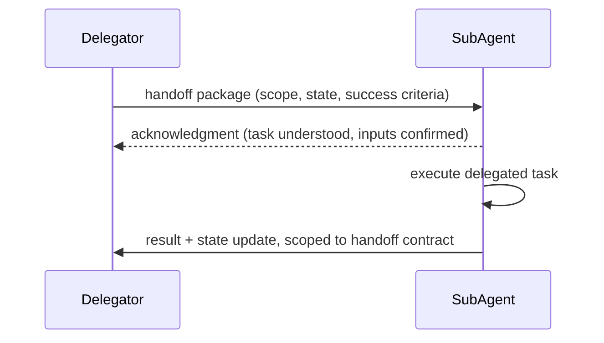

## Question
How do you design an explicit state-passing and handoff protocol between specialized sub-agents to prevent lost context and state corruption when delegating tasks across boundaries?

## Quick Answer
A handoff should pass a small, explicit, schema-defined package — the delegated task's scope, the specific prior state the receiving agent actually needs, and success criteria for what "done" means — rather than dumping the delegating agent's entire transcript, and the delegating agent shouldn't consider the handoff complete until it gets an explicit acknowledgment back.

## Detailed Answer
The naive handoff just forwards the whole upstream conversation to the sub-agent and hopes it figures out what's relevant. This causes two distinct failure modes: **lost context**, where something the sub-agent actually needed was buried deep in a transcript it wasn't given enough of, or wasn't given at all because the handoff assumed shared context that doesn't exist; and **state corruption**, where the sub-agent, working from an ambiguous or incomplete picture, makes a change that conflicts with something the delegating agent already did or assumed.

The fix is treating the handoff as a **contract**, not a context dump. A well-defined handoff package specifies: the **task scope** (exactly what the sub-agent is being asked to do, bounded explicitly enough that it can't silently expand its own mandate), the **relevant prior state** (only the specific facts, files, or decisions the sub-agent needs — resolved and summarized, not the raw transcript that produced them), and **success criteria** (what output or state change constitutes the task being complete, so the sub-agent knows when to hand back rather than continuing indefinitely). This is deliberately narrower than "give it everything" — narrower context is both cheaper and less likely to let the sub-agent latch onto an irrelevant detail.

Just as important as what's handed off is confirming it arrived intact: the delegating agent shouldn't mark the handoff complete the instant it dispatches the package — it should wait for an explicit **acknowledgment** from the receiving agent (even a simple "received task X with these inputs" echo) before considering control transferred. This catches malformed handoffs immediately rather than discovering, several steps later, that the sub-agent silently misunderstood its scope.

## Production Implications
- Version the handoff schema itself — as agents evolve, a receiving agent should reject a handoff package it doesn't recognize rather than guessing at missing fields
- Log every handoff package and acknowledgment; when coordination breaks, this is the trace you need to diagnose whether the fault was in the package or the sub-agent's handling of it
- Bound sub-agent scope explicitly enough that "success" is checkable — an open-ended handoff makes it impossible to tell whether the sub-agent actually finished or just stopped

<Callout variant="tip" title="Key Takeaways">
Hand off a scoped, explicit contract with confirmed receipt — not a raw context dump — so the receiving agent can't silently misunderstand what it was asked to do.
</Callout>

