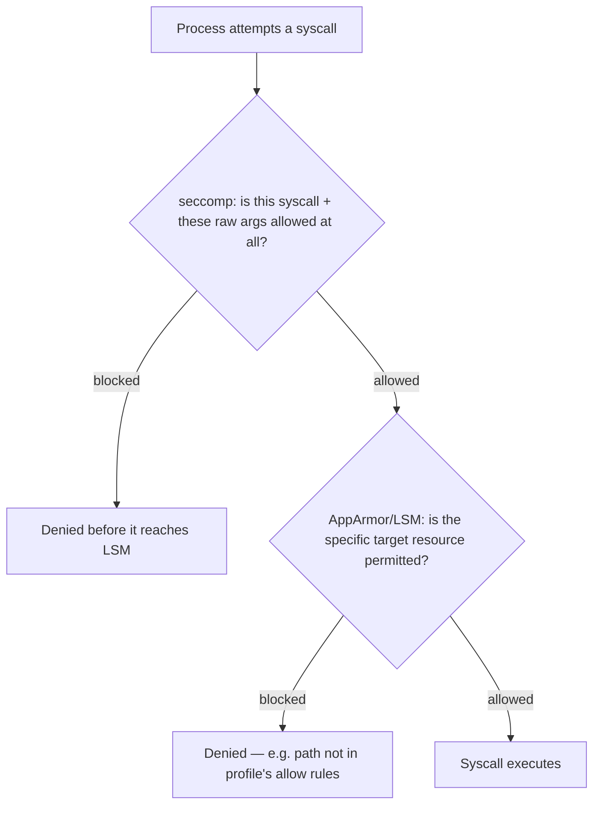

## Question
Contrast what AppArmor's mandatory access control profile enforces versus what seccomp enforces for the same container, and describe a concrete attack scenario that seccomp alone would not stop but a correctly scoped AppArmor profile would.

## Quick Answer
seccomp controls **which syscalls a process can make at all**; AppArmor controls **what those permitted syscalls are allowed to act on** — specific files, paths, network operations, and capability use — which is why a correctly scoped AppArmor profile stops attacks that stay entirely within seccomp's allowed syscall set.

## Detailed Answer
These two mechanisms operate at genuinely different layers, and conflating them is the single most common gap in container hardening.

**seccomp** is a **syscall gate**. It answers one question per syscall attempt: is this syscall (with these particular arguments) permitted at all? It has no concept of *paths*, *files*, or *what the syscall is trying to do* beyond the raw arguments passed to it. `open()` is either allowed or not — seccomp generally can't say "allow `open()` on `/tmp/*` but deny it on `/etc/shadow`," because that distinction lives in the *content* of a string argument, which BPF-based seccomp filtering isn't designed to parse and evaluate meaningfully.

**AppArmor** is a **Mandatory Access Control (MAC)** system that works at exactly that finer grain. An AppArmor profile is a per-path, per-capability rulebook: it can say a process may read `/app/config.yml` but not write to it, may execute `/usr/bin/curl` but not `/bin/sh`, may use network raw sockets but not mount filesystems — decisions based on *what resource* the syscall targets, not just which syscall it is. AppArmor enforces this by hooking into the **Linux Security Module (LSM)** framework, evaluating the actual target (a file path, a capability, a network operation type) against the loaded profile at the point of access, which is a fundamentally different check than seccomp's syscall-and-raw-arguments filter.

Put differently: seccomp is the bouncer checking IDs at the door (are you even allowed into this *kind* of room?); AppArmor is the room-by-room access list once you're inside the building (can you, specifically, go into *this* room and touch *that* object?). Both checks happen for every relevant operation, in sequence, and either one denying it is sufficient to block the action.

## An Attack seccomp Allows but AppArmor Stops
Consider a container running a web application that gets compromised via an application-level vulnerability (e.g., a path traversal or arbitrary file write bug in the app itself, not a kernel exploit). The attacker's injected code wants to read `/etc/shadow`-equivalent secrets baked into the image, or write a malicious cron-triggerable script to a writable path, or read another mounted secret file it has no business touching.

- `open()`, `read()`, and `write()` are all completely ordinary, universally-needed syscalls — a seccomp profile that blocked them would break virtually every application. seccomp has no mechanism to say "allow `open()` generally, but not on `/run/secrets/db-password`" — from seccomp's perspective, this is just an ordinary, permitted `open()` call with a string argument it isn't built to inspect against a security policy.
- A correctly scoped **AppArmor profile**, by contrast, can explicitly deny read access to specific paths outside the application's legitimate working set — `deny /run/secrets/** r,` or restricting write access to only the exact directories the app is supposed to write to. Even though the attacker's `open()`/`read()` syscalls are individually seccomp-legal, AppArmor's LSM hook evaluates the actual path being accessed and denies it, because it's outside the profile's allow rules for that container.

This is the precise class of attack seccomp is structurally unable to address (path/resource-scoped access) and AppArmor is specifically designed to address — they're not redundant, they're complementary layers covering different dimensions of "what can this process do."

## Production Implications
- Run both, not one or the other — Docker's defaults already ship a baseline AppArmor profile (`docker-default`) alongside the default seccomp profile precisely because they cover non-overlapping attack surface.
- Write AppArmor profiles as tightly scoped as practical per application: explicit read/write allow rules for known config, log, and data paths, with `deny` rules for anything sensitive that shouldn't be reachable even if the app is compromised.
- On distributions using SELinux instead of AppArmor (RHEL-family systems), the same MAC-layer complementary relationship to seccomp holds — the specific mechanism differs, the architectural role doesn't.
- Test AppArmor profile changes in `complain` mode first (which logs violations without enforcing them) before switching to `enforce` mode in production, since an overly strict profile can break legitimate application behavior in ways that look identical to the crash-diagnosis challenge seccomp misconfiguration creates.

<Callout variant="tip" title="Key Takeaways">
seccomp decides whether a syscall can happen at all; AppArmor decides what that syscall is allowed to touch — and any hardening strategy relying on seccomp alone leaves every path- and resource-scoped attack completely unaddressed.
</Callout>

---
