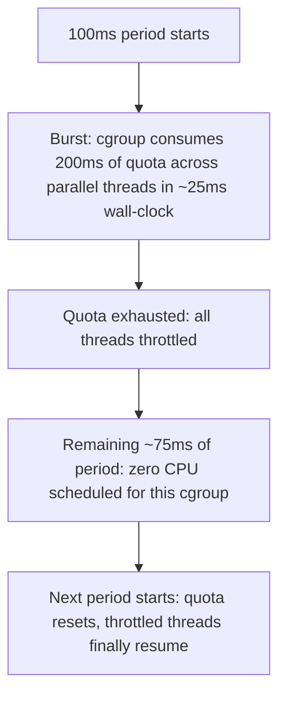

## Question
A service configured with `--cpus=2` shows periodic latency spikes even though average CPU usage sits well under 200%. Explain how CFS (Completely Fair Scheduler) quota-based throttling within a fixed period can cause this, and why average utilization metrics can be misleading here.


## Quick Answer
`--cpus=2` is enforced by the CFS (Completely Fair Scheduler) as a **quota per fixed period** (typically 200ms of CPU time per 100ms period), not a smooth 200%-of-a-core ceiling — so a bursty workload can burn its entire period's quota in a few milliseconds and then sit fully throttled, unable to run at all, until the next period starts, even though its *average* usage across a longer window looks well under the limit.

## Detailed Answer
When you set `--cpus=2`, Docker translates that into two cgroup CPU controller values: `cpu.cfs_quota_us` (the amount of CPU time allowed per period, here 200000 microseconds) and `cpu.cfs_period_us` (the period length, default 100000 microseconds — 100ms). The scheduler's job is simple in principle: track how much CPU time the cgroup's tasks have consumed within the current period, and once that hits the quota, **throttle** — refuse to schedule any of the cgroup's tasks again until the next period rolls over.

This is fundamentally different from a smooth rate limit. A "2 CPUs" limit doesn't mean "never use more than 2 cores' worth of processing power averaged over time" — it means "never use more than 200ms of CPU time inside any single 100ms window." A workload doing bursty work — handling a batch of incoming requests, running a garbage collection pause, spawning several goroutines/threads simultaneously — can easily consume all 200ms of quota within the first 20–30ms of a period if it briefly needs 6–8 cores' worth of parallel work. Once exhausted, every thread in that cgroup is denied CPU time for the remainder of that 100ms period, regardless of how idle the rest of the period is.



## Why Average Utilization Is Misleading
`docker stats`' CPU percentage — and most monitoring dashboards — report utilization averaged over seconds or longer. A cgroup that's fully throttled for 75 out of every 100ms, then bursts hard for the remaining 25ms, can average out to well under 200% CPU usage over a 10-second window, because the idle-while-throttled time drags the average down. The dashboard shows "150% average, well under the 200% limit" while every single request landing in one of those throttled windows experiences real added latency — the process wasn't slow, it was simply not running.

This is exactly the kind of failure mode averages are bad at surfacing: it lives in the *distribution* of CPU time within each 100ms period, not in the mean across many periods, and standard monitoring intervals (10s, 30s, 1m scrapes) are far too coarse to see individual period-level throttling events at all.

## Production Implications
- The ground-truth signal is `nr_throttled` and `throttled_time` in `/sys/fs/cgroup/cpu/docker/<id>/cpu.stat` (cgroup v1) or the equivalent under `cpu.stat` in the unified hierarchy (cgroup v2) — a nonzero and climbing `nr_throttled` count directly confirms this failure mode, independent of what average CPU graphs show.
- Raising `--cpus` reduces throttling by giving more quota per period, but the *real* fix for latency-sensitive, bursty workloads is often increasing parallelism headroom (more CPUs than the process's steady-state need) rather than sizing to the average.
- Some workloads benefit from `--cpuset-cpus` (pinning to specific cores) instead of a CFS quota, which avoids period-based throttling entirely at the cost of losing the elasticity a shared quota provides.
- Kernel versions and cgroup v2's newer `cpu.max` interface behave identically in principle but expose clearer, more granular stats — checking the `cpu.stat` output should be one of the first steps whenever a `--cpus`-limited service reports latency spikes despite "healthy" average CPU.

```bash
# Watch throttling events live
watch -n1 cat /sys/fs/cgroup/cpu/docker/<container-id>/cpu.stat
```

<Callout variant="tip" title="Key Takeaways">
`--cpus` is a per-period quota, not a smooth ceiling, so a bursty workload can be fully throttled for most of every 100ms window while its multi-second average utilization still looks comfortably under the limit — always check `cpu.stat`'s throttling counters, not just average CPU.
</Callout>

---
