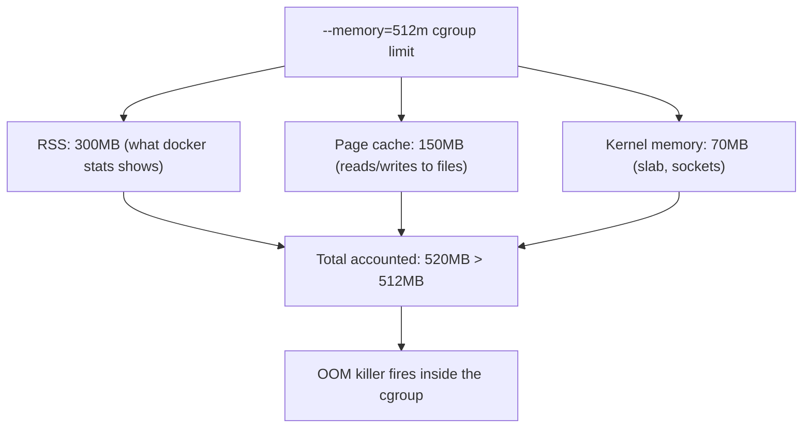

## Question
A container set with `--memory=512m` gets OOM-killed even though `docker stats` shows it using only 300MB of RSS at the time. Explain what other memory accounting cgroups tracks (page cache, kernel memory) that could explain this, and how you'd investigate.

## Quick Answer
`docker stats` shows RSS, but the memory cgroup enforcing `--memory=512m` counts RSS **plus** page cache and kernel memory (slab, socket buffers) against the same limit, so a container can be OOM-killed well before its "visible" usage looks close to the cap.

## Detailed Answer
`docker stats` is a convenient but incomplete window into memory usage. It surfaces roughly the RSS (resident set size) figure — the process's own private and shared heap/stack pages. The kernel's **memory cgroup**, which is what actually enforces `--memory`, tracks a broader figure closer to `memory.usage_in_bytes` (cgroup v1) or `memory.current` (cgroup v2). That number includes:

- **Page cache** — Every file the container reads or writes gets cached in memory by the kernel for performance. If the container reads a large dataset, writes logs, or unpacks an archive, those pages count toward the cgroup limit even though they're reclaimable and don't show up as RSS.
- **Kernel memory** — Slab allocations (things like open file descriptor structures, network socket buffers, and dentry/inode caches) attributable to the container's activity are charged to the same cgroup on many kernel versions.
- **Shared memory and tmpfs** — Anything mapped through `/dev/shm` or tmpfs also counts, and it's easy to lose track of because it isn't tied to a single process's RSS figure.

When total accounted usage — RSS + cache + kernel memory — hits the `--memory` ceiling, the kernel's OOM killer fires *inside that cgroup*, picking a victim process by the same badness-scoring heuristic it would use system-wide, but scoped to the container. The process can be killed even though `docker stats`' RSS column reads far below the limit, because that column was never the number being enforced.

## Production Implications
- Read the real number directly from the cgroup instead of `docker stats`: `cat /sys/fs/cgroup/memory/docker/<container-id>/memory.usage_in_bytes` (cgroup v1) or the equivalent `memory.current` under the unified hierarchy (cgroup v2).
- Check `memory.stat` in the same directory to break the total down by `rss`, `cache`, and `kernel_stack`/`slab` — this is the fastest way to confirm page cache is the real culprit.
- Workloads that do heavy file I/O (log-heavy apps, ETL jobs, anything unpacking archives) should either raise the memory limit to account for cache headroom or explicitly drop caches with `posix_fadvise`/streaming reads instead of buffering entire files.
- `dmesg` on the host after an OOM-kill shows the full cgroup accounting breakdown at the moment of the kill (`docker exec` won't work — the container is already dead), which is the ground-truth source, not `docker logs`.

<Callout variant="tip" title="Key Takeaways">
`--memory` caps total cgroup-accounted memory, not RSS, so diagnosing an unexpected OOM-kill means reading `memory.stat` on the host, not trusting `docker stats`.
</Callout>

---
