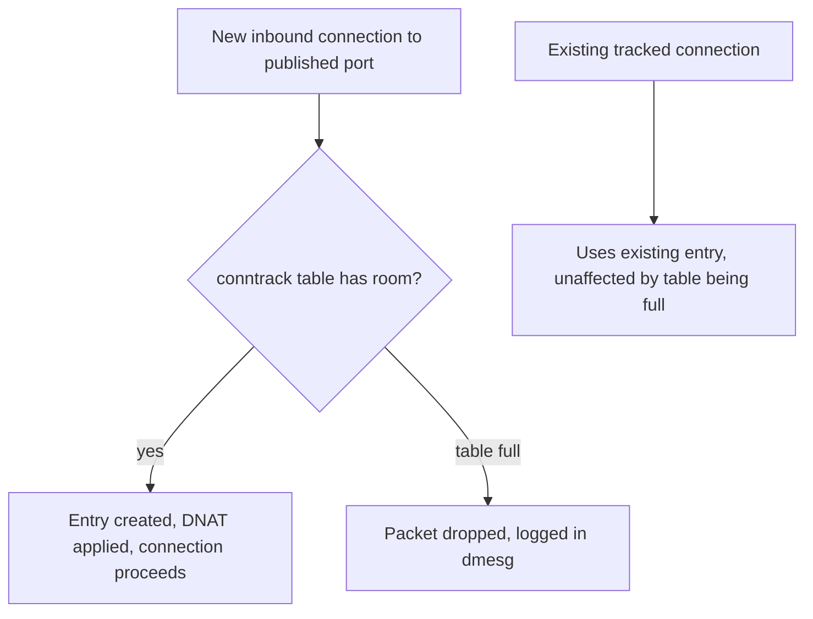

## Question
A high-throughput edge service running in containers starts silently dropping new connections under load, and `dmesg` shows conntrack table full errors. Explain how Docker's iptables-based NAT interacts with the kernel's connection tracking table, why containerized workloads are especially prone to exhausting it, and the tuning levers available.


## Quick Answer
Every connection that passes through Docker's `iptables`-based NAT (container port publishing, outbound masquerading) must be tracked by the kernel's **conntrack table** so return traffic can be correctly un-NAT'd, and that table has a fixed maximum size — once full, the kernel starts silently dropping new connection attempts rather than degrading gracefully, which is exactly what a `dmesg` "conntrack table full" error indicates.

## Detailed Answer
NAT isn't stateless. When Docker's `POSTROUTING`/`MASQUERADE` rule rewrites a container's outbound source IP, or a `PREROUTING`/`DNAT` rule rewrites an inbound published-port destination, the kernel has to remember that mapping somewhere — otherwise return packets would have no way to be translated back to the original address. That memory is the **connection tracking table** (`nf_conntrack`), a hash table where the kernel records one entry per active connection (roughly: source IP/port, destination IP/port, protocol, and NAT translation state), consulted on every packet that touches a `conntrack`-aware `iptables` rule.

The table has a hard ceiling, `net.netfilter.nf_conntrack_max` (commonly defaulting to 65536 or 262144 depending on distro/kernel, often scaled by available RAM at boot). Once the number of tracked connections hits that ceiling, the kernel cannot create new conntrack entries — and because Docker's NAT rules depend on conntrack to function, packets that would need a *new* entry (new connections) get dropped, logged as `nf_conntrack: table full, dropping packet` in `dmesg`. Critically, **existing** connections already in the table keep working; only new connection attempts fail, which is exactly the "silently dropping new connections under load" symptom — the service looks alive and even handles existing traffic, but can't accept anything new.



## Why Containerized Workloads Are Especially Prone to This
- **Every container's traffic goes through NAT by default.** Unlike a bare-metal service binding directly to a host interface, a containerized service almost always has its traffic passing through at least one Docker-managed NAT rule (published ports, outbound masquerading, or both), so conntrack entries accumulate at a rate proportional to *all* container connection churn on the host, not just one service's.
- **High connection churn workloads multiply entries fast.** Edge/proxy services handling many short-lived connections (HTTP/1.1 without keep-alive, high-frequency polling clients, connection-per-request patterns) create and tear down conntrack entries constantly — and entries aren't removed the instant a connection closes; they linger for a timeout period (`nf_conntrack_tcp_timeout_*` values, some defaulting to hours for established connections), so churn plus lingering timeouts compounds table occupancy faster than raw concurrent-connection counts would suggest.
- **Multiple containers share one host-wide table.** `nf_conntrack_max` is a single, host-level ceiling — it isn't namespaced per container or partitioned per network. A busy neighbor container's connection load counts against the exact same shared budget as the edge service that's actually struggling, meaning the table can fill from aggregate host activity even when any single service's own load looks reasonable.
- **Overlay/VXLAN encapsulation adds its own tracked flows.** In multi-host Swarm setups, the VXLAN tunnel traffic between hosts is itself often subject to conntrack tracking at the outer-packet level, adding to table pressure beyond just the inner container-to-container connections.

## Tuning Levers
- **Raise `net.netfilter.nf_conntrack_max`** (`sysctl -w net.netfilter.nf_conntrack_max=1048576` or higher, persisted in `/etc/sysctl.conf`) — the most direct fix, sized to the host's actual peak concurrent+lingering connection count with headroom, not just current averages.
- **Reduce lingering timeouts for high-churn protocols** — `net.netfilter.nf_conntrack_tcp_timeout_established` and related timeout sysctls can be tuned down from very conservative defaults so closed/idle connections free their table slot sooner, directly reducing table pressure from churn-heavy workloads.
- **Increase the conntrack hash table size** (`net.netfilter.nf_conntrack_buckets`, often needs a module parameter or kernel boot parameter alongside the max) to keep lookups fast as the table grows — raising `nf_conntrack_max` without a proportionate bucket count increase can turn conntrack lookups into a CPU cost of their own.
- **Reduce actual NAT dependency where possible** — using host networking mode (`--network=host`) for the specific high-throughput edge service removes it from Docker's NAT path entirely (at the cost of losing network namespace isolation), which is a legitimate trade-off specifically for this class of problem on a service that doesn't need port remapping.
- **Monitor proactively**, not just react to `dmesg` — `conntrack -C` (or `cat /proc/sys/net/netfilter/nf_conntrack_count`) against `nf_conntrack_max` as an ongoing metric catches the trend before it becomes a production drop event.

```bash
# Check current usage against the ceiling
cat /proc/sys/net/netfilter/nf_conntrack_count
cat /proc/sys/net/netfilter/nf_conntrack_max

# Raise the ceiling
sysctl -w net.netfilter.nf_conntrack_max=1048576
```

<Callout variant="tip" title="Key Takeaways">
conntrack table exhaustion is a host-wide, shared-budget problem that Docker's NAT dependency makes containers especially prone to under connection churn, and it fails silently (dropped new connections, working existing ones) rather than with an obvious error — `nf_conntrack_count` vs. `nf_conntrack_max` should be a standing metric on any NAT-heavy container host.
</Callout>

---
