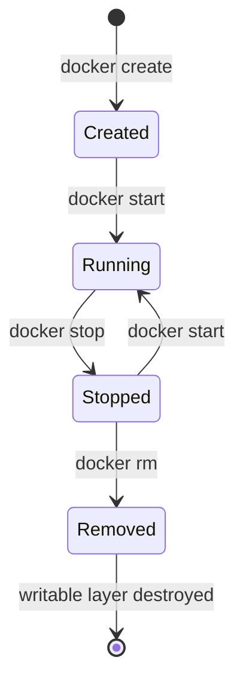

## Question
A container running a database is removed with `docker rm`, and the team is shocked their data disappeared. Diagnose what likely went wrong in their setup and explain the container filesystem lifecycle that caused this.

## Quick Answer
The database was almost certainly writing to the container's own **writable layer** instead of a named volume. That layer's lifecycle is tied to the container itself, so `docker rm` deletes it — and the data with it — permanently.

## Detailed Answer
Every running container's filesystem is a stack: read-only image layers on the bottom, and one thin **writable layer** on top, created fresh when the container is created. Anything the process inside the container writes — new files, modified files, database data files, log output — lands in that writable layer, unless something explicitly redirects the write elsewhere.

That writable layer is scoped to the *container*, not the image and not the host in any durable sense. `docker stop` leaves it intact. `docker rm`, however, deletes the container object and its writable layer together — there's no separate step, no confirmation, no recycle bin. If the database's data directory was never mounted to a **named volume** or a **bind mount**, every write it ever made lived only in that writable layer, and removing the container removed the only copy.

Volumes exist specifically to break this coupling. A **named volume** (`docker volume create`, or the `-v myvolume:/var/lib/postgresql/data` shorthand) is a storage location Docker manages *independently* of any single container's lifecycle. The container mounts it at a path and writes through to it, but the volume itself persists after that container — or any container — is removed, until it's explicitly deleted with `docker volume rm`. The fix for this team is to recreate the database container with its data directory mounted to a named volume, so future `docker rm` calls only remove the disposable compute layer and leave the durable data layer untouched.

<Callout variant="tip" title="Key Takeaways">
Treat every container's writable layer as disposable by default — anything that needs to outlive the container, especially a database's data directory, belongs on a named volume, not in the container's own filesystem.
</Callout>

