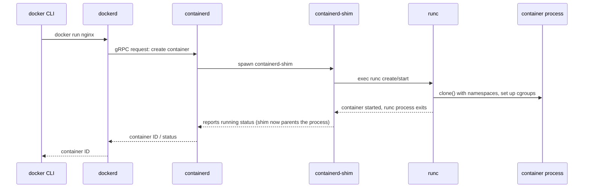

## Question
Diagram (in words) the full process chain from a `docker run` invocation down to the actual container process, explicitly naming the role of `dockerd`, `containerd`, `containerd-shim`, and `runc`, and explain why the shim's existence allows the Docker daemon to be restarted without killing running containers.

## Quick Answer
`docker run` travels through `dockerd` → `containerd` → `containerd-shim` → `runc`, where `runc` creates the container process and then exits, leaving the long-lived `containerd-shim` as the process's direct parent — which is exactly what lets `dockerd` restart without killing running containers.

## Detailed Answer
It's tempting to think of `dockerd` as "the thing that runs containers," but by design it delegates almost all of that responsibility away, one layer at a time, specifically so no single long-running daemon has to stay alive for a container to keep running.

Walking each hop:

- **dockerd** — Receives the CLI request over its REST API, resolves the image, builds the OCI runtime spec (`config.json`), and hands the actual work off to `containerd` over gRPC. It does not create the container process itself.
- **containerd** — The container lifecycle manager. It manages image pulls, storage snapshots, and — critically — spawns one `containerd-shim` process per running container rather than managing the process directly.
- **containerd-shim** — A small, purpose-built process whose only job is to sit between `containerd` and the container process. It execs `runc` to actually create the container, and once `runc` finishes, the shim becomes the container process's real parent (technically its reaper via `PR_SET_CHILD_SUBREAPER`), holding its stdio streams and reporting exit status back to `containerd`.
- **runc** — The low-level OCI runtime. It reads `config.json`, calls into the kernel to set up namespaces, cgroups, and the mount tree, execs the container's entrypoint, and then **exits**. `runc` is not a long-running process — its job is done the moment the container starts.

## Why the Shim Decouples dockerd from Running Containers
Because `runc` exits immediately after startup and `containerd-shim` — not `containerd` and not `dockerd` — becomes the container process's parent, the container's lifetime is no longer tied to either daemon's lifetime. If `dockerd` is restarted (a config change, an upgrade, a crash), it simply reconnects to `containerd`, which reconnects to the still-running shims, and reattaches to the containers' stdio and state without touching the container processes themselves. This is what enables `dockerd` upgrades and restarts with zero container downtime — a capability that didn't exist before `containerd` and the shim architecture were introduced.

## Production Implications
- `ps -ef --forest` on a Docker host shows `containerd-shim-runc-v2` processes as the direct parent of container entrypoints — `dockerd` and `containerd` are notably absent from that parent chain, confirming the decoupling.
- Restarting `dockerd` (`systemctl restart docker`) is safe for running containers precisely because of this chain; restarting `containerd` itself is riskier since shims depend on it for lifecycle reporting, even though they don't depend on it to keep the process alive.
- One `containerd-shim` process per container means shim crashes are isolated — a single shim dying doesn't take down `containerd` or other containers' shims, unlike older architectures where a monolithic daemon crash could affect everything.
- When debugging "container won't die" issues, check for an orphaned `containerd-shim` still holding the process open after `containerd` itself was restarted or crashed — `ctr` (containerd's low-level CLI) can inspect shim state directly, bypassing `dockerd` entirely.

<Callout variant="tip" title="Key Takeaways">
The `containerd-shim` — not `dockerd` or `containerd` — is the actual parent of every running container process, which is the architectural reason Docker daemon restarts don't kill your containers.
</Callout>

---
