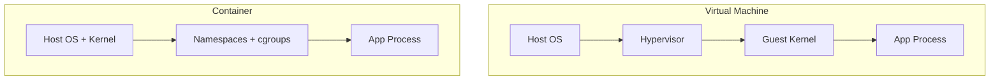

## Question
A junior engineer says "a container is just a lightweight VM." Explain precisely why this analogy is wrong, and describe what a container actually *is* at the process level on the host.

## Quick Answer
A container isn't a small VM — it's an ordinary host process that the kernel isolates with **namespaces** and **cgroups**. There's no hypervisor and no guest kernel underneath it.

## Detailed Answer
The "lightweight VM" analogy breaks down at the most fundamental level: a VM virtualizes hardware and boots a full, separate guest kernel on top of a hypervisor. A container does neither. When you run `docker run nginx`, the process that starts is a **regular Linux process visible in the host's own process table** — run `ps aux` on the host and you'll see it sitting right next to every other process, with a normal PID.

What makes it look isolated is a combination of two kernel features, not virtualization:

- **Namespaces** — the kernel gives the process its own restricted *view* of certain global resources: its own PID tree (so it thinks it's PID 1), its own network stack, its own mount table, its own hostname. The resources aren't duplicated — the process just can't see outside its slice of them.
- **cgroups (control groups)** — the kernel caps how much CPU, memory, and I/O that process (and its children) can consume, and accounts for that usage separately from the rest of the host.

On top of that, the container's filesystem is assembled from stacked, read-only image layers plus a thin writable layer, using a union filesystem — this is what makes the container *look* like it has its own independent OS filesystem, even though it's still running directly on the host's single shared kernel.

Because there's no guest kernel to boot and no hardware to emulate, a container starts in milliseconds and has none of the per-instance memory overhead a VM carries just to run its own OS. The tradeoff is isolation strength: every container on a host shares that one kernel, so a kernel-level exploit can, in principle, cross container boundaries in a way it can't cross a hypervisor boundary.

<Callout variant="tip" title="Key Takeaways">
A container is a namespaced, resource-limited process sharing the host's kernel — not a miniature computer — which is exactly why it starts fast and why "just add more isolation like a VM" isn't a free upgrade.
</Callout>

