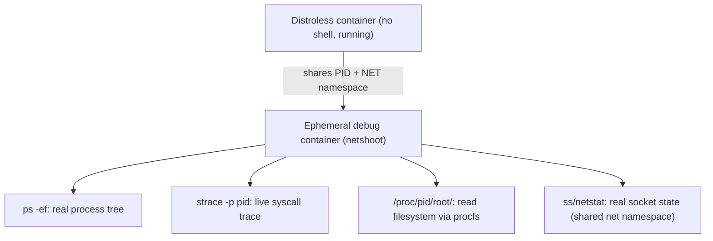
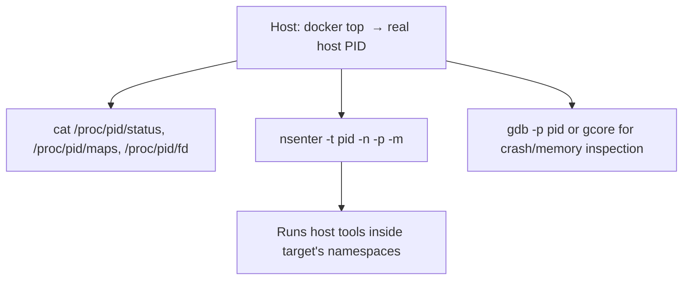

## Question
A production incident requires live debugging of a distroless container that has no shell, no package manager, and no coreutils. Walk through at least two distinct real-world techniques (e.g., ephemeral debug containers sharing namespaces, sidecar attach) to inspect its running process, filesystem, and network state without modifying the original image.


## Quick Answer
Two reliable techniques for debugging a shell-less distroless container in production are attaching an **ephemeral debug container that joins its namespaces** (via `--pid=container:x` / `--net=container:x` or `kubectl debug`'s ephemeral containers) and inspecting the running process directly through `/proc` on the host, without ever executing anything inside the original image.

## Detailed Answer
Distroless images are deliberately minimal — no shell, no package manager, often not even `coreutils` — specifically to shrink attack surface and remove tools an attacker could otherwise abuse post-compromise. That's a real security win, but it means `docker exec -it <container> sh` simply fails: there's no `sh` binary to exec into. Debugging has to happen *around* the container rather than *inside* it.

### Technique 1: Ephemeral Debug Container Sharing Namespaces
This is the direct evolution of the namespace-sharing debugging pattern: start a brand-new container, built from a full-featured debug image, that joins the target's PID and (optionally) network namespaces without touching the target's filesystem or requiring any change to the original image.

```bash
docker run -it --rm \
  --pid=container:target-app \
  --net=container:target-app \
  --cap-add=SYS_PTRACE \
  nicolaka/netshoot
```

Once attached:
- `ps -ef` shows the target's real process tree (shared PID namespace), including its actual PID 1 and any child processes.
- `strace -p <pid>` attaches directly to the target's running process for live syscall tracing — invaluable for diagnosing hangs, unexpected syscall failures (like the seccomp-blocked-`clone()` scenario), or figuring out what a stuck process is actually doing.
- `netstat`/`ss` (via the shared network namespace) show the target's actual open sockets and connections, since the debug container now has the *same* network stack, not a separate one.
- `/proc/<pid>/root/` gives a live, read-only view into the target process's filesystem as it sees it — you can `ls`, `cat`, and inspect files inside the distroless container's root filesystem from the debug container, entirely through `/proc`, without needing a shell inside the target at all.

Kubernetes formalizes this same pattern natively via **ephemeral containers**: `kubectl debug -it target-pod --image=nicolaka/netshoot --target=target-container` attaches a debug container to a running pod, sharing the target container's process namespace when the pod supports it, without modifying the pod spec permanently or requiring a restart.



### Technique 2: Host-Level /proc Inspection Without Any Container Attach
For scenarios where even spinning up a debug container isn't desirable (a locked-down node, an incident requiring minimal additional attack surface), the target process is directly inspectable from the **host** itself, since every container process is still an ordinary Linux process visible in the host's own process table (just namespaced from its own perspective):

- `ps -ef | grep <container-related-name>` or `docker top <container>` identifies the host-visible PID of the target's processes.
- `cat /proc/<host-pid>/status`, `/proc/<host-pid>/maps`, and `/proc/<host-pid>/fd/` from the host give memory mapping, open file descriptor, and resource usage information without entering any namespace.
- `nsenter --target <host-pid> --net --pid --mount` from the host temporarily runs a command *inside* the target's namespaces using host-available tools — for example `nsenter -t <pid> -n ss -tlnp` inspects the container's network state using the host's `ss` binary, sidestepping the "no tools inside the container" problem entirely by borrowing the host's tools instead of installing anything in a sidecar.
- `gdb -p <host-pid>` (or `gcore` for a memory dump) can attach directly for deep process-state or crash inspection, again entirely from the host, given appropriate capabilities (`SYS_PTRACE`) and permissions.



Both techniques share the same core principle: since distroless removes tools *from the image*, the fix is bringing tools *to the process* from outside — either a purpose-built debug container joining the right namespaces, or the host's own toolset reaching in via `/proc` and `nsenter` — rather than trying to get tools installed inside the immutable, minimal image.

## Production Implications
- Prefer Technique 1 (ephemeral debug container) for anything requiring interactive, sustained investigation — it gives a full toolset without SSH access to the host or elevated host-level trust.
- Prefer Technique 2 (`nsenter`/`/proc` from host) when host access is already available and minimizing additional running processes/containers during an incident is a priority, or when the orchestrator doesn't yet support ephemeral containers.
- Neither technique modifies the original image or requires a rebuild/redeploy — this is the key property that makes them safe to use against a live, in-incident production container without changing its behavior or losing the state you're trying to debug.
- Grant `SYS_PTRACE` and namespace-sharing debug tooling only to break-glass/incident tooling, not as a standing capability on regular deployments — the same namespace-sharing power that makes debugging possible is exactly what `--pid=host`-style trade-offs warn about if left broadly available.

<Callout variant="tip" title="Key Takeaways">
Distroless containers can't run tools internally, so debug by bringing tools to the process from outside — an ephemeral namespace-sharing debug container or host-level `nsenter`/`/proc` inspection — rather than trying to get a shell inside an image that was deliberately built without one.
</Callout>

---
