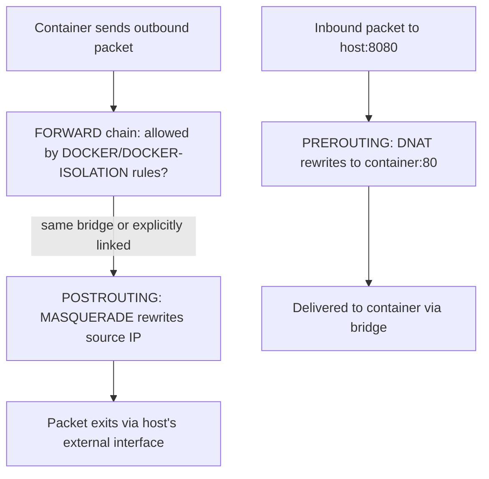

## Question
You create a custom bridge network and notice new `iptables` chains and rules appear on the host without you touching `iptables` directly. Explain what Docker is doing to the NAT and FILTER tables to make inter-container and container-to-external routing work, and describe a scenario where a conflicting host firewall rule could silently break container connectivity.


## Quick Answer
Docker programs the host's `iptables` **NAT table** for masquerading outbound traffic and publishing container ports, and the **FILTER table** for controlling inter-container and forwarding traffic — all automatically, whenever a bridge network is created or a container is started with published ports.

## Detailed Answer
Each Docker bridge network is a real Linux bridge device (`docker0` for the default, or `br-<network-id>` for custom ones), and connecting containers to it is only half the story — the other half is making sure traffic actually routes correctly between containers, and between containers and the outside world. Docker handles that by writing rules directly into the kernel's `iptables` tables via its own custom chains, layered underneath the built-in `FORWARD`, `PREROUTING`, `POSTROUTING`, and `OUTPUT` chains.

- **NAT table — `POSTROUTING` / `MASQUERADE`** — When a container without a published port initiates outbound traffic (say, an API call to an external service), Docker adds a `MASQUERADE` rule in the `DOCKER-POSTROUTING`/`POSTROUTING` chain scoped to the bridge's subnet, rewriting the container's private source IP to the host's outbound interface IP. Without this, return traffic from the internet would have nowhere to route back to, since container IPs aren't routable outside the host.
- **NAT table — `DOCKER` chain / `-p`published ports** — Publishing a port (`-p 8080:80`) adds a `DNAT` rule in a Docker-managed chain (typically named `DOCKER`) hooked into `PREROUTING`, rewriting traffic arriving at the host's `8080` to the container's internal `80`. This is what makes `-p` work without you touching `iptables` yourself.
- **FILTER table — `DOCKER` and `DOCKER-ISOLATION-STAGE-1/2` chains** — These control whether traffic is allowed to forward between bridges at all. By default, containers on the *same* bridge can talk to each other freely, while Docker inserts isolation rules that **block** traffic between containers on *different* user-defined bridge networks unless they're explicitly connected to both.



## The Conflicting-Rule Scenario
Because Docker inserts its chains at specific, predictable positions relative to the host's own rules, a host firewall tool that manages `iptables` independently — `firewalld`, `ufw`, or a manually maintained ruleset — can silently break container connectivity in a genuinely confusing way:

- If a host-level `DROP` policy or an explicit `REJECT` rule in the `FORWARD` chain is inserted **above** Docker's `DOCKER`/`DOCKER-ISOLATION` chains, packets get dropped before they ever reach Docker's own (correctly configured) rules — `docker network inspect` and `docker port` will both report everything as fine, because from Docker's point of view, nothing is wrong.
- Tools like `ufw`, by default, set the `FORWARD` chain's default policy to `DROP`, which — unless `ufw` is explicitly configured with `DEFAULT_FORWARD_POLICY="ACCEPT"` or given rules for the Docker bridge subnet — blocks exactly the forwarding traffic Docker depends on, even though `docker0`/custom bridges and their NAT rules are all present and correct.
- Restarting `firewalld` or reloading `ufw` after Docker has already started can wipe or reorder Docker's chains entirely, since these tools often flush and rebuild `iptables` from their own managed state without knowledge of Docker's rules — this is why containers can lose connectivity after an unrelated firewall config change, with no Docker-side error at all.

## Production Implications
- Inspect the live ruleset directly rather than trusting Docker's abstractions when debugging: `iptables -t nat -L -n -v` and `iptables -t filter -L DOCKER-ISOLATION-STAGE-1 -n -v` show exactly what's programmed and whether traffic counters are incrementing.
- If using `firewalld` alongside Docker, use the `docker` zone integration (Docker 20.10+) or ensure `FirewallBackend=iptables` (not `nftables`) matches what Docker expects, since a backend mismatch is a common source of "it worked yesterday" breakage.
- With `ufw`, explicitly set `DEFAULT_FORWARD_POLICY="ACCEPT"` in `/etc/default/ufw` and add rules permitting the Docker bridge subnet, rather than disabling `ufw` outright.
- Order matters: any host firewall management layer should be configured to append its rules, not flush-and-rebuild the whole table, or it should be started/reloaded before Docker so Docker's own chain insertions land in the position it expects.

```bash
# Confirm Docker's chains exist and are actually receiving traffic
iptables -t nat -L DOCKER -n -v
iptables -t filter -L DOCKER-ISOLATION-STAGE-1 -n -v
```

<Callout variant="tip" title="Key Takeaways">
Docker's bridge networking depends entirely on `iptables` rules it manages itself, so any external firewall tool that flushes, reorders, or shadows those chains can silently break container connectivity without Docker ever reporting an error.
</Callout>

---
