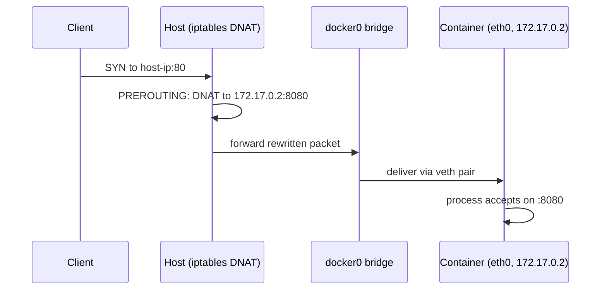

## Question
A service inside a container listens on port 8080, and it's exposed with `-p 80:8080`. Walk through what actually happens to a packet arriving at the host's port 80 to reach the process inside the container.

## Quick Answer
`-p 80:8080` installs a **NAT rule** on the host: a packet arriving at the host's port 80 gets its destination rewritten to the container's private IP on port 8080, then gets routed across the container network like any other packet.

## Detailed Answer
Nothing about port 80 exists inside the container — the process only ever binds to 8080, inside its own network namespace. Docker's job is to make traffic aimed at the host's port 80 quietly become traffic aimed at that container's 8080, without either side needing to know about the translation. Here's the path a packet actually takes:

1. **Bridge network setup.** When the container starts (on the default `bridge` network), Docker creates a virtual ethernet pair — one end stays in the host's network namespace, the other is moved into the container's network namespace and shows up there as `eth0`. Both ends of every container's pair connect to a virtual switch, `docker0`, and Docker hands the container a private IP from that bridge's subnet (e.g. `172.17.0.2`).
2. **NAT rule installation.** Because `-p 80:8080` was specified, `dockerd` inserts a rule into the host's `iptables` `nat` table, in the `DOCKER` chain (reached from `PREROUTING`): destination `80` on the host gets **DNAT'd** to `172.17.0.2:8080`.
3. **Packet arrives.** An external client connects to `<host-ip>:80`. The kernel's netfilter hooks match the DNAT rule in `PREROUTING` before any routing decision is made, and rewrite the packet's destination address and port in place.
4. **Routed across the bridge.** With the destination now `172.17.0.2:8080`, the packet is routed like ordinary bridge traffic — out through `docker0`, across the veth pair, and into the container's network namespace.
5. **Delivered to the process.** Inside the container's namespace, the packet arrives addressed to `172.17.0.2:8080` — exactly where the application is listening. As far as that process is concerned, it just received a normal connection on 8080; it never sees port 80 or any translation.

The return path works the same way in reverse: reply packets get their source rewritten back from `172.17.0.2:8080` to `<host-ip>:80` (SNAT/connection tracking) so the client's connection looks unbroken.

<Callout variant="tip" title="Key Takeaways">
Port mapping is address translation, not magic — the container never binds to the published port at all, the host's `iptables` NAT rules do all the work of getting the packet there.
</Callout>

