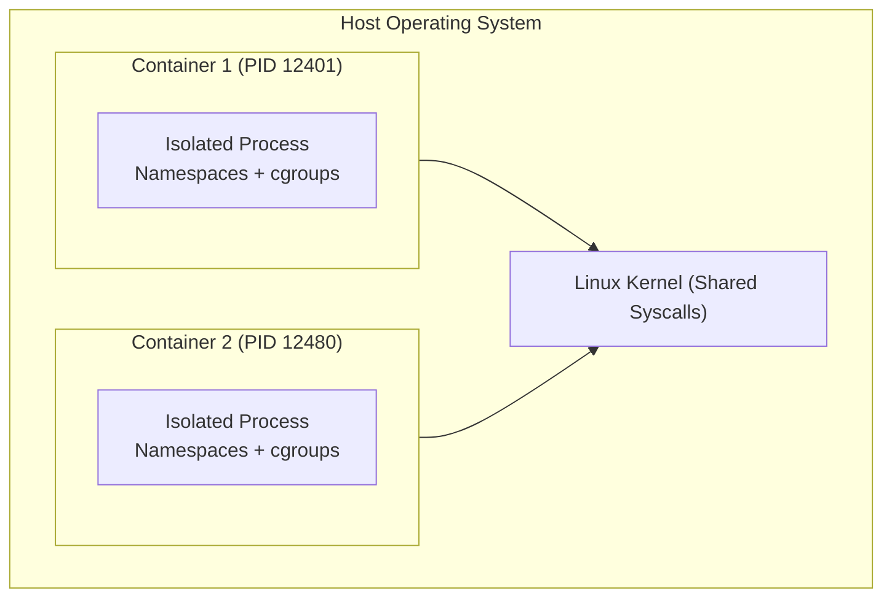

## Question
A junior engineer says "a container is just a lightweight VM." Explain precisely why this analogy is wrong, and describe what a container actually *is* at the process level on the host.

## Quick Answer
A container is not a virtual machine — it is a standard Linux host process wrapped in namespace boundaries (for isolation) and constrained by cgroups (for resource limits). There is no guest kernel or hypervisor overhead.

## Detailed Answer
Virtual machines achieve isolation by running a full guest operating system on top of a hypervisor (Type 1 bare-metal or Type 2 hosted). Each VM has its own virtualized hardware, device drivers, system services, and its own running kernel, requiring gigabytes of memory and multiple minutes to boot.

In sharp contrast, containers share the single host Linux kernel. When you invoke `docker run`, the Docker daemon (via containerd and runc) instructs the Linux kernel to fork/clone a new process with several kernel namespace flags:

- **PID Namespace**: Isolates the process ID space so the container process perceives itself as PID 1.
- **NET Namespace**: Assigns a dedicated virtual network interface, routing table, and firewall filter rules.
- **MNT Namespace**: Gives the process an isolated root filesystem view using layered storage (overlay2).
- **UTS & IPC Namespaces**: Provide separate hostnames and inter-process communication semaphores.
- **Control Groups (cgroups v2)**: Enforce strict CPU quotas, memory limits, and IO bandwidth restrictions on the process group.

Because there is no guest kernel, container processes execute instructions directly on the host CPU cores at native machine speed with zero hypervisor emulation overhead.

<Callout variant="tip" title="Key Takeaways">
Containers are processes, not machines. They leverage Linux kernel primitives (namespaces and cgroups) to provide isolated execution boundaries without running separate guest operating systems.
</Callout>

