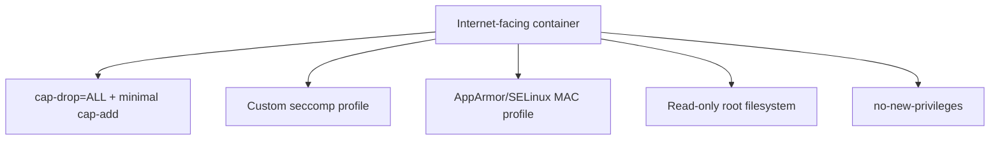

## Question
A Dockerfile does `COPY . .` before `RUN npm install`. Every single code change forces a full dependency reinstall during CI, adding 4 minutes per build. Explain the caching mechanic causing this and restructure the instructions to fix it.

## Quick Answer
A maximally hardened internet-facing container profile combines capability dropping, a custom seccomp filter, an AppArmor/SELinux MAC profile, a read-only root filesystem, and `no-new-privileges` — five distinct controls, each closing off a different class of breakout or escalation technique rather than one control doing everything.

## Detailed Answer
No single control covers the full space of container-escape and privilege-escalation techniques, because those techniques operate at different layers: identity/capability, syscall availability, resource-path access, filesystem mutability, and privilege-acquisition mechanics. A genuinely hardened profile stacks controls that each neutralize a specific class, so that defeating the whole profile requires simultaneously bypassing several independent mechanisms.

## The Profile, Control by Control

**1. `--cap-drop=ALL` + minimal `--cap-add`**
Strips every root capability by default, re-adding only what's demonstrably required (e.g. `NET_BIND_SERVICE` for a privileged port). This specifically neutralizes **capability-based escalation** — techniques that rely on the container process still holding capabilities like `CAP_SYS_ADMIN` (which can enable remounting filesystems, manipulating namespaces, or abusing certain `mount`/`unshare` calls to break isolation), `CAP_SYS_MODULE` (loading arbitrary kernel modules — a direct path to full host compromise), or `CAP_SYS_PTRACE` (attaching to and manipulating other processes' memory). Without these, whole categories of published container-escape exploits simply have no capability to work with, regardless of what other bugs exist.

**2. A custom seccomp profile**
Layered on top of (or replacing) Docker's default, restricting the syscall surface further than the general-purpose default allows for this specific workload. This neutralizes **dangerous syscall invocation directly** — `mount()`/`umount2()` (filesystem manipulation attempts), kernel module syscalls, `unshare()`/`clone()` with namespace-creation flags (nested namespace tricks used in several real container-escape CVEs), and `ptrace()`-family calls if not otherwise needed. Even if an attacker gets arbitrary code execution inside the container, a properly scoped seccomp filter means many exploit primitives simply return `EPERM` before they can do anything.

**3. AppArmor (or SELinux) MAC profile**
Enforces path- and resource-scoped access control beneath the syscall-availability layer. This neutralizes **resource-targeted exploitation that stays within an otherwise-permitted syscall** — reading secrets or config outside the app's legitimate working set, executing unexpected binaries that happen to be present in the image, or writing to paths that shouldn't be reachable even by a permitted syscall like `open()`/`write()`. This is precisely the gap seccomp structurally cannot close (see the seccomp-vs-AppArmor scenario), so its absence would leave every path-scoped attack completely unaddressed regardless of how tight the other controls are.

**4. Read-only root filesystem (`--read-only`, with explicit writable volumes/tmpfs only where genuinely needed)**
Makes the container's own image filesystem immutable at runtime. This neutralizes **persistence and tooling-drop techniques** — an attacker who gets code execution can't write a malicious script, a reverse-shell binary, or a cron-triggerable payload into the container's filesystem to survive or expand the compromise, because there's nowhere writable to put it outside the explicitly declared exceptions (which should be as narrow as `/tmp` or a specific app data directory, mounted as `tmpfs` or a scoped volume rather than leaving the whole filesystem open).

**5. `--security-opt=no-new-privileges`**
Sets the kernel's `PR_SET_NO_NEW_PRIVS` flag, which prevents any process in the container — including ones spawned via `execve()` — from gaining privileges it didn't already have, most importantly blocking **setuid/setgid binary privilege re-acquisition**. Without this, a process that's had its capabilities carefully dropped could still regain elevated privileges by executing a setuid-root binary present in the image (intentionally or via a supply-chain-planted one), completely undoing the capability-dropping work from control #1. This is the control that specifically closes the "gained privileges back via exec" class of escalation that the other four don't directly address.

## Why Stacking Matters
Each control addresses a technique class the others don't:

| Control | Class of Technique Neutralized |
|---------|----------------------------------|
| Capability dropping | Direct abuse of retained root capabilities (mount tricks, module loading, ptrace abuse) |
| seccomp | Invocation of dangerous syscalls regardless of capability state |
| AppArmor/SELinux | Path/resource-scoped access to secrets or unexpected binaries within allowed syscalls |
| Read-only root filesystem | Persistence and malicious tooling drop into the image filesystem |
| no-new-privileges | Privilege re-acquisition via setuid binaries or exec-time privilege gain |

An attacker defeating this profile has to find a technique that simultaneously doesn't require a dropped capability, doesn't touch a blocked syscall, doesn't touch a path AppArmor restricts, doesn't need to write anything to disk, and doesn't rely on regaining privilege through exec — a genuinely narrow remaining surface compared to a default, unhardened container.

## Production Implications
- Build the profile iteratively against the real application in a staging environment — an overly aggressive seccomp or AppArmor profile written blind commonly breaks legitimate functionality (see the `clone()`-blocking scenario) before it stops a single real attack.
- Document the justification for every capability re-added and every seccomp/AppArmor exception granted — a hardened profile that nobody can safely modify six months later tends to get bypassed wholesale under deployment pressure instead of adjusted correctly.
- Combine this runtime profile with user namespace remapping and non-root `USER` directives in the image itself — the controls here restrict what a process can do, but running as an unprivileged UID to begin with removes an entire tier of assumptions attackers rely on.
- Validate the full stack together, not just individually — `docker inspect` and a startup smoke test should confirm capabilities, seccomp profile, AppArmor profile, read-only status, and `no-new-privileges` are all actually applied as configured, since a single silently-dropped flag re-opens exactly the class of attack that control was meant to close.

<Callout variant="tip" title="Key Takeaways">
Each hardening control closes a distinct, non-overlapping class of attack technique, so a maximally hardened profile is a deliberate stack of five independent barriers, not one strong setting doing all the work.
</Callout>

---
