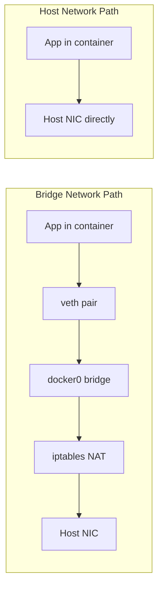

## Question
A latency-sensitive service performs noticeably better under `--network host` than the default bridge network. Explain the actual network path difference that causes this performance gap, and identify the operational trade-off the team is accepting by using host networking.

## Quick Answer
`--network host` removes an entire layer of virtual networking — no bridge, no NAT, no `iptables`-based port mapping — by giving the container direct access to the host's network stack, which is why it's measurably faster but also less isolated.

## Detailed Answer
Under the default **bridge** network, every packet in or out of a container crosses several extra hops: the container's `veth` interface, the virtual bridge (`docker0` or a user-defined bridge), and a `NAT`/port-forwarding rule in `iptables` that rewrites the destination from `hostIP:hostPort` to `containerIP:containerPort`. Each of those steps adds a small amount of processing overhead and an extra hop through the kernel's networking stack — usually negligible, but measurable under high packet rates or strict latency budgets.

Under **`--network host`**, the container doesn't get its own network namespace at all — it shares the host's directly. A process inside the container binds to a port on the host's actual network interfaces, the same way a normal host process would. There's no `veth` pair, no bridge, and no NAT translation step, because there's no separate container IP to translate to or from. That's the entire source of the performance gap: fewer layers between the application and the wire.

The trade-off the team accepts is **isolation**. With host networking, the container listens directly on the host's ports — two containers can no longer both bind port 8080 the way they could with independent bridge IPs and mapped ports, and there's no network-namespace boundary protecting the host from a compromised or misbehaving container's network activity. It also breaks Docker's automatic port-mapping model (`-p hostPort:containerPort` becomes meaningless), so port conflicts have to be managed manually at the application level.

<Callout variant="tip" title="Key Takeaways">
Host networking trades away container network isolation and independent port allocation for the lower latency of skipping the bridge/NAT translation layer entirely — reserve it for cases where that latency genuinely matters.
</Callout>

---
