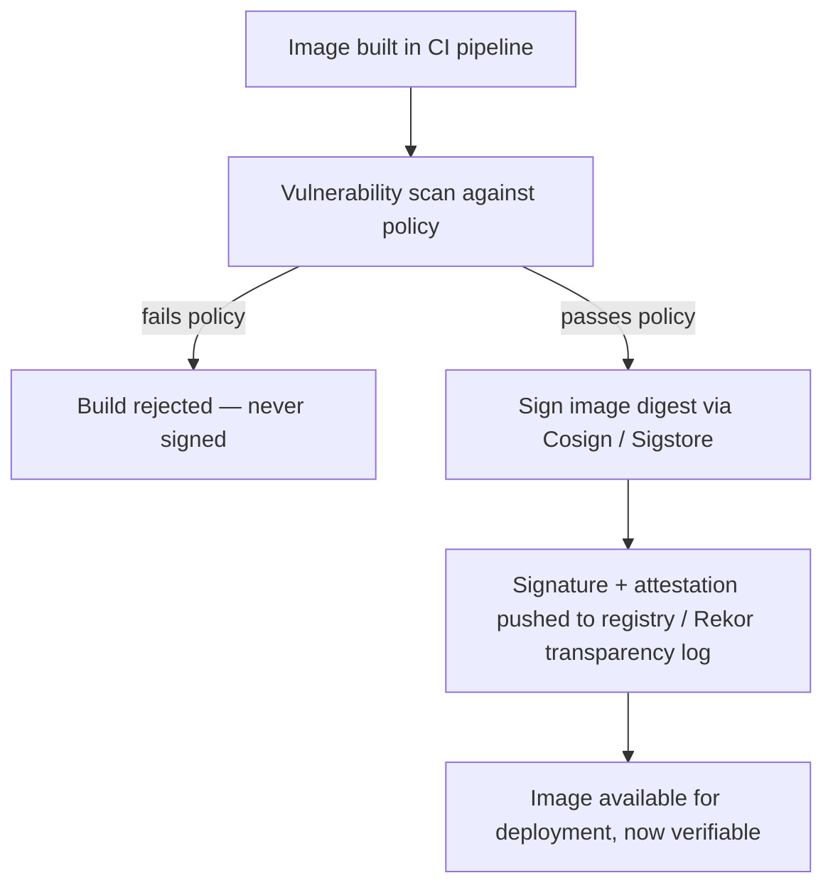
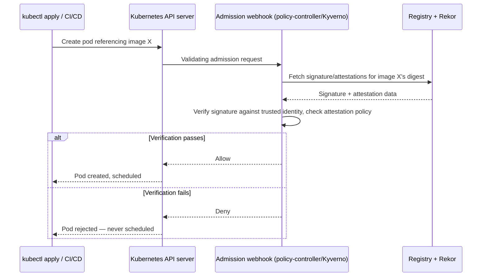

## Question
Two containers on the default `bridge` network can't resolve each other by container name, but two containers on a user-defined bridge network can. Explain the underlying difference in how Docker handles DNS resolution between these two network types.

## Quick Answer
A verified image supply chain has two halves working together: a **signing pipeline** that cryptographically signs each image after it's built and passed vulnerability scanning (using a mechanism like Sigstore's Cosign, or Docker Content Trust/Notary), and an **admission-control gate** at the orchestrator level that verifies that signature — and checks scan results/policy — before allowing any pod or container to be scheduled, rejecting anything unsigned or non-compliant regardless of how it was submitted.

## Detailed Answer

### Stage 1: Build and Scan
Every image build happens through a controlled CI pipeline — not ad hoc `docker push` from a developer machine — so the pipeline itself can be trusted as the source of what gets signed. Immediately after build:
- A **vulnerability scanner** (Trivy, Grype, or a commercial equivalent) evaluates the image against known CVE databases, checking both OS packages and application-layer dependencies (language package manifests baked into the image).
- Scan results are evaluated against a defined **policy** (e.g., "no unpatched Critical/High CVEs with an available fix," or an allow-list for accepted, tracked exceptions) — images failing policy are rejected here, before signing, so a failing scan structurally can never produce a signed artifact.

### Stage 2: Cryptographic Signing
Images that pass are signed using a **content-addressable signing mechanism**. In the Sigstore model (Cosign being the common tool):
- The image's content digest (a SHA-256 hash of the image manifest, uniquely identifying its exact content — not its tag, which is mutable) is signed using a private key, or — in Sigstore's **keyless signing** model — using a short-lived certificate issued by Fulcio after the signer authenticates via an OIDC identity (a CI pipeline's own workload identity, not a long-lived secret key that could leak).
- The resulting signature is pushed to the registry alongside the image (or to a public transparency log — Sigstore's **Rekor** — providing an immutable, publicly auditable record of *what* was signed, *when*, and *by which identity*, which is what makes keyless signing viable despite having no long-lived private key to protect).

### Stage 3: Admission Control at Deploy Time
This is the enforcement gate that makes the first two stages actually matter — without it, signing is just metadata nobody checks. In Kubernetes, this is implemented as a **validating admission webhook** (tools like Kyverno, OPA/Gatekeeper, or Sigstore's own `policy-controller`) that intercepts every pod creation request before it's persisted to `etcd` or scheduled to a node:

1. The admission controller extracts the image reference(s) from the incoming pod spec.
2. For each image, it fetches the associated signature from the registry (or Rekor) and **cryptographically verifies** it against the trusted signing identity/key configured in policy — confirming the image digest matches what was actually signed, not just that *a* signature exists.
3. It can additionally verify **attestations** — signed metadata beyond just "this image is legitimate," such as the actual vulnerability scan result attached as a signed in-toto attestation, letting the admission controller enforce "must have passed a scan with zero Critical CVEs" as policy, not just "must be signed."
4. If verification fails — no signature, signature from an untrusted identity, digest mismatch, or a failing attached attestation — the admission request is **rejected outright**, and the pod is never scheduled, regardless of who submitted the manifest or through what path (`kubectl apply`, a CI/CD pipeline, a compromised credential).

## Why the Digest, Not the Tag, Matters
Image tags (`myapp:latest`, `myapp:v1.2.3`) are mutable pointers — a tag can be repointed to a different image content at any time, which is precisely the supply-chain weakness this whole design closes. Signing and verification operate on the **content digest** (`sha256:abc123...`), an immutable hash of the actual image content. Admission policy should pin deployments to digests (or verify that a tag currently resolves to a digest with a valid signature at admission time, re-checked on every deploy) rather than trusting a tag's historical reputation — otherwise an attacker who can repoint a tag (via compromised registry credentials, for instance) can substitute unsigned or malicious content under a previously-trusted name.

## Production Implications
- Keyless signing (Sigstore/Fulcio/Rekor) removes the operational burden and risk of long-lived private key management, replacing it with short-lived, workload-identity-bound certificates and a public, auditable transparency log — a meaningfully different (and for most CI-driven pipelines, stronger) trust model than traditional static-key signing.
- Enforce admission control in **deny-by-default** mode for any namespace handling production or internet-facing workloads — an admission controller configured to only warn/log on failed verification provides visibility, not actual supply-chain guarantee.
- Attach vulnerability scan results as signed attestations, not just as a side-channel CI check — a scan result that isn't cryptographically bound to the image and verified at admission time can be bypassed by anyone who can submit a manifest directly, defeating the purpose of having run the scan at all.
- Test the admission policy's failure mode explicitly (attempt to deploy an unsigned or tampered image in staging) as part of the pipeline's own validation — a supply-chain control that's never been observed to actually reject something is unverified in the one way that matters most.

<Callout variant="tip" title="Key Takeaways">
Signing alone only produces verifiable metadata; the actual guarantee comes from an admission-control gate that refuses to schedule anything whose signature and attached policy attestations don't check out, closing the gap between "we scanned and signed our images" and "only scanned, signed images can actually run."
</Callout>

---
