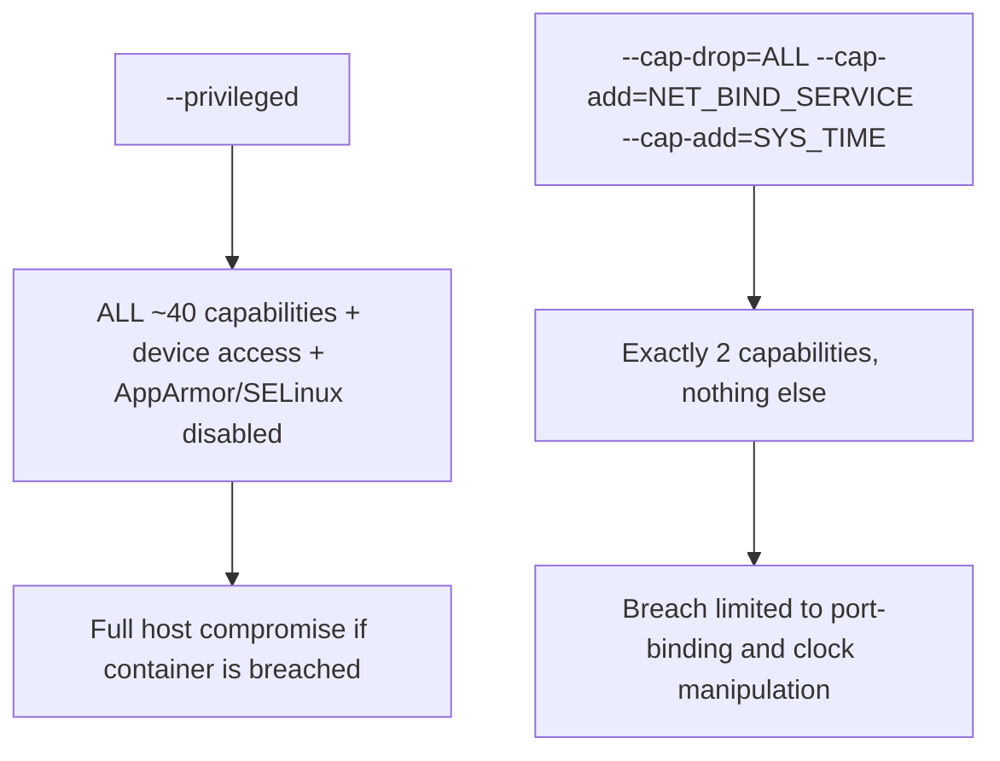

## Question
A container needs to bind to a privileged port and adjust system time as part of its function, but your security policy forbids `--privileged`. Explain the capability-based alternative, name the specific capabilities required, and articulate why granular capability grants are architecturally superior to the privileged flag.


## Quick Answer
Instead of `--privileged` (which grants every root capability plus device access), grant only `CAP_NET_BIND_SERVICE` for binding to ports below 1024 and `CAP_SYS_TIME` for adjusting the system clock — the two specific capabilities the workload actually needs.

## Detailed Answer
The Linux kernel doesn't treat "root" as one monolithic power. Since kernel 2.2, root's traditional abilities are split into roughly 40 individually-grantable **capabilities** — `CAP_NET_BIND_SERVICE`, `CAP_SYS_ADMIN`, `CAP_CHOWN`, `CAP_SYS_TIME`, and so on. A non-root process holding one specific capability can perform that one root-level operation and nothing else. Docker containers, by default, run with a curated *subset* of these capabilities (roughly 14, covering things like `CAP_CHOWN` and `CAP_KILL`) — already dropping the most dangerous ones like `CAP_SYS_ADMIN` and `CAP_SYS_MODULE` even without `--privileged`.

For this scenario, the workload needs two things a default container can't do:

- **Binding to a privileged port (below 1024)** requires `CAP_NET_BIND_SERVICE`. Without it, a process attempting to bind port 80 or 443 gets `EACCES` even if it's running as root inside the container, because the kernel checks the capability, not the UID, for that specific syscall.
- **Adjusting system time** requires `CAP_SYS_TIME`. This governs `settimeofday()`, `adjtimex()`, and related calls that change the clock — relevant for NTP daemons or time-sync sidecars.

Both are grantable individually:

```bash
docker run -d \
  --cap-drop=ALL \
  --cap-add=NET_BIND_SERVICE \
  --cap-add=SYS_TIME \
  -p 80:80 \
  my-time-sync-service
```

`--cap-drop=ALL` first strips even Docker's default capability set, then `--cap-add` re-adds exactly the two needed. The result is a process that can bind port 80 and adjust the clock, but cannot load kernel modules, access arbitrary devices, remount filesystems, or perform any of the dozens of other operations `--privileged` would have handed over wholesale.



## Production Implications
- `--privileged` also disables seccomp, AppArmor/SELinux confinement, and grants access to all host devices under `/dev` — it is not just "more capabilities," it's a near-total removal of the container security boundary. Reserve it for genuinely device-management workloads (e.g. `docker`-in-`docker` build agents), never as a default fix for permission errors.
- Audit which capabilities a running container actually holds with `docker inspect --format '{{.HostConfig.CapAdd}} {{.HostConfig.CapDrop}}' <container>`, or `getpcaps <pid>` from the host for the live, effective set.
- Standard practice: start every production container definition with `cap_drop: ["ALL"]` in Compose or the Kubernetes `securityContext`, and add back only what's demonstrably needed — treat every `--cap-add` as something that must be justified in a review, not a default.
- `CAP_NET_BIND_SERVICE` alone is often preferable to running the app on a high port and remapping with `-p 80:8080`, since it avoids an extra layer of port translation and lets the app's own logging/metrics reflect the real bound port.

<Callout variant="tip" title="Key Takeaways">
`--privileged` is an all-or-nothing root grant; capability flags let you hand over exactly the one or two kernel powers a workload needs and nothing more, which is the actual architectural point of least privilege.
</Callout>

---
