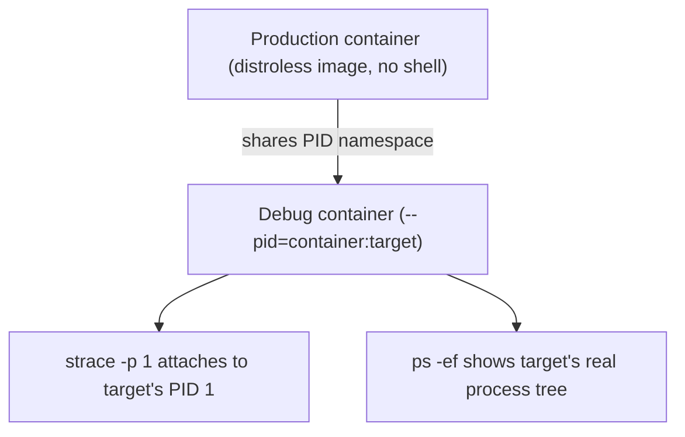

## Question
Explain, namespace by namespace (PID, NET, MNT, UTS, IPC, USER), what specific kernel isolation each one provides to a container, and describe a real scenario where sharing one particular namespace between containers (e.g., `--pid=container:x`) is a deliberate and useful debugging technique.

## Quick Answer
A container isn't one isolation mechanism — it's six independent Linux namespaces (PID, NET, MNT, UTS, IPC, USER), each walling off a different kernel resource, and you can deliberately share individual namespaces between containers for targeted debugging.

## Detailed Answer
Docker containers have no single "container" primitive in the kernel. Instead, `runc` asks the kernel to create a process with a unique combination of **namespaces** — each one restricting what that process can see or touch for one specific kernel resource. Think of it like giving an employee (the container process) a badge that only lets them see certain floors of a building, where each floor is a different kind of system resource.

- **PID namespace** — The container sees its own process tree, starting at PID 1. It cannot see, signal, or `ps` processes outside its namespace, even though those processes are visible to the host. This is why killing PID 1 inside a container stops the whole container.
- **NET namespace** — A separate network stack: its own interfaces, routing table, iptables rules, and port space. A container can bind port 80 without conflicting with another container also bound to port 80, because each has its own loopback and interface set.
- **MNT namespace** — A private view of the filesystem mount table. The container's root filesystem (its image layers via **OverlayFS**) and any bind mounts are invisible to other containers and largely invisible to the host's own mount table.
- **UTS namespace** — Isolates the hostname and NIS domain name, letting each container set its own `hostname` without affecting the host or siblings.
- **IPC namespace** — Isolates System V IPC objects and POSIX message queues, so two containers can't accidentally read each other's shared memory segments or semaphores.
- **USER namespace** — Maps container-internal UIDs (including root, UID 0) to unprivileged UIDs on the host. A process that's "root" inside the container may map to an unprivileged host UID like 100000, which is the single most effective mitigation against container-to-host privilege escalation.

## Namespace Sharing as a Debugging Technique
The deliberate exception proves the rule. `docker run --pid=container:target-name` starts a *new* container that keeps its own MNT, NET, UTS, and IPC namespaces but **joins the target container's PID namespace**. Your debug container can now run `ps`, `strace`, or `gdb` against the target's processes directly — something impossible from the host's own PID namespace without extra tooling, and often impossible from inside the target container itself because production images deliberately ship without a shell or debugging tools.

## Production Implications
- Use `docker run -it --pid=container:app --net=container:app --cap-add=SYS_PTRACE nicolaka/netshoot` to attach a full debugging toolkit to a minimal production container without rebuilding its image.
- USER namespace remapping (`--userns-remap`) trades some compatibility (certain volume permission edge cases) for real defense-in-depth against container breakout — enable it by default in multi-tenant environments.
- Namespace sharing is scoped per-flag: sharing PID doesn't imply sharing NET or MNT, so you can attach process visibility without also exposing the target's filesystem or network stack.
- `lsns` on the host lets you audit exactly which namespaces exist and which processes belong to each, which is the first place to look when isolation behaves unexpectedly.

<Callout variant="tip" title="Key Takeaways">
Container isolation is six separate, independently controllable walls, not one — and knowing that lets you selectively lower exactly one wall (like PID) for debugging without giving up the rest.
</Callout>

---
