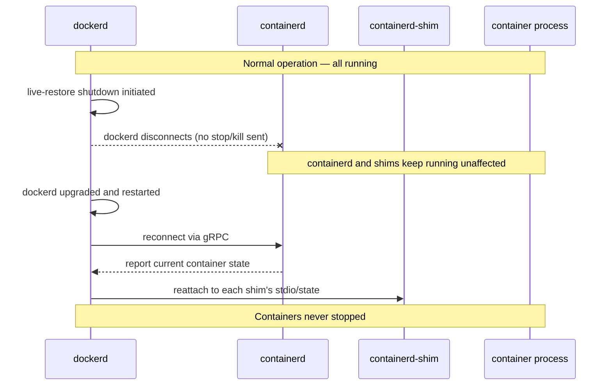

## Question
You need to perform a zero-downtime Docker Engine upgrade on a host running stateful production containers. Explain how `live-restore` allows containers to keep running through a daemon restart, what it does *not* protect against, and what happens if the containerd/shim architecture itself needs an upgrade at the same time.

## Quick Answer
`live-restore` lets `dockerd` stop and restart — for an upgrade or a crash recovery — without killing running containers, because it explicitly tells `dockerd` to leave `containerd` and its per-container shims running independently and simply **reattach** to them afterward, rather than tearing anything down; it does not protect against upgrades that touch `containerd` or the shim layer itself, or against networking state that only `dockerd` manages.

## Detailed Answer
Without `live-restore` enabled, a `dockerd` shutdown is configured (by default, historically) to also stop all running containers as part of a clean shutdown sequence — reasonable for a single-host dev setup, disruptive for a production host mid-upgrade. `live-restore` (`"live-restore": true` in `daemon.json`) changes that default: on shutdown, `dockerd` disconnects from `containerd` without issuing any stop/kill commands to the containers it manages. Because — as covered in the containerd/shim architecture — the actual container processes are parented by their `containerd-shim` processes and supervised by `containerd`, not by `dockerd` directly, this disconnection is safe: the containers simply keep running, unaware that `dockerd` even went away.

When the new `dockerd` version starts back up, it reconnects to the still-running `containerd`, queries the current state of all containers, and **reattaches** — reconnecting stdio streams, resuming log collection, re-registering the containers in its own internal state — without ever having sent a stop, start, or restart command to any of them. From the container process's perspective, nothing happened at all.

## What live-restore Does Not Protect Against

- **containerd or shim-level upgrades.** `live-restore` decouples `dockerd`'s lifecycle from the containers, but it does nothing to decouple `containerd` or `containerd-shim`'s lifecycle from them. If the upgrade also needs to bump the `containerd` version — a common pairing, since Docker Engine releases frequently bundle a corresponding `containerd` version — restarting `containerd` itself is a different, much riskier operation. Whether existing shims survive a `containerd` restart depends on `containerd`'s own persistence and reattachment logic; it is not automatically as safe as a `dockerd`-only restart, and shim protocol or state-format changes between `containerd` versions can break that reattachment outright.
- **Networking state owned by dockerd.** Some networking constructs — particularly ones involving `iptables` rule management, embedded DNS, and certain overlay network control-plane state — are actively managed by `dockerd` itself, not purely by `containerd`. A `dockerd` outage during the restart window can leave networking in a stale state: existing established connections typically continue working (the kernel-level rules are already in place), but *new* connections, DNS resolution for service discovery, or dynamic network reconfiguration can fail or behave inconsistently until `dockerd` is back and has reconciled state.
- **dockerd-level orchestration features.** Health checks, restart policies, and Swarm-mode reconciliation are evaluated by `dockerd`, not `containerd`. During the gap where `dockerd` is down, a container that crashes won't be restarted by a restart policy until `dockerd` comes back — `live-restore` guarantees *already-running* containers keep running, not that the full operational feature set stays active throughout the gap.
- **In-flight requests to dockerd's own API.** Anything talking to the Docker API/CLI during the restart window fails or blocks until `dockerd` is back — `live-restore` protects container uptime, not Docker Engine API availability.

## If containerd/Shim Itself Needs an Upgrade
This is the genuine edge case where `live-restore`'s guarantee breaks down. If the upgrade requires a new `containerd` binary, `containerd` itself must be restarted, and unlike `dockerd`, `containerd`'s restart safety for already-running shims depends on version-to-version compatibility of its own internal state format and shim API — this is generally handled carefully across normal point releases, but a major version jump or a shim protocol change is exactly the scenario where reattachment can fail, potentially leaving orphaned shims that `containerd` can no longer manage, or requiring a full container restart as an unavoidable part of the upgrade despite `live-restore` being enabled.

## Production Implications
- Enable `live-restore` as a baseline production setting (`{"live-restore": true}` in `/etc/docker/daemon.json`), but don't treat it as a substitute for genuinely rolling, health-checked deployment strategies for anything requiring guaranteed request-level continuity.
- Before any upgrade, check whether it bundles a `containerd` version bump — Docker Engine release notes specify this — and treat those upgrades with the same caution as a `containerd` restart, not a routine `dockerd`-only bounce.
- Test the specific upgrade path (old containerd/shim version → new) in staging first when a major version jump is involved, since shim reattachment compatibility isn't something `live-restore`'s existence guarantees on its own.
- Monitor for orphaned shim processes after any upgrade involving `containerd` — `ctr containers list` and comparing against `docker ps` output surfaces state drift if reattachment didn't fully succeed.

<Callout variant="tip" title="Key Takeaways">
`live-restore` only decouples `dockerd`'s own lifecycle from running containers — it doesn't extend that same guarantee to `containerd` or shim-level upgrades, which remain the real risk window in a zero-downtime Docker Engine upgrade.
</Callout>

---
