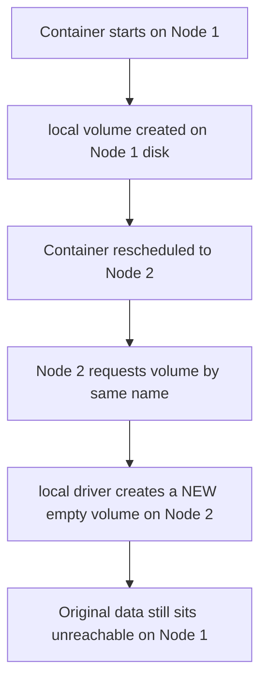

## Question
A team migrating from a single Docker host to a small Swarm/multi-host setup discovers that named volumes don't "follow" a rescheduled container to another node. Explain why this happens and what class of solution is required.

## Quick Answer
The default `local` volume driver stores data as an actual directory on **one specific host's disk**, so it has no concept of following a container that gets rescheduled to a different node — the volume stays exactly where it was created, and the container just doesn't find its data there anymore.

## Detailed Answer
A named volume created with the default driver (`docker volume create mydata`, or implicitly via a Compose `volumes:` entry) is backed by a directory under `/var/lib/docker/volumes/` **on the machine where it was created**. On a single host, this is invisible and unremarkable — every container on that host can see the same disk, so a volume is always "there" no matter which container attaches to it. Nothing about the `local` driver is host-aware in a distributed sense, because on a single host there was never a second host to be aware of.

That assumption breaks the moment scheduling spans multiple nodes. In a Swarm (or similarly, an unconfigured Kubernetes setup using a hostPath-style default), a service's container can be rescheduled to a different physical or virtual machine — for load balancing, node failure, or maintenance. The volume, however, is not a distributed object; it's a directory that still only exists on the original node's disk. The rescheduled container, now running on a different machine, requests a volume with the same name, and Docker happily creates a **brand-new, empty** volume with that name on the new node — silently, with no error, because from the local driver's perspective there's nothing wrong: it was asked for a volume by name and it provided one.

This is why it looks like the volume "doesn't follow" the container — there was never a mechanism to move it in the first place, only an assumption (valid on a single host) that the storage would always be local to wherever the container ran.

<Callout variant="tip" title="Key Takeaways">
Multi-host container scheduling requires a **volume driver aware of shared or networked storage** — NFS, cloud block-storage plugins (EBS, Azure Disk), or a distributed filesystem — because the default local driver's storage is physically pinned to whichever single node created it.
</Callout>

---
