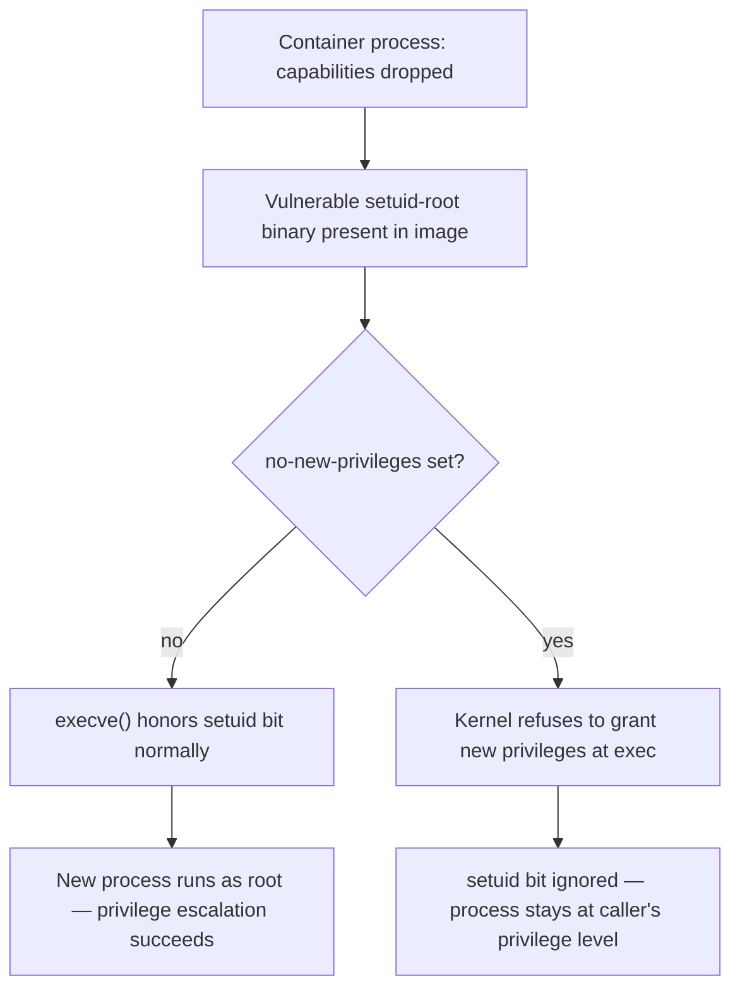

## Question
Even after reordering Dockerfile instructions for cache-friendliness, your team's CI runners (ephemeral, ban `--cache-from` layer reuse) still reinstall dependencies every run. What BuildKit feature addresses this specific problem, and how does it differ from ordinary layer caching?

## Quick Answer
`no-new-privileges` sets the kernel's `PR_SET_NO_NEW_PRIVS` flag, which blocks **any** mechanism by which a process could gain privileges it didn't already have at `execve()` time — including a `setuid` binary's normal ability to run with its owner's privileges — which is exactly the gap that dropping capabilities at container start leaves open, since capability dropping only controls what the *original* process can do, not what a *newly executed* binary is allowed to acquire.

## Detailed Answer
Capability dropping (`--cap-drop=ALL --cap-add=...`) restricts the capability set of the container's initial process at the moment the container starts. That's a real, meaningful restriction — but it says nothing about what happens when that process later calls `execve()` on a different binary, particularly a **setuid** binary.

A `setuid` binary is a program with the setuid bit set in its file permissions, meaning when *any* user executes it, the resulting process runs with the *file owner's* UID (commonly root) rather than the invoking user's UID — this is the classic Unix mechanism behind tools like `passwd`, `sudo`, and `ping` needing elevated access for one specific, narrow operation while being runnable by ordinary users. Critically, this privilege gain happens **at exec time**, driven by the kernel's normal exec/setuid handling, entirely independent of whatever capability set the *calling* process had going in.

This is exactly the loophole in the scenario: even if the container's main process has had every unnecessary capability dropped, if a vulnerable setuid binary sitting in the image can be reached and executed (whether through the compromised application invoking it, or an attacker's injected code calling `execve()` on it directly), the kernel's normal setuid mechanics still apply — the new process gets the file owner's privileges (root) via the standard, unrelated setuid pathway, completely bypassing whatever capability set its parent had.

## What no-new-privileges Actually Prevents
Setting `PR_SET_NO_NEW_PRIVS` on a process (and it's inherited by all its children, permanently — it cannot be unset once applied) tells the kernel: no `execve()` call by this process or any descendant may result in a process with **more** privilege than the caller already had. Concretely, this blocks:

- **setuid/setgid binary execution from granting elevated privilege** — the binary still executes, but the kernel ignores the setuid/setgid bits' privilege-granting effect; the resulting process runs at the caller's actual privilege level instead.
- **File capabilities** (`CAP_*` attached to a binary via extended attributes, e.g. `setcap cap_net_raw+ep /some/binary`) from being honored — the same "gain privilege at exec" pathway, blocked the same way.
- Certain **LSM (AppArmor/SELinux) transition rules** that would otherwise grant a process a different, more permissive security context upon executing a specific binary — `no-new-privileges` constrains this transition from increasing privilege as well.

It does **not** retroactively remove capabilities or permissions the process already holds, and it doesn't prevent execution of the binary itself — only the *privilege gain* that would normally accompany that execution. A process can still run a setuid binary with `no-new-privileges` set; it just runs it as itself, not as the file owner.

## Why Capability Dropping Alone Is Insufficient
Capability dropping and `no-new-privileges` operate on different axes of the same problem, and neither substitutes for the other:

- Capability dropping restricts **what the current process, right now, is allowed to do** — the standing capability set.
- `no-new-privileges` restricts **whether any future `execve()` can increase that set** — the exec-time privilege-gain pathway.

A container can have zero unnecessary capabilities on its main process and still be fully exploitable via a vulnerable setuid binary, precisely because capability dropping never touches the setuid mechanism at all — setuid privilege escalation isn't a capability-based mechanism, it's a separate, older UID-based mechanism that capability restrictions don't intersect with unless `no-new-privileges` is also set to specifically close that exec-time gap.

## Production Implications
- Set `--security-opt=no-new-privileges` (or `no_new_privileges: true` in Compose, `securityContext.allowPrivilegeEscalation: false` in Kubernetes, which maps to the same kernel flag) as a default on every container, not just internet-facing ones — the cost of enabling it is near zero for workloads that don't legitimately need setuid escalation.
- Audit images for unnecessary setuid/setgid binaries directly (`find / -perm -4000 -o -perm -2000` inside the image build) and remove ones the application doesn't actually need — `no-new-privileges` neutralizes the escalation *outcome*, but reducing setuid binary surface area removes the exploitable entry point in the first place.
- Legitimate uses of `sudo`/setuid tooling inside a container (rare, and usually a design smell) are fundamentally incompatible with `no-new-privileges` — if a workload genuinely needs setuid-based privilege transitions, that's a signal to reconsider the container's privilege model rather than disable this protection.
- Combine with capability dropping and a read-only root filesystem as complementary layers — `no-new-privileges` closes the exec-time escalation path, capability dropping restricts standing privileges, and a read-only filesystem prevents an attacker from *introducing* a new setuid binary into the image in the first place.

<Callout variant="tip" title="Key Takeaways">
Capability dropping only controls the privileges a process already has; `no-new-privileges` is the control that stops it from gaining more via exec — including through a vulnerable setuid binary — which is why hardened profiles need both, not either alone.
</Callout>

---
