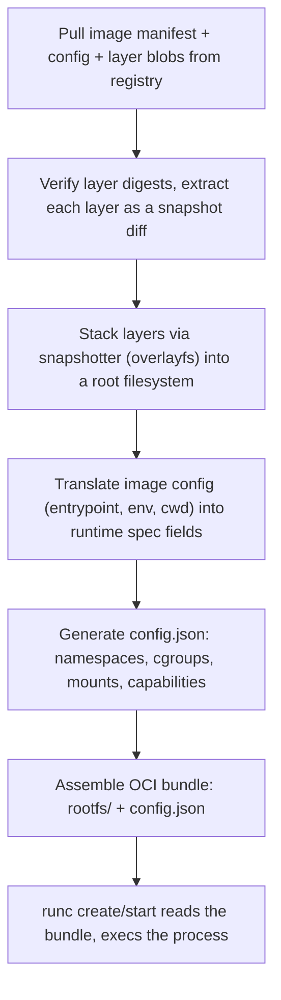

## Question
A container running a simple shell script exits immediately after starting, even though the script "runs forever" when tested locally. What container lifecycle rule explains this behavior?

## Quick Answer
The **OCI image manifest** describes a *static image* — its layers, config, and how to assemble a filesystem — while the **OCI runtime spec** (`config.json`) describes a *specific process about to run*: namespaces, cgroups, mounts, and the entrypoint, and a container runtime's job is to turn the first into the second.

## Detailed Answer
These are two different specifications under the OCI umbrella, solving two different problems, and conflating them is a common source of confusion.

**The image manifest** (`application/vnd.oci.image.manifest.v1+json`) is what a registry serves when you pull an image. It's a JSON document listing:
- A reference to the **image config** (environment variables, entrypoint/cmd, exposed ports, working directory — the "recipe" metadata).
- An ordered list of **layer digests**, each pointing to a compressed tarball (typically `application/vnd.oci.image.layer.v1.tar+gzip`) that represents one filesystem diff.

None of this describes a *running* process. It's purely about content-addressable storage and how to reconstruct a filesystem — the manifest is content, not configuration for execution.

**The runtime spec** (`config.json`, per the [OCI Runtime Specification](https://github.com/opencontainers/runtime-spec)) is entirely different: it's the file `runc` actually reads to create a container process. It specifies the root filesystem path, the process to exec and its arguments/environment, which namespaces to create, cgroup resource limits, mount points, and Linux-specific fields like capabilities and seccomp profiles. This is execution configuration, not image content.

## From Pulled Image to Running Bundle
A container runtime (here, `containerd`, coordinating with `runc`) bridges the two specs through a defined sequence:

1. **Pull and verify** — `containerd` fetches the manifest, the image config, and each layer blob, verifying content digests match what the manifest claims.
2. **Snapshot assembly** — Layers are extracted and stacked by a snapshotter (typically the `overlayfs` snapshotter), producing a single merged root filesystem view — this becomes `rootfs/` in the eventual bundle.
3. **Config translation** — The image config's `Entrypoint`, `Cmd`, `Env`, `WorkingDir`, and `ExposedPorts` fields are mapped onto the corresponding runtime spec fields (`process.args`, `process.env`, `process.cwd`), merged with runtime-level settings the user requested (`--memory`, `--cap-add`, volume mounts) that have no equivalent in the image manifest at all — those only exist at the runtime-spec layer because they're properties of *this specific run*, not the image.
4. **Bundle assembly** — The result is an **OCI bundle**: a directory containing `rootfs/` (the assembled filesystem) and `config.json` (the generated runtime spec) sitting side by side.
5. **Handoff to runc** — `runc create <id> --bundle <path>` reads exactly that bundle and does the actual kernel work — namespace creation, cgroup setup, mount namespace population, and finally `execve()` of the specified process.

## Production Implications
- `docker inspect` reflects mostly image-manifest-derived data (layers, config); the generated runtime spec is ephemeral and lives under `containerd`'s state directory (commonly `/run/containerd/.../config.json`) — useful to inspect directly when debugging mismatches between what you *asked* for and what actually ran.
- Multi-arch images publish an **image index** (a manifest of manifests, one per platform) above the per-platform image manifest — the runtime selects the right platform-specific manifest before this whole pipeline even starts.
- Because runtime-spec fields like resource limits and mounts have no image-manifest equivalent, two `docker run` invocations of the identical image can produce very different `config.json` files — the image is a constant input, the bundle is not.
- Tools that operate purely on OCI bundles (like `runc` itself, or `crun`) never touch a registry or a manifest at all — they're a layer *below* image handling, which is why runtime spec and image manifest can evolve as genuinely separate specifications.

<Callout variant="tip" title="Key Takeaways">
The image manifest is a recipe for a filesystem; the runtime spec is a recipe for a process — and the runtime's real work is translating and merging the first into the second before `runc` ever runs.
</Callout>

---
