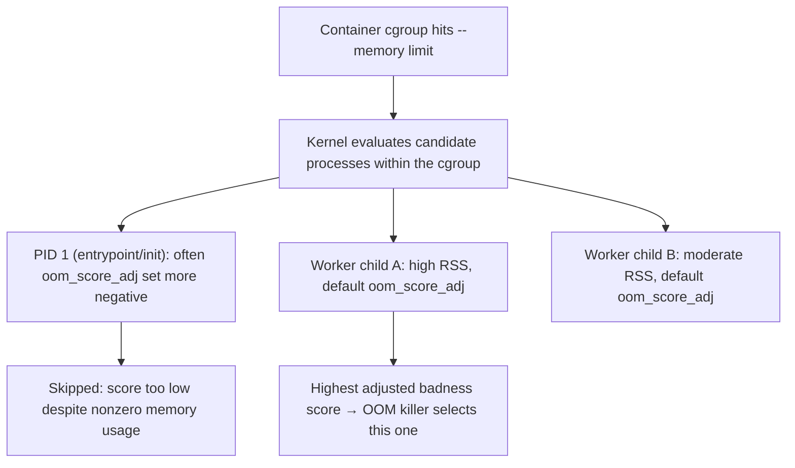

## Question
Your Go application's final image is 900MB because it includes the full compiler toolchain. Design a multi-stage build that resolves this, and explain precisely what gets carried between stages and what gets discarded.

## Quick Answer
The OOM killer selects a victim using a **badness score** derived from each process's memory footprint adjusted by `oom_score_adj`, and because PID 1 inside a container's PID namespace commonly receives special init-process treatment and a more negative adjustment, the kernel can end up killing a *different*, seemingly smaller process instead of the one actually consuming the most memory.

## Detailed Answer
When a cgroup hits its memory limit (or the system as a whole is under global memory pressure), the kernel's OOM killer doesn't simply kill "the biggest process." It computes a **badness score** for every candidate process, primarily driven by RSS plus swap usage, and then applies a per-process adjustment: `oom_score_adj`, a value from -1000 to +1000 readable/writable at `/proc/<pid>/oom_score_adj`. A value of -1000 makes a process effectively immune to the OOM killer; +1000 makes it maximally likely to be chosen. The final decision picks the highest-scoring (most "killable") process among the candidates the kernel is allowed to consider for this event.

**Cgroup-aware OOM killing** (the default and more predictable behavior under cgroup v2, and available with `memory.oom_group` under specific configurations) changes the *scope* of that candidate pool: instead of comparing badness scores across the entire host, the kernel can be constrained to compare only among processes within the offending cgroup — the container that actually breached its own `--memory` limit. This is generally the more correct behavior for containerized workloads, since without it, a memory-hungry process in one container's cgroup could theoretically influence the kill decision for a completely unrelated container, or worse, the host's own processes could become collateral candidates for a limit that was never about the host at all.

## PID 1's Special Role
Inside a container's PID namespace, the container's entrypoint process runs as PID 1 — and PID 1, in any PID namespace, inherits some of the same special kernel treatment that real host PID 1 (`init`/`systemd`) gets: default signal handling behaves differently (PID 1 ignores signals it hasn't explicitly registered a handler for, including `SIGKILL`'s *default disposition* — though `SIGKILL` still forcibly terminates it, just without normal signal-delivery semantics applying), and many init systems and container runtimes explicitly set a lower (more negative) `oom_score_adj` for PID 1, on the reasoning that killing the container's init process is more disruptive than killing a single worker/child process — losing PID 1 tears down the entire container, whereas losing a child process might be recoverable.

This creates the exact scenario in the question: if a container runs a multi-process workload — say, an init/supervisor process (`tini`, or a custom entrypoint script) as PID 1, spawning several worker child processes — and one worker balloons in memory usage, the OOM killer's badness comparison isn't purely "who has the most RSS." PID 1's adjusted (more negative) score can keep it off the chopping block even if it happens to have non-trivial memory usage of its own, while among the *remaining* candidates, the kernel picks whichever child scores highest — which may or may not be the single largest consumer, depending on how `oom_score_adj` values were set across the process tree and whether any other process has an even less favorable adjustment.

## Production Implications
- Check `/proc/<pid>/oom_score` (the computed, current badness score) and `/proc/<pid>/oom_score_adj` (the adjustment) for every process in the container's tree *before* the next OOM event, not after — post-mortem, the killed process is already gone and its score history isn't retained.
- If a specific worker process should always be preferred as the OOM victim over others (e.g., a batch job worker over a request-handling process), set its `oom_score_adj` explicitly higher (more positive) rather than relying on default kernel heuristics to make that call correctly.
- `dmesg`/kernel logs after an OOM-kill report the selected PID, its `oom_score`, and often a memory breakdown of the cgroup at kill time — cross-reference the killed PID against `docker top <container>` history (or application-level PID logging) to confirm which logical process it actually was, since PIDs are frequently reused quickly after a kill.
- Design multi-process container entrypoints (supervisors, `tini`-wrapped multi-worker setups) with awareness that PID 1 surviving an OOM event while a child dies can leave the container in a degraded-but-alive state rather than restarting cleanly — decide deliberately whether that's the desired failure mode or whether `memory.oom_group` (killing the whole cgroup together) is more appropriate for the workload.

<Callout variant="tip" title="Key Takeaways">
The OOM killer doesn't simply kill the largest process — it kills the highest-scoring one after `oom_score_adj` adjustments, and PID 1's typically favorable adjustment means the process most people assume should die (the biggest one) isn't always the one that actually does.
</Callout>

---
