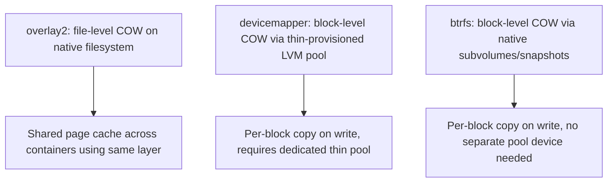

## Question
Your team deploys using the `latest` tag and occasionally ends up with different code running on different hosts despite "not changing anything." Explain why tag-based deployment without immutable references is risky in production.

## Quick Answer
`overlay2` does copy-on-write at the **file level** on top of a native filesystem, sharing a single page cache across containers using the same image layer, while `devicemapper` and `btrfs` do copy-on-write at the **block level** using their own snapshotting primitives — a structural difference that shows up directly in startup latency and disk footprint at high density.

## Detailed Answer
All three drivers solve the same problem — stacking read-only image layers under a writable container layer — but at fundamentally different layers of the storage stack.

**overlay2** works entirely at the **VFS/file level**, using the kernel's native OverlayFS to merge directories (`lowerdir` + `upperdir` → `merged`) without needing a dedicated block device or thin-provisioned volume underneath. Because it's file-oriented and sits directly on top of whatever filesystem (ext4, xfs) the host already uses, every container sharing a base image layer shares the **same underlying files and the same page cache entries** for those files — reading a shared library from a common base image costs page cache memory once, not once per container.

**devicemapper** (in `direct-lvm` mode, the only supported production configuration) works at the **block device level**, using thin provisioning: each image layer and each container's writable layer is a **thin snapshot** — a virtual block device that shares underlying blocks with its parent until a write triggers a block-level copy. This requires a dedicated thin pool (a preallocated LVM volume), and copy-on-write happens per-block, independent of file boundaries.

**btrfs** also does block-level, filesystem-native copy-on-write via its own subvolume/snapshot mechanism, similar in spirit to devicemapper's block-level model but implemented as first-class btrfs functionality rather than a generic device-mapper thin pool — it doesn't need a separate thin pool device, since snapshotting is native to the filesystem itself.

## Operational Implications at Density

| Driver | Startup Latency | Disk Usage Pattern | Density Behavior |
|--------|------------------|---------------------|-------------------|
| overlay2 | Fastest — mounting overlay dirs is cheap, no block allocation step | Layers deduplicated on disk by content, page cache shared | Scales well; the kernel-native default for a reason |
| devicemapper | Slower — thin snapshot creation/activation per container has real overhead | Thin pool must be sized and monitored; pool exhaustion is a hard failure mode | Requires careful thin-pool capacity planning; misconfigured loop-lvm mode is unsupported and unsafe in production |
| btrfs | Moderate — native snapshot is fast but btrfs fragmentation under heavy COW churn can degrade over time | Efficient dedup via snapshots, but write-heavy workloads fragment more than ext4/overlay2 | Needs periodic maintenance (balance/defrag) at scale that overlay2 doesn't |

At high container density specifically, `overlay2`'s shared page cache is the decisive factor: dozens or hundreds of containers built from the same base image (say, a common `python:3.12-slim` layer) all read that layer's files from the *same* cached pages in memory, rather than each maintaining an independent block-level view. `devicemapper`'s thin pool, by contrast, introduces a hard capacity ceiling — if the pool fills, new container writes fail outright regardless of how much space appears free at the host filesystem level, a failure mode that has caused real production outages when pools weren't monitored.

## Production Implications
- `overlay2` has been Docker's default and best-supported driver on modern kernels (4.x+) for exactly these reasons — there's rarely a reason to choose `devicemapper` for new deployments unless a very specific storage requirement (e.g. a filesystem devicemapper is layered under for other operational reasons) dictates otherwise.
- If already running `devicemapper`, monitor thin pool usage (`docker info` reports pool metrics) proactively — pool exhaustion doesn't just slow things down, it hard-fails container writes.
- `btrfs` deployments should schedule periodic `btrfs balance` to counteract fragmentation from heavy copy-on-write churn, something `overlay2` on ext4/xfs doesn't require.
- Check `docker info | grep "Storage Driver"` on any host before assuming — some distros or older installs may default differently than expected, and switching drivers requires clearing existing image/container storage, not a live migration.

<Callout variant="tip" title="Key Takeaways">
overlay2's file-level, page-cache-sharing design is why it outperforms block-level drivers like devicemapper and btrfs at high container density, and it's the reason it's the modern default rather than an arbitrary choice.
</Callout>

---
