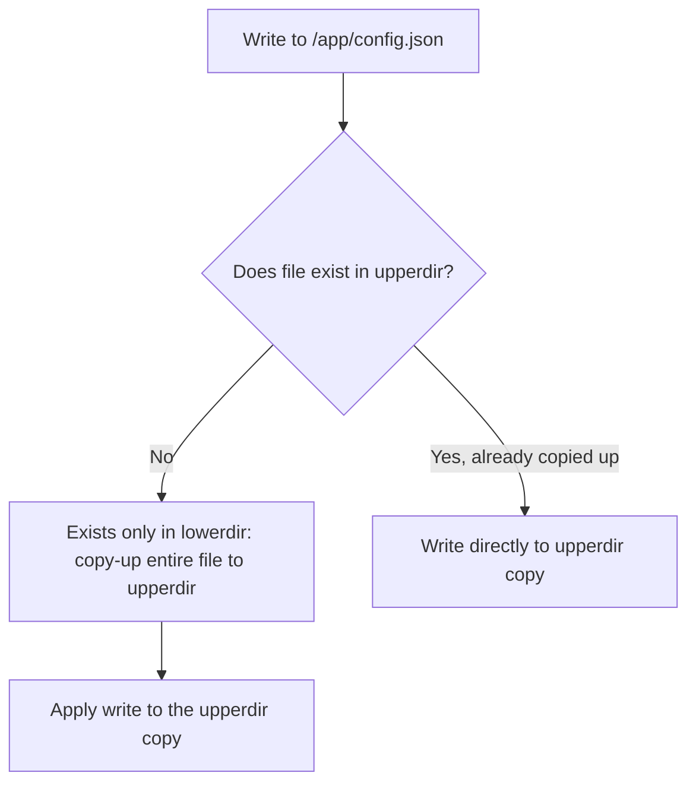

## Question
A build suddenly takes much longer after a teammate added a large `node_modules` folder to the project directory, even though it's never referenced in the Dockerfile. Explain what's happening and how to fix it.


## Quick Answer
OverlayFS uses **copy-on-write**: the first write to any file that exists in a read-only image layer triggers a full-file **copy-up** into the writable layer before the write proceeds, and workloads that touch many small files pay this whole-file-copy penalty over and over.

## Detailed Answer
OverlayFS stacks a `lowerdir` (the read-only, squashed image layers) under an `upperdir` (the container's writable layer), and presents a single merged view through `merged`. This is efficient for reads and for images that share layers across containers — but writes work very differently from a normal filesystem.

When a container writes to a file that only exists in `lowerdir`, OverlayFS can't just patch the bytes in place — the lower layers are read-only and typically shared by other containers using the same image. Instead it performs a **copy-up**: the *entire file* is copied from `lowerdir` into `upperdir`, and only then does the actual write get applied to that copy. A single-byte modification to a 50MB file means copying all 50MB first. For files that don't yet exist, no copy-up is needed — new files are created directly in `upperdir`.

This is precisely why heavy **small-file** write workloads are a known weak spot: each file incurs its own copy-up overhead (open the lower file, allocate space, copy full contents, update metadata) independent of file size, so the *fixed per-file cost* dominates. A workload writing thousands of small files (package extraction, session-file caches, SQLite-per-request patterns) multiplies that fixed cost thousands of times, whereas a bind mount writes straight to the host filesystem with no copy-up step at all — which is exactly why the same workload against a bind mount looks dramatically faster.



## Production Implications
- Mount genuinely hot, write-heavy paths (databases, caches, log directories) as **bind mounts or named volumes** instead of leaving them in the writable OverlayFS layer — this sidesteps copy-up entirely for that path.
- Pre-warm heavily-written files during image build (touch/write them once at build time) so the copy-up cost happens once at image build rather than per-container-start.
- Use `docker system df -v` and layer inspection to check whether large files that get modified at runtime are baked deep into lower image layers — moving them to the last layer or a volume reduces both copy-up size and image bloat.
- Benchmark with `fio` against both the container's writable layer path and an equivalent bind-mounted directory before assuming OverlayFS is "slow" in general — the gap is specific to modify-in-place small-file patterns, not sequential large-file writes.

```bash
# Compare small-file write throughput: writable layer vs bind mount
fio --name=overlay-test --directory=/app/data --rw=randwrite \
    --bs=4k --size=100M --numjobs=4 --group_reporting

fio --name=bindmount-test --directory=/mnt/bind-data --rw=randwrite \
    --bs=4k --size=100M --numjobs=4 --group_reporting
```

<Callout variant="tip" title="Key Takeaways">
Copy-on-write in OverlayFS means the first write to any pre-existing file costs a full-file copy, so route hot small-file write paths to a bind mount or volume instead of the writable layer.
</Callout>

---
