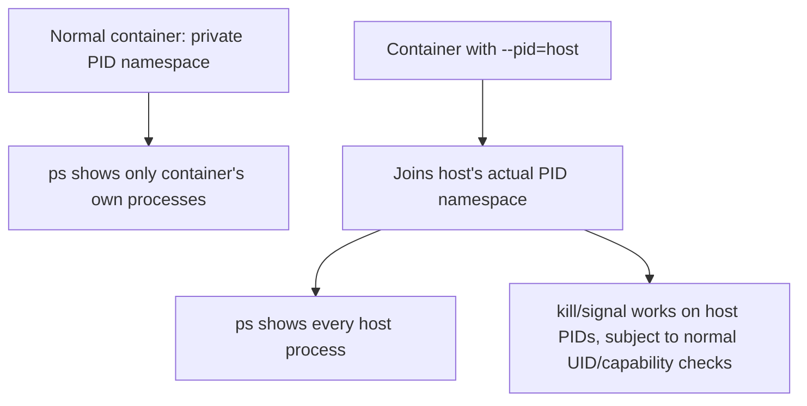

## Question
A container running as an unprivileged process is still able to see and signal processes on the host when run with `--pid=host`. Explain precisely what isolation guarantee is being intentionally broken, and describe one legitimate production use case where this trade-off is justified.

## Quick Answer
`--pid=host` removes the **PID namespace isolation guarantee** entirely — instead of getting its own private process tree, the container joins the host's actual PID namespace, so it can see, and (permissions permitting) signal, every process on the host, not just its own.

## Detailed Answer
Normally, a container's PID namespace is a completely separate process-numbering universe: its own process starts as PID 1, `ps` inside the container shows only that container's processes, and processes outside the namespace are invisible to it entirely — not hidden by permissions, but genuinely absent from what the kernel reports through `/proc` and process-related syscalls for that namespace.

`--pid=host` skips creating a new PID namespace for the container altogether. The container process is placed directly into the **host's own PID namespace** — the same one `init`/`systemd` and every other host process lives in. From inside the container, `ps -ef` now lists every process running on the entire host, `/proc/<pid>` is walkable for any host PID, and — critically — whether the container can actually *signal* those processes depends only on standard Unix permission checks (UID match, capabilities), not on namespace boundaries, because there's no namespace boundary left to enforce.

This is a real, specific removal of one of the six isolation walls — not a general "less secure" statement. NET, MNT, UTS, IPC, and USER namespaces are unaffected by `--pid=host`; only process-tree visibility and signaling reach are opened up. But because PID namespace isolation was the thing preventing a container from even *seeing* host processes (a prerequisite for a huge range of attacks — process injection, credential scraping from other processes' memory via `/proc/<pid>/mem`, signaling arbitrary host daemons), giving it up is a meaningful expansion of what a compromised container can reach.

## A Legitimate Production Use Case
**Host-level monitoring and observability agents** are the standard justified case. A tool like a system-wide APM agent, a process-level metrics exporter, or a security/EDR sidecar fundamentally *needs* to see every process on the host to do its job — that's not incidental access, it's the entire point of the tool. Running such an agent in a normal, PID-isolated container would make it blind to anything outside itself, defeating the purpose of deploying it as infrastructure tooling in the first place.

The trade-off is justified there specifically because:
- The workload's *function* requires host-wide process visibility — it isn't a convenience, it's the requirement.
- These agents are typically deployed from trusted, tightly-controlled images (often vendor-shipped, rarely rebuilt ad hoc), reducing the attack surface that would otherwise make `--pid=host` risky.
- They're usually paired with *other* restrictions — read-only root filesystem, minimal capabilities, no network egress beyond the metrics backend — so `--pid=host` is the one deliberately widened door in an otherwise narrow container, not one relaxation among many.

## Production Implications
- Never combine `--pid=host` with running the container process as root *and* full default capabilities — if PID isolation is gone, capability restriction becomes the primary remaining control on what the container can actually do with the host processes it can now see.
- Audit `--pid=host` usage explicitly in CI/deployment policy — it should require the same review rigor as `--privileged`, since it's a targeted but real removal of a kernel security boundary, not a networking or convenience flag.
- For monitoring agents that only need to *read* process information (not signal), consider whether a narrower alternative — mounting `/proc` from the host read-only, or using an agent built against `/proc` access rather than requiring the full PID namespace join — meets the need with a smaller blast radius.
- Log and alert on any `kill`/signal syscalls originating from `--pid=host` containers targeting PIDs outside their own process tree, since that's the specific capability this flag grants and the one most worth watching.

<Callout variant="tip" title="Key Takeaways">
`--pid=host` doesn't weaken isolation generally — it removes one specific, well-defined wall (PID namespace visibility and signaling), and that trade-off is justified only when a workload's actual job requires host-wide process visibility, like a monitoring or observability agent.
</Callout>

---
