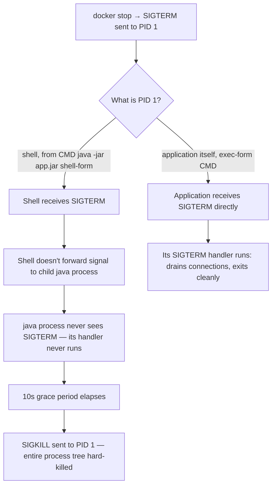

## Question
During a rolling deployment, containers are hard-killed after a 10-second timeout, dropping in-flight requests, even though the application has SIGTERM handling implemented correctly. Diagnose the most likely architectural cause involving PID 1, process supervision, and signal propagation inside the container, and describe the fix.

## Quick Answer
The most likely cause is that the application's correctly implemented SIGTERM handler **never receives the signal in the first place**, because a shell (from a Dockerfile `CMD` written in shell form, or a wrapper script) is running as PID 1 instead of the application itself, and a shell as PID 1 does not forward signals to its child processes by default — `docker stop` sends SIGTERM to PID 1 (the shell), the shell ignores it or doesn't propagate it, and the full timeout elapses before Docker escalates to SIGKILL.

## Detailed Answer
`docker stop` (and orchestrator-driven container termination during a rolling deployment) sends `SIGTERM` to the container's PID 1 — and only PID 1, by default — then waits a grace period (10 seconds unless configured otherwise) before sending `SIGKILL` to force termination if the process hasn't exited. This makes PID 1's exact identity and signal-handling behavior the single most consequential detail in graceful shutdown, and it's frequently not the application at all.

**The common misconfiguration**: a Dockerfile using shell-form `CMD java -jar app.jar` (rather than exec-form `CMD ["java", "-jar", "app.jar"]`) causes Docker to run the command as `/bin/sh -c "java -jar app.jar"`. In this setup, `/bin/sh` becomes PID 1, and the actual application (`java`) runs as a **child** process (PID 2 or later) of that shell. When `SIGTERM` arrives, it goes to PID 1 — the shell — not to the Java process. Standard shells (`sh`, `bash` in default configuration) do **not** automatically forward received signals to their child processes; the shell either ignores SIGTERM (common default shell behavior for a foreground child) or, in some configurations, exits itself without passing anything to the child, leaving the actual application process running, un-notified, until the grace period elapses and `SIGKILL` terminates everything abruptly — including whatever in-flight requests the app was still serving, since it never got the chance to drain them.

A second, related variant: even with **exec-form** `CMD`, if the entrypoint is a **wrapper or supervisor script** (a custom shell script that itself launches the real application as a subprocess, common for setting up environment variables or running migrations before starting the app), that script becomes PID 1 and has exactly the same signal-forwarding problem unless it was explicitly written to trap and forward signals — most ad-hoc wrapper scripts are not.

## Why This Specifically Explains "Handler Implemented Correctly, Still Hard-Killed"
The question states the application's SIGTERM handling is implemented correctly — and that's consistent with this diagnosis precisely because the handler is never being *invoked* at all. The bug isn't in the application's shutdown logic; it's in whether the signal ever reaches the application process to trigger that logic in the first place. This is a common and confusing failure mode specifically because testing the application's shutdown behavior directly (e.g., running it locally and sending SIGTERM to its actual PID) works perfectly — the disconnect only appears once it's wrapped inside a container where PID 1 isn't the application.

## The Fix
- **Use exec-form `CMD`/`ENTRYPOINT`** (`CMD ["java", "-jar", "app.jar"]` instead of `CMD java -jar app.jar`) whenever the application itself can be PID 1 directly — this is the simplest fix and avoids the shell-wrapping problem entirely for applications that don't need shell features (env var expansion, globbing) at startup.
- **When a wrapper script is genuinely necessary** (setup steps before exec'ing the real process), end the script with `exec` before launching the application — `exec java -jar app.jar` as the script's final line replaces the shell process *with* the application process rather than running it as a child, so the application itself becomes PID 1 and receives signals directly.
- **Use a minimal init system as PID 1** when multiple processes genuinely need to run and be supervised (not just a single app), such as `tini` (`ENTRYPOINT ["tini", "--", "java", "-jar", "app.jar"]` or Docker's built-in `--init` flag) — a proper init system is specifically designed to forward signals to children and reap zombie processes correctly, unlike an ad-hoc shell script.
- **Verify the fix directly**, not just by inspecting the Dockerfile: `docker exec <container> ps -ef` should show the application itself (or `tini`, correctly forwarding) as PID 1, and a manual `docker stop` test should confirm the container exits within its graceful-shutdown logic's own timeframe, well under the SIGKILL grace period, rather than hitting it every time.

## Production Implications
- Audit all Dockerfiles for shell-form `CMD`/`ENTRYPOINT` as a standing CI lint check — this is a common enough mistake that catching it automatically before deployment is more reliable than relying on individual developers remembering the distinction.
- Set the SIGKILL grace period (`docker stop -t <seconds>`, or the orchestrator's equivalent `terminationGracePeriodSeconds` in Kubernetes) to genuinely match how long clean shutdown takes once signals are actually reaching the app — masking a signal-forwarding bug by simply extending the timeout hides the root cause and still risks dropped requests if load or shutdown work varies.
- `tini`/`--init` is a near-zero-cost addition for any multi-process or wrapper-script container and eliminates this entire failure class proactively, rather than requiring each Dockerfile author to get `exec` usage exactly right by hand.

<Callout variant="tip" title="Key Takeaways">
Graceful shutdown depends entirely on the signal reaching the application process, and a shell or wrapper script running as PID 1 silently swallows that signal — the fix is exec-form `CMD`, an `exec` at the end of wrapper scripts, or a proper init system like `tini`, not touching the application's already-correct signal handler.
</Callout>

---
