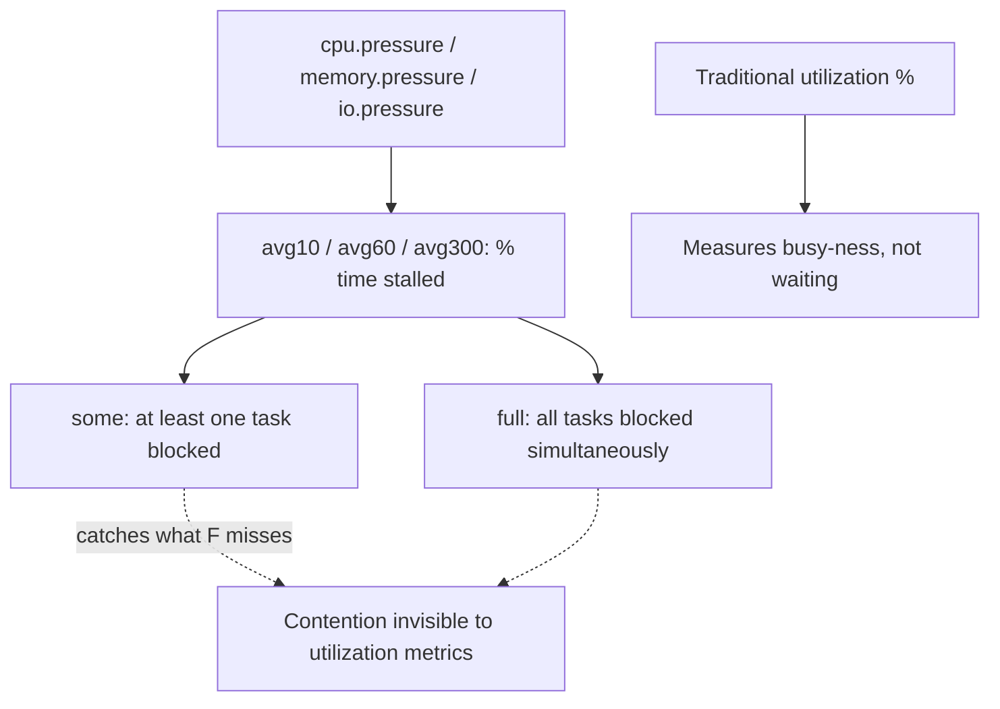

## Question
Standard CPU/memory utilization metrics look healthy, but application-level latency at the edge is degrading under load. Explain how Pressure Stall Information (PSI) in cgroups v2 exposes resource contention that traditional utilization metrics miss, and how you'd use it to diagnose whether the bottleneck is CPU, memory, or I/O contention.


## Quick Answer
**PSI (Pressure Stall Information)** measures the fraction of time tasks spend *stalled waiting* for CPU, memory, or I/O to become available — rather than how busy a resource looks on average — which is exactly the dimension traditional utilization metrics miss, since a resource can be "only 60% utilized" while tasks are still frequently blocked waiting for their turn at it.

## Detailed Answer
Traditional utilization metrics (CPU%, memory used, disk busy%) answer "how much of this resource is in use, on average, over this window?" That's a useful but fundamentally incomplete question for diagnosing latency: a CPU can sit at 60% average utilization while still causing real request-level delays, if that 60% is unevenly distributed in bursts that repeatedly leave waiting tasks queued — the average smooths over exactly the contention that matters.

PSI, introduced in the Linux kernel and exposed per-cgroup under cgroups v2 (`/sys/fs/cgroup/<path>/cpu.pressure`, `memory.pressure`, `io.pressure`), instead answers "what fraction of time did tasks in this cgroup spend **stalled**, unable to make progress because they were waiting on this resource?" It reports two figures per resource:

- **`some`** — the percentage of time at least one task in the cgroup was stalled waiting for the resource (partial contention — some tasks blocked, others may still be running).
- **`full`** — the percentage of time *all* non-idle tasks in the cgroup were stalled simultaneously (total contention — nothing in the cgroup could make progress at all during that window).

Each is reported as an averaged percentage over 10-second, 60-second, and 300-second windows, directly analogous to load-average reporting but scoped to a specific resource and a specific cgroup rather than the whole system.



## Diagnosing CPU, Memory, or I/O Contention with PSI

**CPU contention**: Rising `cpu.pressure` `some avg10` with low reported CPU utilization is the classic PSI signature of scheduling contention — tasks are ready to run but not getting scheduled promptly, often due to CFS quota throttling (see the `--cpus` latency-spike scenario) or genuine core oversubscription across containers on the host. A high `full` figure means the *entire* cgroup is starved simultaneously, a stronger signal than `some`.

**Memory contention**: Elevated `memory.pressure` indicates tasks are stalling on memory-related operations — page faults waiting on reclaim, swap activity, or waiting for the allocator under tight `--memory` limits — even when the raw memory usage figure sits comfortably under the configured cap. This is the direct pressure-based counterpart to the "OOM-kill despite low RSS" scenario: PSI shows the *stalling* building up well before an actual OOM event occurs, giving genuine early warning that isn't visible in a plain usage number.

**I/O contention**: `io.pressure` climbing while disk "busy%" looks moderate typically points to queue depth or latency issues rather than raw throughput saturation — tasks are waiting on I/O completion longer than the aggregate throughput numbers would suggest, common with noisy-neighbor containers sharing a single underlying disk or with the OverlayFS copy-up penalty on write-heavy small-file workloads compounding under concurrent load.

The differentiation workflow in practice:

```bash
# Check all three at once for a specific container's cgroup
for r in cpu memory io; do
  echo "== $r =="
  cat /sys/fs/cgroup/<container-cgroup-path>/$r.pressure
done
```

Whichever resource shows a materially higher `some`/`full` average relative to the others — and relative to its own historical baseline — is the actual bottleneck, independent of what the utilization dashboards report for that same window. If CPU pressure is flat but memory pressure climbs sharply under the same load test, the bottleneck is memory contention (likely reclaim/swap pressure), even if CPU utilization graphs look the more dramatic of the two at first glance.

## Production Implications
- Add per-container PSI scraping (`cpu.pressure`, `memory.pressure`, `io.pressure` `avg10`) to standard monitoring alongside traditional utilization — PSI is a leading indicator for exactly the class of latency-under-healthy-utilization incidents that are otherwise diagnosed by guesswork.
- Alert on `full avg10` thresholds specifically, since `full` (total stall) correlates much more directly with user-visible latency than `some` (partial stall), which can be present even in reasonably healthy systems under normal contention.
- Requires cgroups v2 — hosts still on cgroups v1 don't expose PSI per-cgroup (only system-wide via `/proc/pressure/`), which is itself a reason to prioritize the v1→v2 migration on hosts where this class of diagnosis matters.
- Correlate a PSI spike with the specific mechanism behind it — CFS throttling counters for CPU pressure, `memory.stat` reclaim/swap activity for memory pressure, and per-device I/O queue depth for I/O pressure — PSI tells you *which* resource, the resource-specific stats tell you *why*.

<Callout variant="tip" title="Key Takeaways">
PSI measures how long tasks spend waiting, not how busy a resource looks, which is why it catches real contention-driven latency that traditional utilization metrics — averaged, busy-ness-only — miss entirely.
</Callout>

---
