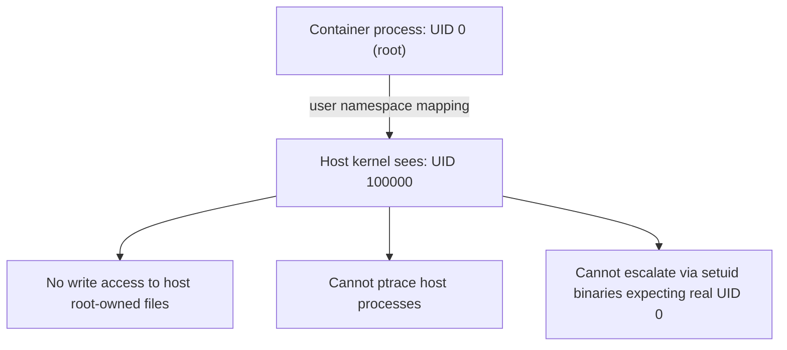

## Question
Your application needs different database URLs in staging versus production, but you want to use the exact same image in both. Explain the mechanism that makes this possible without rebuilding the image, and why baking config into the image is considered an anti-pattern.

## Quick Answer
User namespace remapping maps container UID 0 (root) to an unprivileged UID on the host — like 100000 — so a process that's root *inside* the container is provably never root *on* the host, even if it escapes the container's other isolation boundaries.

## Detailed Answer
Normally, UID 0 inside a container really is UID 0 on the host — the **USER namespace** simply isn't remapped, so container root and host root are the same identity, and a container escape (via a kernel bug, a misconfigured mount, or a capability leak) hands the attacker literal host root. User namespace remapping breaks that equivalence by inserting a translation table between the two.

With `--userns-remap` (or Docker's rootless mode, which enables this by default), the daemon consults `/etc/subuid` and `/etc/subgid` for a range of UIDs/GIDs allocated to a given user — for example `dockremap:100000:65536`. The container's internal UID range `0–65535` is then mapped one-to-one onto the host range `100000–165535`. Concretely:

| Inside container | On the host |
|-------------------|-------------|
| UID 0 (root)       | UID 100000  |
| UID 1000           | UID 101000  |
| UID 33 (www-data)  | UID 100033  |

A process that believes it's root — and *is* root for every in-container purpose, including passing `if (getuid() == 0)` checks, writing to root-owned files inside the container's filesystem view, and binding privileged ports if granted the right capability — is, from the host kernel's perspective, just UID 100000: an ordinary unprivileged account with no special access to host files, host processes, or other UID ranges.

This means even a successful container breakout — the attacker gets arbitrary code execution on the host, outside the container's mount and PID namespaces — still only runs as an unprivileged host user, because UID 0-ness was never real outside the namespace to begin with. It's a fundamentally stronger guarantee than any capability drop or seccomp profile, which all still assume the identity itself (UID 0) is trustworthy.

## The Limitation
The mapping is exactly what breaks workloads that need genuine host-level access:

- **Bind-mounted host directories** owned by a specific host UID (e.g. `/var/lib/postgres` owned by host UID 999) will appear owned by a *different*, meaningless UID inside the container's remapped view — the container's root can't actually chown or write to it as expected, because container-root maps to a host UID that has no permissions on that path.
- **Binding to genuinely privileged resources that check the real host UID** (some device nodes, certain host IPC/network configuration syscalls) can still fail, since the kernel is evaluating the mapped, unprivileged UID, not container-perceived root.
- **Networking features requiring host network namespace or raw sockets** are commonly harder to reconcile with rootless setups, often requiring `slirp4netns` or `rootlesskit` userspace networking with a real throughput cost compared to a normal bridge.

## Production Implications
- Set explicit `/etc/subuid` / `/etc/subgid` ranges per remapped user rather than relying on defaults, so the mapping is auditable and doesn't silently overlap between hosts in a fleet.
- For bind mounts that need write access, either pre-chown the host directory to the mapped UID range or use named volumes, which Docker manages inside the correct mapped ownership automatically.
- Rootless mode is the stronger default for CI runners and multi-tenant build agents specifically because it removes the "one kernel bug from real root" failure mode that traditional Docker carries.
- Combine with `--cap-drop=ALL` and minimal `--cap-add` grants (see capability-based least privilege) — user namespace remapping and capability restriction are complementary layers, not substitutes for each other.

<Callout variant="tip" title="Key Takeaways">
User namespace remapping severs the assumption that container root equals host root, turning even a successful container escape into an unprivileged host foothold instead of a full compromise.
</Callout>

---
