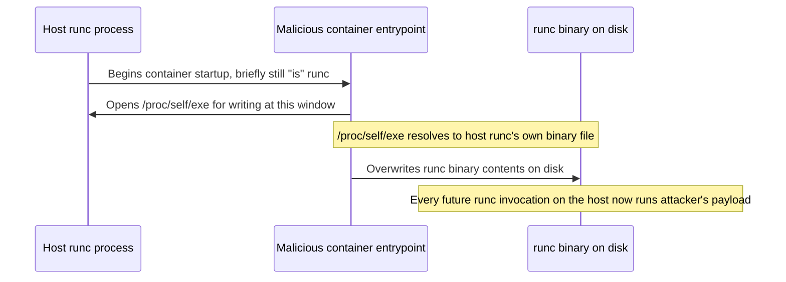

## Question
Explain, at a mechanistic level, how a historical runc container-breakout vulnerability (such as the `/proc/self/exe` file-descriptor overwrite class of CVEs) allowed a malicious container to overwrite the host `runc` binary, and what defense-in-depth layers (user namespaces, read-only host binaries, monitoring) would have limited the blast radius even if the specific CVE were unpatched.

## Quick Answer
The `/proc/self/exe` overwrite class of `runc` CVEs (most notably CVE-2019-5736) let a malicious container trick the host's `runc` binary into reopening a file descriptor pointing at *itself* while `runc` was executing on the host side, allowing the container to overwrite the host `runc` binary's own contents on disk — a breakout from container to host achieved through a race in how `runc` handled its own process image, not through a namespace escape in the traditional sense.

## Detailed Answer
This class of vulnerability exploited a subtle interaction between how `runc` executes and Linux's `/proc/self/exe` symlink, which always points to the currently running binary's own executable file — a normal, useful feature for a process to introspect or re-exec itself.

The attack sequence, mechanistically:

1. A malicious container is crafted so that its entrypoint (or a process it controls) is set up in a way that, when `runc` on the **host** side attaches to or execs into the container's namespace to start/join the container process, `runc`'s own running process image ends up reachable through a file descriptor the container can influence — specifically, the container process could arrange for its own `/proc/self/exe` to actually resolve to the *host's* `runc` binary, because at a particular moment during container startup, the container's process **is** the host `runc` process (before it has fully dropped into the container's own namespace and re-exec'd the target entrypoint).
2. The malicious container replaces its own entrypoint with something that, instead of behaving like a normal application, opens `/proc/self/exe` **for writing** at exactly that window — targeting what is, at that moment, actually the host's `runc` binary file on disk, since the container process hadn't yet fully transitioned away from being `runc` itself.
3. Because `runc` (like any executable) can have its own binary file opened for writing by a process that currently *is* that binary (a well-known but easy-to-overlook Linux behavior — a running binary's file descriptor to itself is not automatically protected from being reopened and written to by that same process), the malicious code successfully **overwrites the host `runc` binary's contents on disk**.
4. Every subsequent invocation of `runc` on the host — for *any* container, not just the malicious one — now executes the attacker's payload instead of legitimate `runc` code, giving the attacker code execution in the context of whatever invokes `runc` next (which is host-level, run by `containerd`/`dockerd`, typically as root).

The critical insight is that this wasn't a namespace-isolation failure in the traditional sense (PID/MNT/NET namespaces were all functioning as designed) — it was a race condition in **process identity and file-descriptor handling during the specific moment `runc` transitions from being itself to becoming the container's process**, a narrow but real gap in an otherwise sound isolation model.

## Defense-in-Depth That Would Have Limited the Blast Radius

Even entirely independent of whether this specific CVE was patched, several layered controls would have reduced or eliminated the actual impact:

**User namespace remapping.** If the host `runc` process (and by extension the container) were operating under a remapped, unprivileged UID rather than real root, the overwrite attempt on the host `runc` binary — which typically requires root/write permission on a system binary path like `/usr/bin/runc` — would fail on ordinary file permission grounds. This is precisely the guarantee user namespace remapping is designed to provide: even a process that believes it's root can't actually write to root-owned host files, because it isn't really root outside its own namespace.

**Read-only mounting of host binary paths.** Mounting the directories containing critical host binaries (`/usr/bin`, `/usr/sbin`) as read-only at the filesystem level — independent of any container-specific control — is a coarse but effective backstop: no process, malicious container-originated or otherwise, can write to a path the kernel refuses to allow writes to at the mount level, regardless of what UID it believes it holds.

**File integrity monitoring.** Tools watching critical system binaries for unexpected modification (via inotify-based file integrity monitoring, or periodic hash verification against known-good checksums) wouldn't have prevented the initial overwrite, but would have detected it near-immediately — turning what could otherwise be a silent, persistent host compromise into a rapidly alerted incident, dramatically shrinking the window of undetected attacker access.

**Avoiding running the container runtime as unconstrained root generally.** Rootless container runtimes, or runtimes execute under more restrictive service accounts with minimal filesystem write access outside their own working directories, reduce the set of files an exploited runtime process can touch even if the specific memory-safety/race-condition bug itself remains present.

## Production Implications
- Patch `runc`/`containerd`/Docker Engine promptly for this CVE class specifically — the fix (upgrading to versions that clone the process's own memory rather than allowing this reopen window) closes the root cause directly, and no defense-in-depth layer here is a substitute for the actual patch.
- Treat user namespace remapping as a standing mitigation against an entire *class* of "container process briefly has more host privilege than it should" bugs, not just this one CVE — it's structurally protective against similar future vulnerabilities in the same family.
- Mount host binary directories read-only wherever the host's operational model allows it — this is a cheap, broadly effective control that doesn't depend on knowing about any specific vulnerability in advance.
- Maintain file integrity monitoring on the container runtime's own binaries specifically, since they're a uniquely high-value target — a compromised `runc`/`containerd` binary affects every container on the host, not just the one that delivered the initial exploit.

<Callout variant="tip" title="Key Takeaways">
This CVE class broke out not through a namespace failure but through a narrow race during runc's own process transition, and layered controls — user namespace remapping, read-only host binary mounts, and integrity monitoring — would each independently have blunted or caught the attack even without the specific patch applied.
</Callout>

---
