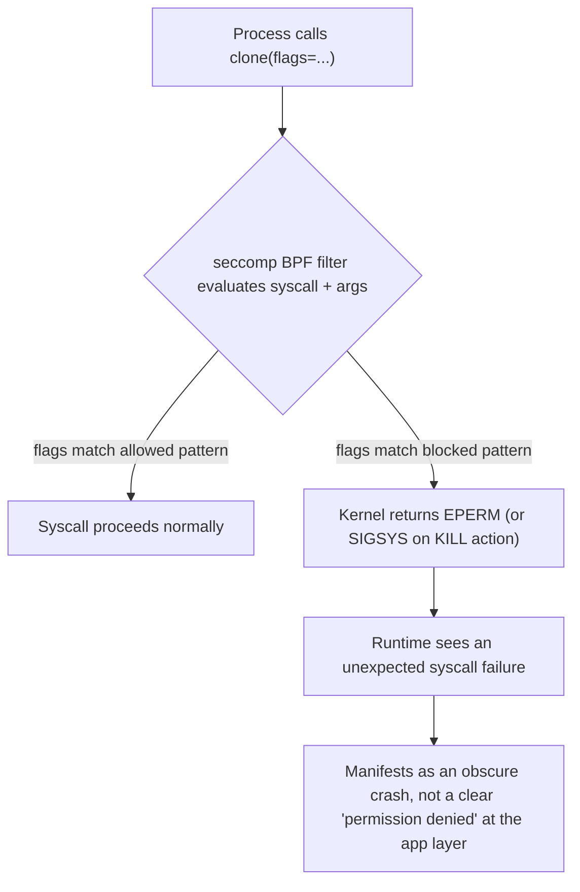

## Question
A hardened production seccomp profile blocks an application from calling `clone()` with certain flags, causing an obscure runtime crash unrelated to any obvious security feature. Explain how seccomp filters operate at the syscall level, why default Docker seccomp profiles allow most syscalls but block dangerous ones, and how you'd methodically identify which specific syscall is being blocked.

## Quick Answer
seccomp filters run a small **BPF program** against every syscall a process attempts, checking the syscall number and its arguments before the kernel executes it; Docker's default profile allow-lists the vast majority of the ~300+ Linux syscalls and blocks a specific denylist of dangerous ones, and a hardened custom profile can accidentally block a `clone()` flag combination a language runtime's threading implementation quietly depends on.

## Detailed Answer
**seccomp** (secure computing mode) attaches a filter to a process that intercepts every syscall at kernel entry, before it executes. The filter is a **BPF (Berkeley Packet Filter) program** — the same underlying bytecode mechanism used for network packet filtering, repurposed here to inspect syscall number and argument registers. For each syscall attempt, the BPF program returns one of several actions: `ALLOW` (proceed normally), `ERRNO` (fail with a specific error code, without executing the syscall), `KILL` (terminate the process), or `TRACE` (hand off to a ptracer). This check happens on **every single syscall**, which is why seccomp filters are compiled to efficient BPF bytecode rather than evaluated as interpreted rules — the performance cost has to be negligible at that call frequency.

Docker's **default seccomp profile** (`default.json`, shipped with the Docker Engine) is an *allow-list-by-exception* design: rather than blocking everything and allowing specific syscalls, it allows the broad, ordinary Linux syscall surface a normal application needs — file I/O, memory management, standard process control — and explicitly denies roughly 40-50 syscalls specifically associated with container breakout risk or host-level tampering: `mount`, `umount2`, `reboot`, `swapon`/`swapoff`, kernel module loading (`init_module`, `delete_module`), and several others tied to namespace or kernel-state manipulation that a containerized process has no legitimate reason to call.

`clone()` is where this gets subtle. `clone()` itself is allowed — it's how every thread and every new process gets created, so blocking it outright would break virtually everything. But `clone()` takes a **flags argument** that can request namespace-creation behavior (`CLONE_NEWUSER`, `CLONE_NEWNS`, `CLONE_NEWPID`, etc.) alongside ordinary thread creation. A **hardened custom profile**, written to close off namespace-creation-via-clone as a defense-in-depth measure against nested container tricks, can end up filtering on those flag bits — and modern language runtimes (Go's runtime, certain JVM thread implementations, `glibc`'s NPTL under specific configurations) sometimes pass `clone()` flag combinations that overlap unexpectedly with what the profile is trying to block, even though the actual intent is ordinary thread creation, not namespace manipulation.

## Methodically Identifying the Blocked Syscall
1. **Reproduce with `strace` outside the hardened profile first**, to get a baseline of exactly which syscalls the runtime makes during the failing operation — `strace -f -e trace=clone,clone3 <command>` isolates just the calls in question.
2. **Check the kernel audit log or dmesg for seccomp denials.** If the profile's default action is `SCMP_ACT_ERRNO`, denials return an error code the application may swallow or mis-report; if it's `SCMP_ACT_KILL`/`SCMP_ACT_LOG`, the kernel logs a `SECCOMP` audit event including the exact syscall number and process — `ausearch -m seccomp` or `dmesg | grep -i seccomp` surfaces this directly and is the fastest way to get the real syscall number rather than guessing from application symptoms.
3. **Decode the syscall number back to a name** using `ausyscall <number>` or a syscall table reference, since audit logs report numeric syscall IDs, not names.
4. **Diff the custom profile against Docker's default** (`docker inspect --format='{{json .HostConfig.SecurityOpt}}'` to confirm which profile is active, then compare its `syscalls` array against `default.json`) to find exactly which rule differs and covers `clone`/`clone3`.
5. **Test incrementally** by adding a scoped exception — an `SCMP_ACT_ALLOW` action rule that permits `clone`/`clone3` when specific dangerous flags (`CLONE_NEWUSER`, `CLONE_NEWNS`) are *not* set, using seccomp's argument-comparison operators — rather than blanket-allowing `clone()` again and losing the intended hardening.

## Production Implications
- Never fully remove `clone`/`clone3` restrictions to "fix" the crash — scope the exception to the specific flag combination the runtime needs, preserving the block against namespace-creation flags that were the actual security intent.
- Test hardened seccomp profiles against the *actual* production language runtime and its threading model before rollout — syscall usage varies meaningfully between Go, JVM, Python (with its various threading/multiprocessing configurations), and native binaries.
- `clone3` (the newer syscall replacing much of `clone`'s functionality on recent glibc) must be considered alongside `clone` in any custom profile — a profile written against only `clone` silently has no effect on `clone3` callers.
- Keep a documented allow-list rationale per non-default syscall rule in the profile, since seccomp profile debugging six months later without that context is exactly this scenario repeating.

<Callout variant="tip" title="Key Takeaways">
seccomp denials often surface as confusing application-level crashes rather than clear permission errors, so the fastest path to a real answer is the kernel's own seccomp audit log, not guessing from the runtime's symptoms.
</Callout>

---
