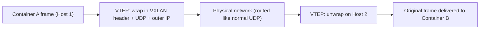

## Question
In a multi-host overlay network (e.g., Swarm), two containers on different physical hosts communicate directly by container IP. Explain the encapsulation mechanism (VXLAN) that makes this possible at the packet level, and identify the MTU-related failure mode this commonly introduces.

## Quick Answer
VXLAN lets two containers on different physical hosts talk directly by container IP because each host wraps the container's original Ethernet frame inside a UDP packet addressed to the other host, and the extra encapsulation overhead is exactly what causes the common MTU-related packet-drop failure mode.

## Detailed Answer
A regular bridge network only works within one host's kernel — container IPs on `docker0` or a custom bridge aren't routable across the physical network at all. Swarm's overlay driver solves this with **VXLAN** (Virtual Extensible LAN), a tunneling protocol that makes a Layer 2 network appear to span multiple physical hosts by carrying it inside ordinary Layer 3/4 traffic.

When Container A (on Host 1) sends a packet to Container B's IP (on Host 2):

1. The packet leaves Container A as a normal Ethernet frame, addressed to Container B's overlay-network MAC/IP.
2. Host 1's kernel VXLAN device (managed by Docker's overlay driver, using a **VTEP** — VXLAN Tunnel Endpoint) intercepts it and wraps the *entire original frame* inside a new UDP packet, adding a VXLAN header carrying a **VNI** (VXLAN Network Identifier) that tags which overlay network this traffic belongs to.
3. That UDP packet is addressed using Host 1 and Host 2's real, routable IPs and sent across the underlying physical/data-center network like any other UDP traffic — the physical network has no idea containers are involved at all.
4. Host 2's VTEP receives the UDP packet, strips the VXLAN/UDP/outer-IP headers, and delivers the original inner Ethernet frame onto its local bridge, where it reaches Container B as if it had arrived on the same LAN.

## The MTU Failure Mode
Encapsulation isn't free — VXLAN adds roughly 50 bytes of overhead (outer IP header, outer UDP header, VXLAN header) around every original frame. A standard Ethernet MTU of 1500 bytes leaves no room for that extra wrapping: an inner frame sent at the full 1500-byte MTU becomes a ~1550-byte outer packet, which either gets fragmented (if fragmentation is allowed) or silently dropped (if a "do not fragment" bit is set or an intermediate device refuses to fragment).

The symptom is distinctive and confusing: small packets (DNS lookups, TCP handshakes, small API calls) work fine, while larger payloads — bulk file transfers, large HTTP responses, database result sets — intermittently stall, hang, or time out. It looks like an application bug because connectivity clearly "works," just not reliably under load, and standard `ping` tests with small packet sizes show nothing wrong.

## Production Implications
- Reduce the *container's* effective MTU to account for VXLAN overhead — typically 1450 bytes instead of 1500 — either at the overlay network level (`docker network create --opt com.docker.network.driver.mtu=1450`) or, if the physical network's own MTU is smaller, subtract accordingly.
- Confirm the failure with a large-packet, no-fragment ping test between hosts: `ping -M do -s 1472 <host-2-ip>` — a failure here while smaller pings succeed is the signature of an MTU mismatch through the tunnel.
- If the underlying physical network supports **jumbo frames** (MTU 9000), raising the physical MTU gives VXLAN plenty of headroom without touching the container-facing MTU at all — the better long-term fix where it's available.
- Check both ends: cloud provider virtual networks, VPN tunnels, and older network hardware between hosts can each impose their own MTU ceiling below what you'd assume from a single host's interface configuration.

<Callout variant="tip" title="Key Takeaways">
VXLAN makes containers on different hosts feel like they share a LAN by encapsulating every frame in UDP, but that added overhead shrinks the usable MTU — and forgetting to account for it produces intermittent, hard-to-diagnose failures on larger packets.
</Callout>

---
