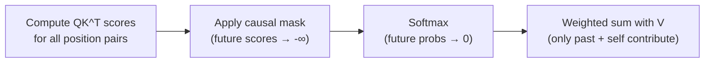

## Question
How does the causal mask matrix physically prevent future-token leakage in autoregressive decoder-only architectures, and how does its computational complexity compare to bidirectional encoder-only self-attention?

## Quick Answer
The **causal mask** adds negative infinity to every attention score for a future position before the softmax step, which forces those positions' probabilities to zero — so each token can only ever attend to itself and everything before it.

## Detailed Answer
Self-attention naturally computes a score between every pair of positions in a sequence, including positions that come after the current one. For an **autoregressive** model — one trained to predict the next token from everything so far — letting a token attend to positions that haven't "happened" yet would let it trivially cheat during training, since the answer it's supposed to predict would already be visible in its own input.

The fix is a mask matrix, applied to the raw `QK^T` score matrix before the `sqrt(d_k)` scaling and softmax step: for every entry where the key's position index is greater than the query's position index, the mask sets that score to `-inf` (or a very large negative number like `-1e9` in practice, to stay within floating-point range). Since `exp(-inf) = 0`, softmax then assigns exactly zero probability to those future positions — they contribute nothing to the weighted sum in `Softmax(QK^T / sqrt(d_k)) * V`, regardless of what value vectors they'd otherwise carry.

In terms of computational complexity, causal masking doesn't reduce the raw matrix-multiplication cost of computing `QK^T` — a naive implementation still computes the full `n x n` score matrix before masking half of it away, so it remains `O(n^2 * d)` same as bidirectional attention, where `n` is sequence length and `d` is head dimension. **Bidirectional encoder-only attention** (as in BERT) does the same `O(n^2 * d)` computation but skips the masking step entirely, letting every token see the whole sequence both forward and backward — appropriate for tasks like classification where the full input is available upfront, but unsuitable for text generation. Some optimized causal-attention kernels (like FlashAttention) do exploit the mask's triangular structure to skip roughly half the redundant compute in practice, even though the theoretical complexity class is unchanged.

<Callout variant="tip" title="Key Takeaways">
The causal mask is a simple pre-softmax score modification, not a separate mechanism — it's what turns general self-attention into the strictly left-to-right attention that autoregressive generation requires.
</Callout>

