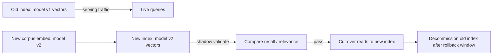

## Question
If you upgrade your embedding model in a production RAG system, why can't you simply swap the model and keep the existing vector index, and what does a safe migration path actually require?

## Quick Answer
Two different embedding models learn geometrically unrelated vector spaces, so distance calculations between an old-model index and new-model query vectors are meaningless — the fix isn't swapping the model, it's re-embedding the whole corpus and building a new index before cutting over.

## Detailed Answer
An embedding model doesn't produce vectors in some universal, model-independent coordinate system — it learns its own latent space during training, shaped by that specific model's architecture, training data, and objective. Two models can even use the *same* vector dimensionality and still place semantically identical text in completely unrelated positions in space, because nothing ties one model's coordinate system to another's. Cosine similarity or dot-product comparisons only mean something when both vectors were produced by the same model (or a model explicitly trained to be compatible with it).

This is what makes an in-place swap dangerous rather than merely suboptimal: if the old index's vectors stay as-is but new queries get embedded with the new model, similarity search doesn't fail loudly — it silently returns nonsense. The distances computed are still valid floating-point numbers, ranking still produces an ordered list, and nothing in the system errors out. The results are simply meaningless, which is often *harder* to catch in production than an outright failure, because the system looks healthy.

**A safe migration path requires:**

1. **Re-embed the entire corpus** with the new model — every chunk, from scratch, since there's no way to translate old vectors into the new space.
2. **Build a new index in parallel**, rather than mutating the existing one in place, so the old (still-serving) index keeps working throughout the migration.
3. **Shadow/validate before cutover** — run the new index alongside the old one, comparing retrieval quality (recall against a labeled eval set, or relevance judgments on real query logs) before it takes live traffic.
4. **Cut over reads only after validation passes**, ideally with a fast rollback path (keep the old index warm) in case the new model regresses on some query class the eval set didn't cover.
5. **Decommission the old index** only after a rollback window has passed with no issues.

The cost that catches teams off guard is usually the re-embedding pass itself — for a large corpus this is a real batch job with real compute and API cost, not a config change, and it needs to complete (and be validated) before the new model can serve a single query in production.

<Callout variant="tip" title="Key Takeaways">
An embedding model and its index are a matched pair — upgrading one without rebuilding the other doesn't degrade search quality gracefully, it breaks it silently, so budget the migration as a full re-embedding and parallel-index rollout, not a model swap.
</Callout>

