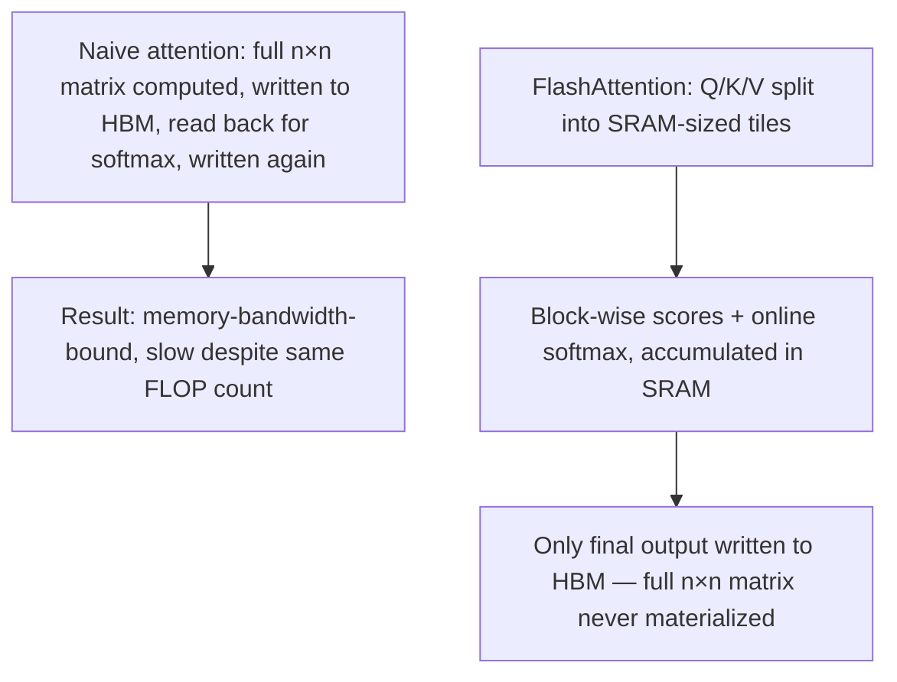

## Question
How does FlashAttention achieve faster wall-clock performance and lower memory usage without changing the mathematical result of attention, and why is this fundamentally an I/O-aware algorithm (tiling and recomputation to minimize HBM reads/writes) rather than a reduction in FLOPs?

## Quick Answer
FlashAttention produces mathematically identical attention output to the standard algorithm, but restructures the computation into small **tiles** that fit in the GPU's fast on-chip SRAM, avoiding the repeated slow reads and writes to high-bandwidth memory (HBM) that dominate naive attention's wall-clock time — it's a hardware I/O optimization, not a reduction in the number of floating-point operations.

## Detailed Answer
The standard attention algorithm materializes the full **n × n** score matrix in HBM: compute `QKᵀ`, write it to HBM, read it back for the softmax, write the softmax result to HBM, read it back for the multiplication with V. Each of these round trips between the GPU's compute cores and HBM is slow relative to the actual arithmetic — GPUs have far more raw compute throughput than memory bandwidth, so an attention implementation that's constantly shuttling large matrices to and from HBM ends up **memory-bandwidth-bound**, not compute-bound. The FLOP count for the matmuls hasn't changed; the bottleneck is how much data has to move and how often.

**FlashAttention's core idea is tiling**: instead of computing the entire n×n matrix at once, it splits Q, K, and V into smaller blocks that fit inside the GPU's on-chip **SRAM** (dramatically faster than HBM, but much smaller in capacity). It then processes attention block-by-block — loading a tile of Q and a tile of K into SRAM, computing a partial score, updating a running (numerically stable) softmax normalization, and accumulating the corresponding partial output — without ever writing the full n×n matrix back out to HBM. The full attention output is mathematically reconstructed via an **online softmax** technique that correctly renormalizes as more blocks are processed, so the final result is identical to what naive attention would produce — this is an exact algorithm, not an approximation.

The other half of the technique is **recomputation** during the backward pass: rather than storing the full n×n attention matrix from the forward pass (which would defeat the memory savings), FlashAttention recomputes the needed blocks on the fly during backpropagation, trading a modest amount of extra compute for a large reduction in memory footprint and HBM traffic. Because GPUs are so much faster at compute than at memory movement, this trade is a clear net win in wall-clock time.

## Production Implications
- FlashAttention's speedup is most pronounced at **longer sequence lengths**, where the n×n matrix's HBM traffic dominates — the relative benefit shrinks for very short sequences where memory movement was never the bottleneck.
- Because it changes *how* attention is computed, not *what* it computes, swapping in FlashAttention should be numerically a no-op for model quality — any regression after adopting it points to an implementation bug, not an expected precision trade-off.
- It composes with other techniques (GQA/MQA, sliding window, KV cache quantization) since it addresses the compute-kernel level, not the attention pattern itself.
- Tile size is a real tuning parameter tied to the specific GPU's SRAM capacity — a tile size tuned for one GPU generation isn't automatically optimal on another.

<Callout variant="tip" title="Key Takeaways">
FlashAttention is fast not because it does less math, but because it stops making the GPU repeatedly shuttle a giant matrix through slow memory to do that math.
</Callout>

