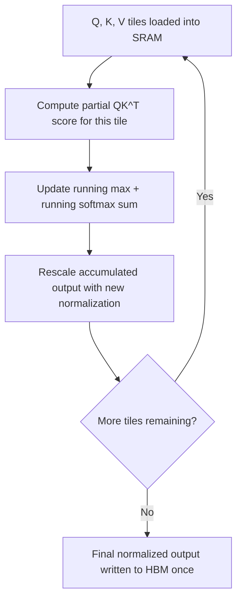

## Question
How does FlashAttention reduce memory overhead from $O(N^2)$ to $O(N)$ and accelerate runtime using tiling and online softmax, without calculating the full attention matrix in High Bandwidth Memory (HBM)?

## Quick Answer
FlashAttention never writes the full N×N attention score matrix to slow High Bandwidth Memory (HBM) at all — it computes attention in small tiles that fit in the GPU's fast on-chip SRAM, using an online (running) softmax so it can produce the correct final result without ever holding the whole matrix at once.

## Detailed Answer
Standard attention computes `softmax(QK^T)V` as three separate steps, each writing its full-size intermediate result back out to HBM before the next step reads it back in. For a sequence of length N, the `QK^T` score matrix is N×N — for a 32K-token sequence, that's over a billion entries per attention head, and the real cost isn't the FLOPs to compute it, it's the **HBM read/write bandwidth** consumed shuttling that matrix back and forth between slow HBM and the GPU's compute units.

FlashAttention restructures the computation around the GPU's memory hierarchy instead of around the math's natural step order. It splits Q, K, and V into small **tiles** sized to fit entirely inside the GPU's on-chip SRAM — which is orders of magnitude faster than HBM but far smaller in capacity. For each tile pair, it computes a partial attention score, applies a **running (online) softmax** that incrementally updates a normalization estimate as new tiles are processed, and accumulates the corresponding partial output — all without ever writing the full score matrix back to HBM.

The mathematical trick that makes this possible is that softmax normalization can be computed **incrementally**: instead of needing every score up front to normalize correctly, the algorithm tracks a running maximum and running sum, rescaling previously accumulated partial outputs each time a new tile shifts the running maximum. This is mathematically equivalent to standard softmax attention — FlashAttention produces bit-for-bit (or numerically equivalent within floating-point tolerance) identical output to the naive implementation. The speedup and memory reduction come entirely from **minimizing HBM traffic**, not from approximating the math or reducing FLOPs.

<Callout variant="tip" title="Key Takeaways">
FlashAttention is an I/O-aware algorithm, not a new attention formula — it gets faster and leaner purely by restructuring computation to minimize trips between HBM and SRAM.
</Callout>

---
