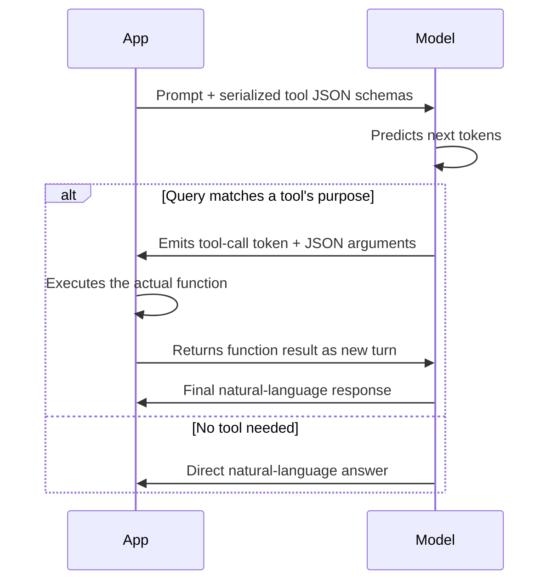

## Question
How do modern open-weights models implement Function Calling under the hood? Specifically, how are JSON schemas mapped to prompt tokens, and how does the model signal a tool execution call versus a final user response?

## Quick Answer
Function calling isn't a separate model capability — the available tools' **JSON schemas get serialized directly into the prompt** as structured text, and the model, having been fine-tuned to recognize this pattern, signals a tool call by emitting a specific reserved token or structured output block instead of its normal free-text response.

## Detailed Answer
There's no hidden API-level mechanism that gives a model "function calling" as a built-in feature — under the hood, it's still just next-token prediction over a specially formatted prompt. When you pass a list of tool definitions to an inference API, those JSON Schema objects (name, description, parameter types) are rendered into the prompt as text, usually inside a dedicated system-level section, sometimes wrapped in specific delimiter tokens the model was fine-tuned to recognize (for example, tags resembling `<tools>...</tools>` in the raw prompt template, even though the API hides this formatting from the caller).

The model then generates its response token-by-token as usual, but its fine-tuning data included many examples where, given a tool-populated prompt like this, the *correct* continuation was a structured call rather than prose — so the model has learned to predict the tokens that begin a tool call (often a specific reserved token, or a JSON object appearing in a designated position) when the query pattern-matches something a tool addresses better than a direct answer.

The **signal** distinguishing "this is a tool call" from "this is my final answer to the user" is typically one of two mechanisms depending on the model family: a **reserved special token** inserted into the vocabulary during fine-tuning (whose presence the serving framework detects and parses as a function call rather than displaying to the user), or a **structural convention** — the model is trained to always wrap tool invocations in a consistent, parseable format (like a specific JSON structure at a fixed position) that the calling application's parser checks for before treating output as user-facing text. Either way, detecting a tool call is the *serving framework's* job — it inspects the raw generated tokens for that signal and branches accordingly, before the response ever reaches the end user.

<Callout variant="tip" title="Key Takeaways">
Function calling is a prompt-formatting and fine-tuning convention, not a distinct model architecture — the model was simply trained to recognize when a JSON-schema-populated prompt calls for a structured tool-call token instead of ordinary prose.
</Callout>

---
